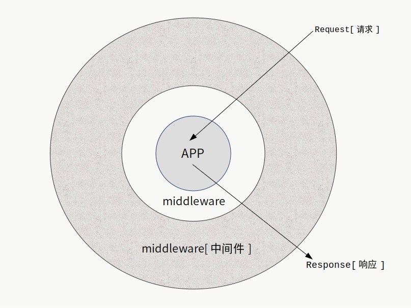
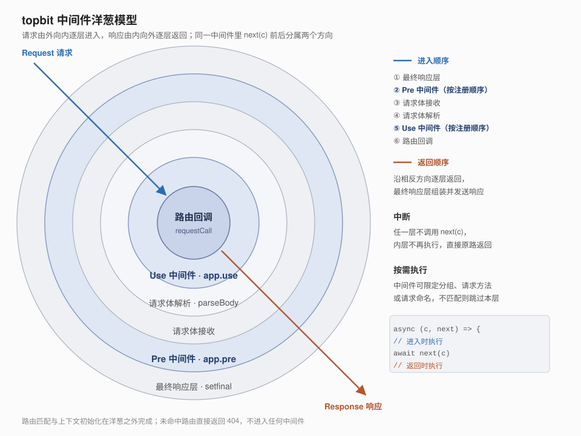

# Topbit

#### [English Documentation](README.md)

topbit是基于Node.js的运行于服务端的Web框架，它没有任何第三方依赖，在独特的路由和中间件分组执行机制上进行了极致优化。


**核心功能：**

* 请求上下文设计屏蔽接口差异。

* 全局中间件模式。

* 路由分组和路由命名。

* 中间件按照路由分组执行。中间件匹配请求方法和路由来执行。

* 开启守护进程，支持多进程集群以及worker进程自动化负载调整。

* 显示子进程负载情况。

* 默认解析body数据。

* 支持通过配置启用HTTP/1.1或是HTTP/2服务。允许同时支持HTTP/2和HTTP/1.1。

* 支持配置启用HTTPS服务。纯 HTTP/2 可在明文(h2c)下运行，但浏览器访问HTTP/2必须开启HTTPS（依赖TLS的ALPN协商）；要 `allowHTTP1` 兼容 HTTP/1.1 同样必须开启HTTPS。

* 限制请求数量。限制一段时间内单个IP的最大访问次数。

* IP黑名单和IP白名单。

* 在cluster模式，监控子进程超出最大内存限制则重启。

* 可选择是否开启自动负载模式：根据负载创建新的子进程处理请求，并在空闲时恢复初始状态。

* 默认设定和网络安全相关的配置，避免软件服务层面的DDOS攻击和其他网络安全问题。


## 📦安装

```javascript
npm i topbit
```

同样可以通过yarn安装：

```javascript
yarn add topbit
```

**本文档对应 topbit v3.7.3。** 框架要求 Node.js v14.18 以上（启动时只校验主版本号，低于 14 直接退出），建议用当前 LTS。

**随包附带的命令行工具**（`package.json` 的 `bin` 字段）：

| 命令 | 对应脚本 | 作用 |
|---|---|---|
| `tbload` | `bin/loadinfo.sh` | 每 0.35 秒清屏并 `cat` 一次负载文件，用于**查看** `loadInfoFile` 输出的负载信息，用法 `tbload /tmp/topbit-loadinfo.log`。它只是轮询显示，**不是 start/stop 服务管理器**。 |
| `topbit-new-app` | `bin/newapp.js` | 把内置模板复制成一个新的入口文件，默认文件名 `app.js`，可传第一个参数指定目标文件名；目标已存在时打印「文件已存在」并跳过，不会覆盖。 |
| `new-route` | `bin/new-ctl.js` | 生成 controller 模板文件，文件头带一份 `context` 的 JSDoc typedef 注释，配合 Loader 的目录约定使用。 |


## 最小示例

```javascript
'use strict'

const Topbit = require('topbit')

const app = new Topbit({
  debug: true
})

//输出服务信息并运行服务
//printServInfo(timeout=0, debug=true)：timeout>0 则延迟输出，否则微任务内输出；
//第一个参数也可以直接传布尔值（会被当作 debug）。只在 debug 为真且 config.debug 为真时才打印。
//cluster 下 worker 会把路由表通过消息交给 master 统一打印。返回 this，可链式接 run()。
app.printServInfo().run(1234)

```

当不填加路由时，topbit会默认添加一个 `GET /*` 路由（仅GET）：

`/*`

浏览器访问会看到一个非常简单的页面，这仅仅是为了方便最开始的了解和访问文档，它不会对实际开发有任何影响。其他请求方法（POST、PUT等）仍然走 notFound 处理。


## 添加一个路由

``` JavaScript
'use strict'

const Topbit = require('topbit')

const app = new Topbit({
  debug: true
})


app.get('/', async ctx => {
  ctx.to('success')
})

//默认监听0.0.0.0，run(port, host) 两个参数，port缺省2368。
app.run(1234)

```

ctx.data是返回的响应数据，也可以使用ctx.to(data)
> 其实 ctx.to()内部就是设置ctx.data的值。**推荐使用 ctx.to()设置返回的数据。**

## 使用import导入

在 `.mjs` 文件中，可以使用ES6的import进行导入：

```javascript
import Topbit from 'topbit'

const app = new Topbit({
  debug: true
})

app.get('/', async ctx => {
    ctx.to('success')
})

app.printServInfo().run(1234)

```

## 路由和请求类型

HTTP的起始行给出了请求类型，也被称为：请求方法。目前的请求方法：
```
GET POST PUT PATCH DELETE OPTIONS  TRACE HEAD
```

最常用的是前面6个。对于每个请求类型，router中都有同名但是小写的函数进行路由挂载。为了方便调用，在初始化app后，可以使用app上同名的快捷调用。

除同名快捷调用外，还有两个多方法挂载入口：

- `app.any(path, callback, name)`：把路由同时挂到全部8种请求方法。
- `app.map(methods, path, callback, name)`：按数组指定方法挂载，示例 `app.map(['GET','HEAD'], '/p', handler)`。

**示例：**

``` JavaScript

'use strict'

const Topbit = require('topbit')

const app = new Topbit({
  debug: true
})

app.get('/', async c => {
  c.to('success')
})

app.get('/p', async c => {
  c.to(`${c.method} ${c.routepath}`)
})

app.post('/', async c => {
  //返回上传的数据
  c.to(c.body)
})

app.put('/p', async c => {
  c.to({
    method : c.method,
    body : c.body,
    query : c.query
  })
})

//默认监听 0.0.0.0，run(port, host) 两个参数，port缺省2368。
//port也可以传对象，但只识别其中的host，端口仍取第一参数。
app.printServInfo().run(8080)

```


## 获取URL参数

- URL中的查询字符串（?后面a=1&b=2形式的参数）解析到c.query中。`#` 及其后面的片段会被剥离，不参与解析。

- 参数个数受 `maxQuery` 限制（默认 **25**）：超出上限的部分是**静默丢弃**，不报错也不告警，表现为「后面的参数取不到」。参数很多时记得调大此项。

- 默认（`fastParseQuery: false`）同名参数会聚合成数组；设为 `true` 时只保留第一个值，不产生数组。

- `autoDecodeQuery` 默认为 `true`，即对query值调用 `decodeURIComponent`。若参数值本身就含有未转义的 `%`，解码会抛 `URIError`，此时可关掉此项自行处理。

- 表单提交的数据解析到c.body中。

> 表单对应的content-type为application/x-www-form-urlencoded


``` JavaScript
'use strict';

const Topbit = require('topbit')

let app = new Topbit({
    debug: true
})

app.get('/q', async c => {
  //URL中?后面的查询字符串解析到query中。
  //返回JSON文本，主要区别在于header中content-type为application/json;charset=utf-8
  c.to(c.query)
})

app.post('/p', async c => {
  //POST、PUT、PATCH、DELETE提交的数据保存到body，
  //表单和application/json会自动解析为object，text/*解析为字符串，
  //其余content-type时body是原始的Buffer（即rawBody）。
  //可以使用中间件处理各种数据。
  c.to(c.body)
})

app.run(2019)

```

## 获取POST提交的数据

提交请求体数据的请求是POST、PUT、PATCH、DELETE。在前端页面中，一般是表单提交，或者是异步请求。

- 表单提交的数据解析到c.body中。

> 表单对应的content-type为application/x-www-form-urlencoded

> 异步请求的数据很多时候content-type是application/json

以上两种类型，对应的c.body都是一个object。`application/json` 解析失败时，框架直接返回400，body为 `bad json data`。表单的键值对个数受 `maxFormKey` 限制（默认100），超出部分静默不解析。

其余 content-type 时，`c.body` 指向原始的 Buffer（即 `c.rawBody`）；只有 `text/*` 会被转成 utf8 字符串。所以不要用 `typeof c.body === 'string'` 来兜住所有非表单的情况。

``` JavaScript
'use strict'

const Topbit = require('topbit')

let app = new Topbit({debug: true})

app.post('/p', async c => {
  //POST、PUT、PATCH、DELETE提交的数据保存到body，如果是表单则会自动解析为object，
  //可以使用中间件处理各种数据。
  c.to(c.body)
});

app.run(2019)

```

## 关于content-type

**application/x-www-form-urlencoded**

基本的表单类型会解析到c.body，是一个JS对象。

**text/\***

若content-type是text/*，就是text/开头的类型，比如text/plain、text/csv，框架层面不做解析处理，仅仅是把上传数据以utf8编码的格式转换成字符串赋值给c.body。后续的处理开发者自行决定。

**multipart/form-data;boundary=xxx**

若content-type是上传文件类型则默认会解析，解析后的文件对象放在c.files中，可以通过c.getFile获取。

**application/json**

这种类型会进行JSON.parse解析。

**其他类型**

若content-type是其他类型，则默认只是让c.body指向c.rawBody，即为最原始的Buffer数据。

框架层面提供基本的核心的支持，其他类型需要开发处理或者是使用扩展。

要比较容易使用，也要留出足够的空间给开发者处理，你可以完全抛弃框架默认的body解析，通过初始化选项parseBody设置为false关闭它。也可以在这基础上，进行扩展处理。

body解析模块本质上是一个中间件，这样设计的目的就是为了方便扩展和替换。

## to函数返回数据

to函数就是对c.data的包装，其实就是设置了c.data的值。另外还有两个别名的函数：ok、oo。根据场景可以自由选择。

``` JavaScript

app.get('/', async c => {
  c.to('success')
})

app.get('/randerr', async c => {
  let n = parseInt(Math.random() * 10)
  if (n >= 5) {
    c.ok('success')
  } else {
    //返回404状态码
    /*
      等效于：
        c.status(404).data = 'not found'
    */
    c.status(404).oo('not found')
  }
})

app.run(1234)

```

## 链式调用

`setHeader`、`status`、`sendHeader`、`write`、`removeHeader` 都返回 `this`，可以链式调用。链式能力由框架自身实现，与 Node.js 版本无关。

`to` 以及别名 `ok`、`oo` 不返回 `this`（返回 undefined），只能作为链的最后一环。

```javascript

app.get('/', async c => {

  c.setHeader('content-type', 'text/plain; charset=utf-8')
    .setHeader('x-server', 'nodejs server')
    .status(200)
    .to(`${Date.now()} ${Math.random()}`)

})

```

> 消息头的生效时机两个协议不同：HTTP/1.1 的 `setHeader` 直接调用 `res.setHeader`，此时消息头已经写出去；HTTP/2 的 `setHeader` 只是缓存到 `ctx.dataHeaders`，要等 `sendHeader`/`write`/`pipe` 时才 `stream.respond` 发出。此外只有 HTTP/2 的 `setHeader` 支持第一个参数传对象批量设置。

## 路由参数

``` JavaScript
app.get('/:name/:id', async c => {
  //使用:表示路由参数，请求参数被解析到c.param
  let username = c.param.name;
  let uid = c.param.id;
  c.to(`${username} ${uid}`)
})

app.run(8000)
```

## 任意路径参数

\* 表示任意路径，但是必须出现在路由最后。

``` JavaScript

app.get('/static/*', async c => {
  //*表示的任意路径解析到c.param.starPath
  let spath = c.param.starPath

  c.to(spath)
})

```

两点需要注意：

- `starPath` **不含前导斜杠**。请求 `/static/images/a.jpg` 命中 `/static/*` 时，`starPath` 是 `images/a.jpg`。
- `/static/*` 也会匹配 `/static` 本身，此时 `starPath` 是空字符串。

----

## 路由查找规则

----

路由查找过程，主要是对带参数路由和带 * 的路由进行了严格的顺序控制，而不是按照添加顺序进行匹配。更严格的顺序减少了冲突的可能。

路由查找策略：

1. 普通字符串路径。
2. 带参数路由，参数少的路由会先匹配。
3. 带 * 的路由，按照最长到最短的模式匹配。

另外三条当前实现的约束：

- 请求路径中多余的斜杠已被容忍，`/x//y` 等价于 `/x/y`（框架固定如此，没有斜杠严格匹配开关）。
- 路径段数上限为 13（`router.maxDepth`），超出的请求直接走 404。
- 归一化后同一个字符串只能注册一次，重复注册会抛「冲突，多次添加」；星号与带参数路由在 `run()` 时建立前缀索引和静态段树，因此**路由必须在 `run()` 之前注册完毕**，之后再新增的带参数/星号路由不会进索引、恒查不到。

```
示例：
存在路由： /x/y/:id  /x/y/* /x/*  /x/:key/:id

/x/y/123 先匹配 /x/y/:id，不会继续匹配。

/x/y/123/345 先匹配到 /x/y/*，不会继续匹配。

/x/q/123 会匹配到 /x/:key/:id。

/x/a.jpg 会匹配到 /x/*，其他路由都无法匹配。

/x/static/images/a.jpg 会匹配到 /x/*，其他路由都无法匹配。

```

----

----

## 路由格式自检

`router.checkRoute(path)` 用于在**注册之前**判断一个路由字符串的格式是否合法。它不注册路由、不抛错、没有任何副作用，适合从配置文件批量生成路由的场景 —— 把错误暴露在启动前，而不是等 `addPath()` 抛错时才发现。

``` JavaScript
const r = app.router;

r.checkRoute('/api/:id')
// { ok: true }

r.checkRoute('/api\\v2')
// { ok: false,
//   message: "路由字符串 /api\\v2 存在非法字符，路由字符串允许 '字母 数字 - _ : * / . @'，最大长度1000",
//   route: '/api\\v2' }

r.checkRoute('/x/:id/*')
// { ok: false, message: '/x/:id/* 参数 : 和 * 不能同时出现', route: '/x/:id/*' }
```

`ok` 为 `false` 时，`message` 是提示信息，`route` 是归一化后的路由串（即这条路由最终会以什么形式被注册）；入参不是字符串时 `route` 为空字符串。

检测的项目：

| 项目 | 说明 |
|---|---|
| 类型 | 必须是字符串 |
| 字符集 | 只允许 `字母 数字 - _ : * / . @`，最大长度 1000 |
| `*` 的位置 | 只能出现在路由最后 |
| `*` 的数量 | 只能有一个 |
| `:` 与 `*` | 不能同时出现在同一条路由中 |
| 参数名 | 不能为空，不能命名为 `__proto__` |

**不检测**模式冲突与路由命名重复 —— 这两项取决于路由表里当前已经注册了什么，属于运行期状态而非字符串本身的属性，同一个路由串在不同路由表里结论不同。它们仍由 `addPath()` 在注册时判定。

`addPath()` 内部就是先调用 `checkRoute()`，因此两者的判定结果永远一致。

另外，路由字符串在注册时会被归一化：先去除首尾空白、连续的斜杠合并为一个、缺失的首斜杠补上、末尾的斜杠剥掉，空字符串归一化为 `/`。`router.normalizeRoute(path)` 返回归一化后的结果，`//api//v2//` 与 `/api/v2` 是同一条路由。

----

## 分组添加路由

你可以使用app.middleware指定中间件并使用返回的group方法添加分组路由，或者直接使用app.group分组添加路由。

**topbit.prototype.middleware(mids, options=null)**

- mids是一个数组，每个元素是一个中间件函数或一个数组，数组的第一个元素是中间件，第二个是添加中间件的选项。

- options默认为null，传递一个object为针对所有mids的选项，比如{pre: true}。数组元素若自带选项（`[mid, {method:'POST'}]`），元素级选项会与这里的公共选项合并，**元素级优先**。

- 返回值是一个仅含 `group` 一个属性的对象（`{ group }`），路由方法要用 `group()` 取；不能直接在返回值上调用 `use()`。

**topbit.prototype.group(group_name, callback, prefix=true)**

- group_name 是一个字符串，表示路由分组的名称。当它符合**前缀字符集**（`/`? + 字母/数字/`_`/`-`/`/`，长度 1~500，见 `src/router.js:21`）时，同时作为路由前缀拼进路径。

- callback 回调函数，回调函数接收的参数仍然可以调用middleware和group，同时可以调用get、post等方法添加路由。若第二个参数直接传布尔值，它会被当作 `prefix`，此时不执行回调、只返回可用于挂载的 route 对象。

- prefix 布尔值，默认为true，用于控制group_name是否添加为路由的前缀。只有 group_name 符合上述前缀字符集时才会作为前缀。

> **分组名不会成为前缀时，框架不报错也不告警**，路由会静默注册到不带前缀的路径上。
> 注意前缀字符集**不包含 `.` `@` `:`**，尽管这些字符在完整路由里是合法的：`app.group('v1.0', ...)`、`app.group('v1:2', ...)` 注册出来的路径是 `/u` 而不是 `/v1.0/u`。版本号式分组请写成 `v1_0`，或直接在路由字符串里带上前缀。
>
> `@` 是分组引用的标记，不是名字的一部分：`app.use(mid, '@web')` 会剥掉 `@` 挂到分组 `web`；而 `app.group('@web', ...)` 的分组名就是 `@web`，两者接不上，中间件会静默不生效。同理 `app.use(mid, {group: '@web'})` 这种对象写法不会剥 `@`（键就是 `@web`）。**分组名一律不要带 `@`，只有字符串引用时才加 `@`。**


```javascript
'use strict'

const Topbit = require('topbit')

const app = new Topbit({
  debug: true
})

//中间件函数
let mid_timing = async (c, next) => {
  console.time('request')
  await next(c)
  console.timeEnd('request')
}

//group返回值可以使用use、pre添加中间件。
// /api同时会添加到路由的前缀。
app.group('/api', route => {
  route.get('/test', async c => {
    c.to('api test')
  })

  route.get('/:name', async c => {
    c.to(c.param)
  })
})

//添加中间件到对应分组
app.use(
  async (c, next) => {
    console.log(c.method, c.headers)
    await next(c)
  }, {group: '/sub'}
).group('/sub', route => {
  route.get('/:id', async c => {
    c.to(c.param.id)
  })
})

//测试 不符合 路由规则，所以不会作为路径的前缀。
app.group('测试', route => {
  route.get('/test', async c => {
    console.log(c.group, c.name)
    c.to('test ok')
  }, 'test')
})

app.run(1234)

```

以上这种方式在指定多个中间件的时候会有些复杂，可以使用middleware方法。参考以下示例。

### 给分组和子分组指派中间件

```javascript
'use strict'

const Topbit = require('topbit')
//导入ToFile扩展
const {ToFile} = Topbit.extensions

const app = new Topbit({
  debug: true
})

//中间件函数
let mid_timing = async (c, next) => {
  console.time('request')
  await next(c)
  console.timeEnd('request')
}

let sub_mid_test = async (c, next) => {
  console.log('mid test start')
  await next(c)
  console.log('mid test end')
}

//group返回值可以使用use、pre、middleware添加中间件。
// /api同时会添加到路由的前缀。

app.middleware([
     //耗时记录中间件，在接收请求提数据之前进行，所以pre设置为true
     [ mid_timing, {pre: true} ],

     //ToFile扩展在接收请求体数据之后运行，并且只针对POST和PUT请求执行
     [ new ToFile(), {method: ['POST', 'PUT']} ]
  ])
  .group('/api', route => {
      route.get('/test', async c => {
        c.to('api test')
      })

      route.get('/:name', async c => {
        c.to(c.param)
      })

      //子分组 /sub启用中间件sub_mid_test。经 middleware() 登记的中间件会被子分组继承，
      //但注意：用 use/pre 直接挂到父分组的中间件不会自动下发到子分组（详见下方说明）。
      route.middleware([sub_mid_test])
        .group('/sub', sub => {
            sub.get('/:key', async c => {
              c.to(c.param)
            })
        })
  })

app.run(1234)

```

分组支持嵌套调用，但是层级不能超过9。通常超过3层的嵌套分组就是有问题的，需要重新设计。

**这个功能，不如TopbitLoader扩展的自动加载机制方便易用，但是在实际情况中。有各种各样的需求。并且有时候不得不利用单文件做服务，同时还要能够兼顾框架本身的路由和中间件分组的优势，还要能够方便的编写逻辑明确，结构清晰的代码，因此middleware、group的接口功能可以方便处理，并且若不习惯TopbitLoader的MCM模式(Middleware - Controller - Model，类似MVC的模式)，使用这个方式也可以很好的组合其他模块代码。**

以上路由指派分组的功能是非侵入式的，它不会影响已有代码，也不会和TopbitLoader冲突。

**!! 复杂的路由处理函数应该放在单独的模块中，使用一个统一的自动化加载函数来完成。**

支持使用返回值进行添加，也可以不必传递回调函数：

```javascript
'use strict'

const Topbit = require('topbit')
//导入ToFile扩展
const {ToFile} = Topbit.extensions

const app = new Topbit({
  debug: true
})

//中间件函数
let mid_timing = async (c, next) => {
  console.time('request')
  await next(c)
  console.timeEnd('request')
}

let sub_mid_test = async (c, next) => {
  console.log('mid test start')
  await next(c)
  console.log('mid test end')
}

let route = app.middleware([
                //耗时记录中间件，在接收请求提数据之前进行，所以pre设置为true
                [ mid_timing, {pre: true} ],

                //ToFile扩展在接收请求体数据之后运行，并且只针对POST和PUT请求执行
                [ new ToFile(), {method: ['POST', 'PUT']} ]
              ])
              .group('/api')

route.get('/test', async c => {
  c.to('api test')
})

route.get('/:name', async c => {
  c.to(c.param)
})

//子分组 /sub启用中间件sub_mid_test；经 middleware() 登记的中间件会被子分组继承，
route.middleware([sub_mid_test])
  .group('/sub', sub => {
      sub.get('/:key', async c => {
        c.to(c.param)
      })
  })

app.run(1234)

```

----

## 上传文件

默认会解析上传的文件，你可以在初始化服务的时候，传递parseBody选项关闭它，关于选项后面有详细的说明。
解析后的文件数据在c.files中存储，具体结构在后面有展示。

``` JavaScript
'use strict'

const Topbit = require('topbit')

const app = new Topbit()

app.post('/upload', async c => {
  
  let f = c.getFile('image')

  //根据原始文件名解析扩展名并生成时间戳加随机数的唯一文件名。

  let fname = c.ext.makeName(f.filename)

  try {
    c.to(await c.moveFile(f, fname))
  } catch (err) {
    c.status(500).to(err.message)
  }
  
}, 'upload-image'); //给路由命名为upload-image，可以在c.name中获取。

app.run(1234)

```

## c.files数据结构

这种结构是根据HTTP协议上传文件时的数据构造设计的，HTTP协议允许同一个上传名有多个文件，所以要解析成一个数组。而使用getFile默认情况只返回第一个文件，因为多数情况只是一个上传名对应一个文件。

> 对于前端来说，上传名就是你在HTML中表单的name属性：&lt;input type="file" name="image"&gt;
> image是上传名，不要把上传名和文件名混淆。


```

{
  image : [
    {
      type: CONTENT_TYPE,
      filename: ORIGIN_FILENAME,
      start : START,
      end   : END,
      length: LENGTH,
      rawHeader: HEADER_DATA,
      headers: {...}
    },
    ...
  ],

  video : [
    {
      type: CONTENT_TYPE,
      filename: ORIGIN_FILENAME,
      start : START,
      end   : END,
      length: LENGTH,
      rawHeader: HEADER_DATA,
      headers: {...}
    },
    ...
  ]
}
```

c.getFile就是通过名称索引，默认索引值是0，如果是一个小于0的数字，则会获取整个文件数组，没有返回null。

> 文件对象**没有 `data` 字段**：`start`/`end`/`length` 只是该文件在 `c.rawBody` 中的字节区间，内容始终留在 `rawBody` 上。要取字节用 `c.rawBody.slice(f.start, f.end)`；想让文件对象具备 `.toFile()` 写盘能力，必须挂载 `ToFile` 扩展（见扩展章节），基础上下文不提供。把 `f.data` 当成内容来判空，会让每个上传都被误判为非法。


## body最大数据量限制

```javascript
'use strict'

const Topbit = require('topbit')

const app = new Topbit({
  //允许POST、PUT、PATCH、DELETE提交的数据量最大值为将近20M。
  //单位为字节。
  maxBody: 20000000
})

//...

app.run(1234)

```

`maxBody` 是上传体积真正的闸门：框架在 body 读完之前就按 `content-length` 判定并拒绝，不会先把整个请求体收进内存再检查。

另一个相关选项是 `maxFiles`（默认 12），它限制**一次请求解析出的文件部件数量**，超出部分**静默不处理**——不会报错，也不会告诉你少收了几个文件。所以接收多文件上传时，要自己比对 `Object.keys(c.files).length`。


## 中间件

中间件是一个很有用的模式，不同语言实现起来多少还是有些区别的，但是本质上没有区别。中间件的运行机制允许开发者更好的组织代码，方便实现复杂的逻辑需求。事实上，整个框架的运行机制都是中间件模式。

中间件图示：



此框架的中间件在设计层面上，按照路由分组区分，也可以识别不同请求类型，确定是否执行还是跳过到下一层，所以速度非常快，而且多个路由和分组都具备自己的中间件，相互不冲突，也不会有无意义的调用。参考形式如下：

``` JavaScript

/*
  第二个参数可以不填写，表示全局开启中间件。
  现在第二个参数表示：只对POST请求方法才会执行，并且路由分组必须是/api。
  基于这样的设计，可以保证按需执行，不做太多无意义的操作。
*/
app.add(async (c, next) => {
    console.log('before');
    await next(c);
    console.log('after');
}, {method: 'POST', group: '/api'});

```

使用add添加的中间件是按照添加顺序逆序执行，这是标准的洋葱模型。为了提供容易理解的逻辑，提供use接口添加中间件，使用use添加的中间件按照添加顺序执行。不同的框架对实现顺序的逻辑往往会不同，但是顺序执行更符合开发者习惯。

**建议只使用use来添加中间件：**

``` JavaScript
//先执行
app.use(async (c, next) => {
  let start_time = Date.now()
  await next(c)
  let end_time = Date.now()
  console.log(end_time - start_time)
})

//后执行
app.use(async (c, next) => {
  console.log(c.method, c.path)
  await next(c)
})

//use可以级联: app.use(m1).use(m2)

```

## topbit 完整的中间件执行机制




> **需要知道的是，其实在内部，body数据接收和解析也都是中间件，只是刻意安排了顺序，分出了pre和use接口。**


## 中间件参数

使用use或者pre接口添加中间件，还支持第二个参数，可以进行精确的控制，传递选项属性：

* group  路由分组，表示针对哪个分组执行。

* method 请求方法，可以是字符串或数组，必须大写。

* name  请求名称，表示只针对此请求执行。

示例：

```javascript

app.get('/xyz', async c => {
  //...
  //路由分组命名为proxy
}, {group: 'proxy'})

app.use(proxy, {
  method : ['PUT', 'POST', 'GET', 'DELETE', 'OPTIONS'],
  //针对路由分组proxy的请求执行。
  group : 'proxy'
})
```


## pre 在接收body数据之前

使用pre接口添加的中间件和use添加的主要区别就是会在接收body数据之前执行。可用于在接收数据之前的权限过滤操作。其参数和use一致。

为了一致的开发体验，你可以直接使用use接口，只需要在选项中通过pre指定：

```javascript
let setbodysize = async (c, next) => {
    //设定body最大接收数据为~10k。
    c.maxBody = 10000;
    await next(c);
};

//等效于app.pre(setbodysize);
app.use(setbodysize, {pre: true});

```

使用pre可以进行更复杂的处理，并且可以拦截并不执行下一层，比如topbit-toolkit扩展的proxy模块利用这个特性直接实现了高性能的代理服务，但是仅仅作为框架的一个中间件。其主要操作就是在这一层，直接设置了request的data事件来接收数据，并作其他处理，之后直接返回。

**根据不同的请求类型动态限制请求体大小**

这个需求可以通过pre添加中间件解决：

```javascript

const app = new Topbit({
  //默认最大请求体 ~10M 限制。
  maxBody: 10000000
})

app.pre(async (c, next) => {

  let ctype = c.headers['content-type'] || ''

  if (ctype.indexOf('text/') === 0) {
    //50K
    c.maxBody = 50000
  } else if (ctype.indexOf('application/') === 0) {
    //100K
    c.maxBody = 100000
  } else if (ctype.indexOf('multipart/form-data') < 0) {
    //10K
    c.maxBody = 10000
  }

  await next(c)

}, {method: ['POST', 'PUT']})


```

这些参数若同时出现在文件里会显得很复杂，维护也不方便，但是功能很强，所以若要交给程序自动完成则可以大大简化编码的工作。

**完整的项目结构搭建，请配合使用topbit-loader，此扩展完成了路由、模型的自动加载和中间件自动编排。<a target=_blank href="https://gitee.com/daoio/topbit-loader">topbit-loader</a>**


## HTTPS

```javascript
'use strict'

const Topbit = require('topbit')

//只需要传递证书和密钥文件所在路径
const app = new Topbit({
    // './xxx.pem'文件也可以
    cert: './xxx.cert',
    key: './xxx.key'
})

app.run(1234)

```

## 同时支持HTTP/2和HTTP/1.1(兼容模式)

兼容模式是利用ALPN协议在同一端口上协商 h2 与 http/1.1，**ALPN 只存在于 TLS 握手中，所以兼容模式必须开启 HTTPS**（与「纯 HTTP/2 可走 h2c 明文」不冲突：h2c 没有 ALPN，无法做这种同端口协议协商）。因此必须配置证书和密钥。

```javascript
'use strict'

const Topbit = require('topbit')

//只需要传递证书和密钥文件所在路径
const app = new Topbit({
    cert: './xxx.cert',
    key: './xxx.key',
    //启用http2并允许http1，会自动启用兼容模式
    http2: true,
    allowHTTP1: true
})

app.run(1234)

```


## 配置选项

应用初始化，完整的配置选项如下，请仔细阅读注释说明。

``` JavaScript
  {
    //此配置表示POST/PUT提交表单的最大字节数，也是上传文件的最大限制。
    maxBody   : 50000000,

    //最大解析的文件数量
    maxFiles      : 12,

    /*
      开启守护进程模式后，如果设置路径不为空字符串，则会把pid写入到此文件，可用于服务管理。
    */
    pidFile       : '',

    //是否开启全局日志，true表示开启，这时候会把请求信息输出或者写入到文件
    globalLog: false,

    //日志输出方式：stdio表示输出到终端，file表示输出到文件
    logType : 'stdio',

    //正确请求日志输出的文件路径
    logFile : '',

    //错误请求日志输出的文件路径
    errorLogFile : '',

    //日志文件最大条数
    logMaxLines: 20000,

    //最大历史日志文件数量
    logHistory: 50,

    //自定义日志处理函数
    logHandle: null,

    //开启HTTPS
    https       : false,

    http2   : false,

    allowHTTP1: false,

    //HTTPS密钥和证书的文件路径，如果设置了路径，则会自动设置https为true。
    key   : '',
    cert  : '',

    //服务器选项都写在server中，在初始化http服务时会传递，参考http2.createSecureServer、tls.createServer
    server : {
      handshakeTimeout: 9000, //TLS握手连接（HANDSHAKE）超时
      //sessionTimeout: 350,
    },

    //设置服务器超时，毫秒单位，在具体的请求中，可以再设置请求的超时。
    timeout   : 20000,

    debug     : false,

    //启用请求限制
    useLimit: false,

    //最大连接数，0表示不限制
    maxConn : 2560,

    //单个IP在单位时间(unitTime)内可建立的连接数，0表示不限制。
    //超限时框架直接 destroy 该连接（src/connfilter.js:77-79），不返回任何响应。
    maxIPRequest: 0,

    //针对IP的限流单位时间，1表示1秒，默认为30秒，0.1 ~ 86400
    unitTime : 30,
    
    //展示负载信息，需要通过daemon接口开启cluster集群模式
    loadMonitor : true,

    //负载信息的类型，text 、null, obj, orgobj
    //json类型是给程序通信使用的，方便接口开发
    loadInfoType : 'text',

    //负载信息的文件路径，如果不设置则输出到终端，否则保存到文件
    loadInfoFile : '',

    //404要返回的数据
    notFound: 'not found',

    //400要返回的数据
    badRequest : 'bad request',

    //控制子进程最大内存使用量的百分比参数，范围从-0.45 ～ 0.45。基础数值是0.52，所以默认值百分比为80%。
    memFactor: 0.28,

    //url最大长度，包括path和querystring，可设置范围 1 ~ 4096
    maxUrlLength: 1152,

    //子进程汇报资源信息的定时器毫秒数，可设置范围 5 ~ 10000。
    monitorTimeSlice: 500,

    //在globalLog为true时，全局日志是否记录真实的IP地址，主要用在反向代理模式下。
    realIP: false,

    //允许的最大querystring参数个数。
    maxQuery: 25,

    //是否启用strong模式，启用后会使用process处理unhandledRejection 和 uncaughtException事件，
    //并捕获一些错误：TypeError,ReferenceError,RangeError,AssertionError,URIError,Error。
    //strong 可以是 true，也可以是 object（{quiet, errorHandle, catchErrors}）。
    //注意：不在 catchErrors 列表里的错误仍会 console.error 并 process.exit(1)。
    strong: false,

    //快速解析querystring，多个同名的值会仅设置第一个，不会解析成数组。
    fastParseQuery: false,
    
    //是否自动解码Query参数，会调用decodeURIComponent函数。
    autoDecodeQuery: true,

    //在multipart格式中，限制单个表单项的最大长度。
    maxFormLength: 1000000,

    /* 错误处理函数，此函数统一收集服务运行时出现的
          tlsClientError、服务器error、secureConnection错误、clientError、运行时的抛出错误。
      errname是一个标记错误信息和出现位置的字符串，统一格式为--ERR-CONNECTION--、--ERR-CLIENT--这种形式。

      通常Node.js抛出错误会有code和message等信息方便识别和排查，也不排除有抛出错误没有code的情况，
        errname可用可不用，但是参数会进行传递。
      通过配置选项传递自定函数即可实现自定义错误收集和处理方式。
    */
    errorHandle: (err, errname) => {
      this.config.debug && console.error(errname, err)
    },

    //最大负载率百分比，默认为0.75表示当CPU使用率超过75%，则会自动创建子进程。
    //必须通过autoWorker开启自动负载模式才有效。
    maxLoadRate: 0.75,

    //http2协议的http2Stream超时，若不设置，-1表示和timeout一致。
    //注意：-1 只是入参约定，构造时会被归一化为 timeout 的实际值，
    //      所以读取 app.config.streamTimeout 拿到的不是 -1。
    streamTimeout: -1,

    //请求超时时间，此超时时间是请求总的时间，主要是为了应对恶意请求。
    //比如，发出大量请求，每个请求每秒发送一个字节，空闲超时不会起作用，则可以长期占有服务器资源。
    //在大量请求时，正常用户无法访问，此攻击属于DDOS。
    requestTimeout: 65000,

    //是否自动解析body数据，为false时框架不挂载内置的bodyparser中间件，body需要自行处理。
    parseBody: true,

    //在multipart格式中，允许的最大表单键值个数，超出部分静默不解析。
    maxFormKey: 100,

    //IP限流缓存的最大条目数，最小值1024。
    maxIPCache: 100000,

    //CPU数量兜底值，仅在 os.cpus() 返回0时使用，默认0表示不设兜底。
    cpus: 0,

    //IP黑名单，可以是Set类型，也可以是 (ip) => boolean 函数。
    deny: null,

    //IP白名单，可以是Set类型，也可以是 (ip) => boolean 函数。
    allow: null,

    //是否开启守护进程（cluster）模式，也可通过 app.daemon() 启动。
    daemon: false,

  };
  // 对于HTTP状态码，在这里仅需要这两个，其他很多是可以不必完整支持，并且你可以在实现应用时自行处理。
  // 因为一旦能够开始执行，就可以通过运行状态返回对应的状态码。
  // 而在这之前，框架还在为开始执行洋葱模型做准备，不过此过程非常快。

```

**配置生效规则**

以上选项并非都能随意取值，框架对每个选项做了类型与范围校验（`src/optionsCheck.js`）：

- 校验不通过时**只会延迟输出一条黄色告警，并不会写入 config**，实际表现是「静默保持默认值」，既不抛错也不中断启动。配置改了不生效时，先看控制台有没有这条告警。
- 未识别的选项名同样只输出一条「未知选项」告警后被忽略。
- 取值白名单：`logType` 只能是 `'stdio'`、`'file'` 或 `''`；`loadInfoType` 只能是 `null`、`'null'`、`'text'`、`'obj'`、`'orgobj'`。
- 数值范围：`memFactor` -0.45 ~ 0.45；`maxUrlLength` 1 ~ 4096；`monitorTimeSlice` 5 ~ 10000；`maxLoadRate` 0.15 ~ 0.98；`maxIPCache` ≥ 1024；`logMaxLines` 1 ~ 5000000；`unitTime` 0.1 ~ 86400（单位为秒）。
- `key` 和 `cert` 必须**同时**提供才会生效并自动把 `https` 置为 true，只给其中一个会被忽略。`server.SNICallback` 为函数时也会自动置 `https` 为 true。

## 请求上下文

请求上下文就是一个封装了各种请求数据的对象。通过这样的设计，把HTTP/1.1 和 HTTP/2协议的一些差异以及Node.js版本演进带来的一些不兼容做了处理，出于设计和性能上的考虑，对于HTTP2模块，封装请求对象是stream，而不是http模块的IncomingMessage和ServerResponse（封装对象是request和response）。

**请求上下文属性和基本描述**

| 属性 | 描述 |
| ---- | ---- |
| version | 协议版本，字符串类型，为'1.1' 或 '2'。 |
| major | 协议主要版本号，1、2、3分别表示HTTP/1.1 HTTP/2 HTTP/3（目前还没有3）。 |
| maxBody | 支持的最大请求体字节数，数字类型，默认为初始化时，传递的选项maxBody的值，可以在中间件中根据请求自动设定。 |
| method | 请求类型，GET POST等HTTP请求类型，大写字母的字符串。 |
| host | 服务的主机名，就是request.headers.host的值。 |
| protocol | 协议字符串，不带冒号，'https'、'http'。 |
| path | 具体请求的路径。 |
| routepath | 实际执行请求的路由字符串。 |
| query | url传递的参数。 |
| param | 路由参数。 |
| files | 上传文件保存的信息。 |
| body | body请求体的数据，具体格式需要看content-type：`application/x-www-form-urlencoded` 和 `application/json` 解析为object，`text/*` 为字符串，其余content-type是原始Buffer（即rawBody）。 |
| port | 客户端的源端口，也就是 `socket.remotePort`，不是服务监听的端口。 |
| ip | 客户端请求的IP地址，是套接字的地址，如果使用了代理服务器，需要检测x-real-ip或是x-forwarded-for消息头获取真正的IP。 |
| headers | 指向request.headers。 |
| isUpload | 布尔属性（不是函数），是否为上传文件请求，此时就是检测消息头content-type是否为multipart/form-data格式。 |
| name | 路由名称，默认为空字符串。 |
| group | 路由分组，默认为空字符串。 |
| res | HTTP/1.1协议，指向response，HTTP/2 指向stream。 |
| req | HTTP/1.1 就是http模块request事件的参数IncomingMessage对象，HTTP/2 指向stream对象。 |
| box | 默认为空对象，可以添加任何属性值，用来动态传递给下一层组件需要使用的信息。 |
| service | 用于依赖注入的对象，指向app.service。 |
| data | 保存最后要返回到客户端的数据，给data赋值即可，或者直接使用ctx.to函数。 |
| dataEncoding | data为字符串时写出使用的编码，默认 `utf8`。 |
| rawBody | 请求体的原始Buffer，body未解析或需要按字节处理时使用。 |
| bodyLength | 已接收的body字节数。 |
| requestCall | 本次命中的路由处理函数引用。 |
| ext | 助手函数集合，包含：`aesDecrypt aesEncrypt bigId ctype delay extName extnameType hmacsha1 makeId makeName md5 nrand pipe randstring readFile readb serialId sha1 sha256 sha512 sm3 timestr uuid writeFile`。 |
| to(data) | 函数，用来设置ctx.data的数据。返回 undefined，因此不能作为链式调用的中间环节；别名 `ok`、`oo` 指向同一个函数。 |
| write(data) | 直接写入数据到客户端。HTTP/2 下若消息头尚未发送会先触发 respond。 |
| moveFile(file:object, target_filepath:string) | 函数，把上传文件写出到指定路径。实现是从 `ctx.rawBody` 按 `file.start`/`file.length` 切片写入新文件（`fs.open(target,'w+',0o644)`），返回写入的字节数；不是 rename，目标目录不存在会抛 ENOENT。 |
| status() | 传数字时设置状态码并返回this；**不传参数时返回当前状态码**（HTTP/2 从 `:status` 读取，缺省返回200）。 |
| setHeader(k, v) | 函数，设置消息头。HTTP/1.1 直接调用 `res.setHeader`，调用时消息头即已写出；HTTP/2 只缓存到 `ctx.dataHeaders`，要等 `sendHeader`/`write`/`pipe` 时才发出。只有 HTTP/2 支持第一个参数传对象做批量设置。 |
| removeHeader(k) | 函数，移除等待发送的消息头。HTTP/1.1 在响应头已发出之后调用会抛错。 |
| getFile(name, ind = 0) | 函数，获取上传的文件信息，其实就是读取files属性的信息。`ind` 默认0取第一个；传负数返回该字段的整个数组；字段不存在或索引越界返回 null。 |
| sendHeader() | 函数，用于发送消息头。HTTP/2 调用 `stream.respond` 发出缓存的头；HTTP/1.1 **并不是空函数**，它会在头尚未发送时执行 `res.writeHead(res.statusCode)`。两者都返回 this。 |
| user | 给用户登录提供一个标准属性，默认之为null。 |
| json(data) | 函数，设置返回数据，并标记类型为json。 |
| text(data) | 函数，设置返回数据，并标记类型为text。 |
| html(data) | 函数，设置返回数据，并标记类型为html。 |
| pipe(filepath) | 函数，流式响应数据，示例：await ctx.setHeader('content-type', 'text/html').pipe('./index.html') |
| pipeJson(filepath) | 以json类型流式响应文件数据。 |
| pipeText(filepath) | 以text类型流式响应文件数据。 |
| pipeHtml(filepath) | 以html类型流式响应文件数据。 |
| dataHeaders | **仅 HTTP/2 上下文存在**。`setHeader` 缓存的消息头对象，`sendHeader` 时整体 respond 发出。 |
| stream | **仅 HTTP/2 上下文存在**。指向当前 http2stream。 |

注意：to函数只是设置ctx.data属性的值，在最后才会返回数据。和直接进行ctx.data赋值没有区别，只是因为函数调用如果出错会更快发现问题，而设置属性值写错了就是添加了一个新的属性，不会报错但是请求不会返回正确的数据。

> 请求上下文按协议有两套实现：HTTP/1.1 用 context1，HTTP/2（未开 `allowHTTP1`）用 context2；开启 `allowHTTP1` 时同一实例会按每个请求的协议分别使用。跨协议复用的处理代码不要依赖只存在于其中一个上下文的成员，例如对象形 `setHeader`、`dataHeaders`、`stream`。

## 依赖注入

请求上下文中有一项是service，指向的是app.service。当初始化app后，一切需要开始就初始化好的数据、实例等都可以挂载到app.service。

``` JavaScript

'use strict';

const Topbit = require('topbit')

let app = new Topbit({
  debug: true
});

//有则会覆盖，没有则添加。
app.addService('name', 'first')
app.addService('data', {
  id : 123,
  ip : '127.0.0.1'
})

/*
这可能看不出什么作用，毕竟在一个文件中，直接访问变量都可以，如果要做模块分离，就变得非常重要了。
*/
app.get('/info', async c => {
  c.to({
    name : c.service.name,
    data : c.service.data
  })
})

app.run(1234)

```

配套还有 `app.getService(key)` 读取、`app.clearService()` 清空。`c.service` 指向的就是 `app.service` 这个对象本身；整体替换 `app.service = {...}` 只在 `run()` 之前有效（`run()` 内部会把新指向同步给服务层），运行期间请改用逐项赋值，否则已建立的引用关系不会更新。

## 扩展请求上下文

如果需要给请求上下文的对象添加扩展支持，可以通过app实例的 `httpServ.Context` 实现。此属性是请求上下文的构造函数（注意是**大写的 `Context`**，`http1.js:27`、`http2.js:27` 都是 `this.Context = Context`；写成小写 `context` 取到 undefined，`.prototype` 直接抛 TypeError）。

HTTP/1.1 与 HTTP/2 用的是两个不同的上下文构造函数，需要分别扩展，或者按当前协议判断后再挂。

**示例：**

```javascript
'use strict'

const Topbit = require('topbit')

const app = new Topbit({
    debug: true
})

//this即表示请求上下文
app.httpServ.Context.prototype.testCtx = function () {
    console.log(this.method, this.path)
}

app.get('/test', async ctx => {
    ctx.testCtx()
})

app.run(1234)

```


## app.isMaster和app.isWorker

Node.js的cluster模块推荐用 `isPrimary` 代替 `isMaster`（`isMaster` 仍然可用）。在topbit初始化app实例之后，app上有三个getter属性：`isMaster`、`isPrimary`、`isWorker`。作用和cluster上的属性一致，其目的在于：

- 在代码中不必再次编写const cluster = require('cluster')。

- 屏蔽未来cluster可能的不兼容更改，增强代码兼容性。


## daemon和run

run接口的参数为：port、host。host默认为0.0.0.0。还可以是sockPath，就是.sock文件路径，本质上是因为http的listen接口支持。使用.sock，host就被忽略了。

daemon的前两个参数和run一致，支持第三个参数是一个数字，表示要使用多少个子进程处理请求。默认为0，这时候会自动根据CPU核心数量创建子进程。之后，会保持子进程数量的稳定，在子进程意外终止后会创建新的子进程补充。

**关于子进程数量的上限：传入的数值如果超过 CPU 核心数量的 2 倍，并不会被截断到 2 倍，而是被整个丢弃、回落到默认策略**（`topbit.js:1273-1285`）。默认策略是：取 CPU 核心数，若核心数大于 2 则再减 1。传 `0` 同样走默认策略。

示例：

```

//host默认为0.0.0.0，端口1234
app.run(1234)

//监听localhost，只能本机访问
app.run(1234, 'localhost')

//使用两个子进程处理请求，host默认为0.0.0.0
app.daemon(1234, 2)

//使用3个子进程处理请求
app.daemon(1234, 'localhost', 3)

```

## 日志

框架本身提供了全局日志功能，当使用cluster模式时（使用daemon接口运行服务），使用初始化选项`globalLog`可以开启全局日志，并且可以指定日志文件，在单进程模式，会把日志输出到终端，此时利用输出重定向和错误输出重定向仍然可以把日志保存到文件。

**注意：只有使用daemon运行，采用cluster模式，才可以把日志保存到文件，run运行后的单进程仅仅是输出到屏幕，可以利用IO重定向保存到文件。**

除了保存到文件和输出到终端进行调试，还可以利用logHandle选项设置自己的日志处理函数。

**设置了logHandle，logFile和errorLogFile会失效，具体请看代码。**

示例：

``` JavaScript

const Topbit = require('topbit')

const app = new Topbit({
  debug: true,
  //全局日志开启
  globalLog: true,

  //表示输出到文件，默认为stdio表示输出到终端。可选 stdio | file
  logType: 'file',

  //返回状态码为2xx或者3xx
  logFile : '/tmp/topbit.log',

  //错误的日志输出文件，返回状态码4xx或者5xx
  errorLogFile: '/tmp/topbit-error.log',

  //自定义处理函数，此时logFile和errorLogFile会失效。
  //接收参数为(worker, message)
  //worker具体参考cluster的worker文档
  /*
    msg为日志对象，属性：
      {
        type : '_log',
        success : true,
        log : '@ GET | https://localhost:2021/randst | 200 | 2020-10-31 20:27:7 | 127.0.0.1 | User-Agent'
      }
  */
  logHandle : (w, msg) => {
    console.log(w.id, msg)
  }

})

app.daemon(1234, 3)

```

使用中间件的方式处理日志和全局日志并不冲突，而如果要通过中间件进行日志处理会无法捕获没有路由返回404的情况，因为框架会先查找路由，没有则会返回。这时候，不会有请求上下文的创建，直接返回请求，避免无意义的操作。

而且，这样的方式其实更加容易和cluster模式结合，因为在内部就是利用master和worker的通信机制实现的。

## 消息事件处理

基于message事件，在daemon模式（基于cluster模块），提供了一个setMsgEvent函数用于获取子进程发送的事件消息并进行处理。

这要求worker进程发送的消息必须是一个对象，其中的type属性是必需的，表示消息事件的名称。其他字段的数据皆可以自定义。

`app.setMsgEvent(evt, callback, mode='always')`：第三个参数可为 `always`（默认，可反复触发）或 `once`（只触发一次后移除）。回调参数为 `(worker, msg, handle)`。配套还有 `app.getMsgEvent(evt)` 查询、`app.removeMsgEvent(evt)` 移除；这两个注册入口在 worker 进程内直接 return，只有 master 生效。

使用方式如下：

``` JavaScript

const Topbit = require('topbit')
const cluster = require('cluster')

const app = new Topbit({
  debug: true,
  loadInfoFile: '/tmp/loadinfo.log'
})

if (cluster.isMaster) {
  app.setMsgEvent('test-msg', (worker, msg, handle) => {
    //子进程中会通过message事件收到消息
    worker.send({
      id : worker.id,
      data : 'ok'
    })

    console.log(msg)
  })
} else {
  //接收worker.send发送的消息
  process.on('message', msg => {
    console.log(msg)
  })

  setInterval(() => {
    process.send({
      type : 'test-msg',
      pid : process.pid,
      time : (new Date()).toLocaleString()
    })
  }, 1000)

}

```

比较麻烦的地方在于，worker进程发送消息比较复杂，所以提供了一个send方法用于快速发送消息。只有在worker进程中才会发送给master进程，所以不必额外进行worker进程检测。

`app.send(evtname, msg, handle)`：`msg` 为字符串或数字时会被包成 `{msg: 值}`，然后写入 `msg.type = evtname`。注意 **`msg` 为空值时静默 return**（`''`、`0`、`false`、`undefined` 都不发），要传空消息得用对象形式。

## app.send 和 app.workerMsg

现在让我们来改写上面代码的worker进程发送消息的部分：

```javascript

const Topbit = require('topbit')

const app = new Topbit({
  debug: true,
  loadInfoFile: '/tmp/loadinfo.log'
})

//master进程注册消息事件类型，worker进程不会执行。
app.setMsgEvent('test-msg', (worker, msg, handle) => {
  //子进程中会通过message事件收到消息
  worker.send({
    id : worker.id,
    data : 'ok'
  })

  console.log(msg)
})

//只有worker进程才会监听。
app.workerMsg(msg => {
  console.log(msg)
})

cluster.isWorker
    &&
setInterval(() => {
  //只有worker会执行。
  app.send('test-msg', {
    pid: process.pid,
    time: (new Date).toLocaleString()
  })

}, 1000)

app.daemon(1234, 2)

```

## 自动调整子进程数量

通过daemon传递的参数作为基本的子进程数量，比如：

``` JavaScript

//使用2个子进程处理请求。
app.daemon(1234, 2)

```

如果需要自动根据负载创建子进程，并在负载空闲时终止进程，维持基本的数量，可以使用autoWorker接口来设置一个最大值，表示最大允许多少个子进程处理请求，这个值必须要比基本的子进程数量大才会生效。

```

//最大使用9个子进程处理请求。
app.autoWorker(9)

//...

app.daemon(1234, 2)

```

当负载过高时，会自动创建子进程，并且在空闲一段时间后，会自动终止连接数量为0的子进程，恢复到基本的数值。

----

## 🛡️strong模式

通过strong选项可以开启strong模式，此模式会监听uncaughtException和unhandledRejection事件，保证程序稳定运行。最简单的情况，你只需要给strong设置为true即可。

**strong模式的所有功能都可以通过process模块自行实现，此处只是简化了处理方式而已。**

```javascript
'use strict';

const Topbit = require('topbit');

setTimeout(() => {
  //在定时器的循环里抛出异常
  throw new Error(`test error`)
}, 2000);

const app = new Topbit({
    //调试模式，输出错误信息。
    debug: true,
    //开启strong模式
    strong: true
});

app.run(1234);

```

默认情况下，strong模式会捕获以下错误：

```
'TypeError', 'ReferenceError', 'RangeError', 'AssertionError', 'URIError', 'Error'
```

但是，你可能需要自定义处理方式，这可以通过给strong传递object类型的选项来实现。

```javascript

//核心代码示例
const app = new Topbit({
    //调试模式，输出错误信息。
    debug: true,
    //开启strong模式
    strong: {
      //静默行为，不会输出错误。
      quiet: true,
      //自定义错误处理函数
      errorHandle: (err, errname) => {
        //....
      },

      //要捕获的错误有哪些
      catchErrors: [
        'TypeError', 'URIError', 'Error', 'RangeError'
      ]

    }
});

```

## 🔔同时运行http和https？

请注意这是打问号的，你最好不要在正式环境这样做，如果你已经开启了https，则不需要http，而且前端应用有些功能在不启用https是无法使用的。

如果你需要这样功能，也许是用于测试，那么你可以这样做：

```javascript
'use strict'

const Topbit = require('topbit')
const http = require('node:http')
const https = require('https')

const app = new Topbit({
    //启用调试
    debug: true,
})

//以下都是http/1.1的服务，若要同时支持http2，需要启用http2服务并兼容http1，若有需要请使用topbit-httpc扩展。

//这种情况下，你需要自己设定相关事件的监听处理。

let http_server = http.createServer(app.httpServ.onRequest())

// https 服务必须自己提供证书，否则 TLS 握手无法完成
const fs = require('node:fs')
let https_server = https.createServer({
    key: fs.readFileSync('./cert/localhost-privkey.pem'),
    cert: fs.readFileSync('./cert/localhost-cert.pem')
  },
  app.httpServ.onRequest()
)

http_server.listen(2025)
https_server.listen(2026)

```

**需要注意的是，这种情况无法再去支持http2，但是你可以使用http2去兼容http1。**

## 请求限流

框架层面提供的限流是基于IP地址的计算和过滤，避免同一个IP地址密集的发送请求。若使用HTTP/2协议，则需要配合使用扩展 `StreamLimit`（源文件是 `http2limit.js`，但注册进 `Topbit.extensions` 的键名是 **`StreamLimit`**，两者不同名）。

```javascript
'use strict';

const Topbit = require('topbit')

const app = new Topbit({
    debug : true,
    //启用请求限制
    useLimit: true,

    //允许访问，不做单位时间请求频率限制的IP地址
    allow: new Set(['127.0.0.1']),

    //拒绝连接的IP地址
    deny: (ip) => {
      //只是示例，支持函数和Set类型
      if (ip.indexOf('1.') === 0) return false
      return true
    },
    
    //每个IP地址单位时间内允许请求的次数
    maxIPRequest: 6,
    
    //单位时间，表示15秒
    unitTime: 15,
    
    //一个worker进程允许的最大并发连接
    maxConn: 2000,

    loadMonitor: true,
    loadInfoType : 'text',
    globalLog : true,
    logType: 'stdio',
    //负载信息放在内存中
    loadInfoFile : '--mem'
})


app.get('/', async ctx => {
  ctx.to('ok')
})

//使用3个worker进程处理请求，每个都支持单位时间内请求6次
//若想要大概总共处理6次，则设置maxIPRequest为2
app.daemon(1234, '0.0.0.0', 3)

```

## 其他

- topbit在运行后，会有一个最后包装的中间件做最终的处理，所以设置c.data的值就会返回数据。默认会按数据形态推断 content-type：对象为 `application/json;charset=utf-8`；字符串若以 `{`/`[` 开头按 `application/json;charset=utf-8`，以 `<!` 开头按 `text/html;charset=utf-8`，其余为 `text/plain;charset=utf-8`（注意只认 `<!` 开头，单独的 `<` 不判为 html）。两个前提：**你没有自己设置过 content-type**，且响应头尚未发出，否则一律不干预。

- 默认会限制url的最大长度，也会根据硬件情况设定一个最大内存使用率。

- 这一切你都可以通过配置选项或是中间件来进行扩展和重写，既有限制也有自由。

- 它很快，并且我们一直在都在关注优化。

- 提供了一个sched函数用来快速设置cluster模式的调度方式，支持参数为'rr'或'none'，本质就是设置cluster.schedulingPolicy的值。传入其它值（包括不传）时**不返回 this，而是返回当前的 schedulingPolicy**，因此不能无条件接在链式调用后面。


框架在初始化会自动检测内存大小并设定相关上限，你可以在初始化后，通过更改secure中的属性来更改限制，这需要你使用daemon接口，也就是使用master管理子进程的模式。


```javascript
'use strict'

const Topbit = require('topbit')

let app = new Topbit()

/*
 以下操作可以通过选项memFactor控制，请参考上文的配置选项部分。
 */

//最大内存设定为600M，但是只有在连接数为0时才会自动重启。
app.secure.maxmem = 600_000_000;

//必须要重启的最大内存上限设定为900M，注意这是总的内存使用，包括你用Buffer申请的内存。
//这个值一般要比maxmem大，当内存使用超过maxmem设置的值，
//但是连接不为0，这时候如果继续请求超过diemem设置的值，则会直接重启进程。
app.secure.diemem = 900_000_000;

//最大内存使用设置为800M，这个就是程序运行使用的内存，但是不包括Buffer申请的内存。
app.secure.maxrss = 800_000_000;

app.get('/', async c => {
  c.to('ok')
})

app.daemon(8008, 2)

```

**注意，这需要你开启loadMonitor选项，这是默认开启的。**

---

# 🧩 中间件扩展和其他扩展 📜

---

作为Web框架，仅仅提供基础功能是不够的，很多基础功能在所有Web服务上都会用到，所以必然会出现通用的扩展模块。

在Topbit全局中间件设计机制上，大部分和Web服务有关的扩展都可以通过开发一个中间件扩展完成，可以参考 `中间件` 部分，这种插件机制十分灵活。

**Topbit提供了一些通用中间件扩展，开发者可以按需使用。**

**也提供了一些其他扩展模块：路由加载器、Token会话验证、命令参数解析、错误日志自动化处理、zip压缩和解压。**

## 导入中间件扩展

所有中间件扩展都在Topbit.extensions下，示例：

```javascript
'use strict'

process.chdir(__dirname)

const Topbit = require('topbit')

//通过解构赋值导入扩展
const {Cors, ToFile} = Topbit.extensions

const app = new Topbit({
  debug: true,
  //开启日志，是globalLog的别名
  log: true
})

// 跨域扩展在解析body之前运行
// use添加的中间件解析body数据之后运行
app.pre(new Cors())
  .use(new ToFile, {method: ['PUT', 'POST']})

app.post('/file', async ctx => {
  let f = ctx.getFile('file')
  if (!f) return ctx.status(400).to('file not found')

  ctx.to(
    await f.toFile('./uploads')
  )
})

app.run(1235)
```

## ☲ 中间件扩展


| 中间件      | 描述                                                                 |
|----------------|----------------------------------------------------------------------|
| Cors           | 支持跨域请求的中间件。                                                |
| Resource       | 静态资源处理，是目前最强静态资源处理服务。                              |
| ToFile         | 让上传的文件对象具备 `toFile` 方法。                                   |
| SSE            | SSE协议中间件，基于HTTP的数据流推送。                                 |
| Proxy          | 针对 HTTP/1.1 协议的反向代理，支持负载均衡和 alive 检测。               |
| Http2Proxy     | HTTP/2 协议的反向代理，支持负载均衡和 alive 检测。                     |
| SNI            | HTTPS 多域名支持。                                                    |
| ParamCheck     | 请求参数检测，支持 `param`、`query`、`body` 的检测。                   |
| JWT            | JWT 协议的 token 验证，推荐使用 Topbit.Token，比 JWT 强太多。          |
| Cookie         | 解析前端请求的消息头 cookie，结果在 `ctx.box.cookie`。                 |
| Session        | Session 会话，使用本地文件机制，依赖 Cookie；仅用于测试和教学。          |
| RealIP         | 从 `x-real-ip` / `x-forwarded-for` 还原真实客户端IP，反向代理场景刚需。 |
| Referer        | referer 白名单校验（防盗链），未通过按配置状态码返回。                  |
| Timing         | 统计各请求方法各路由的耗时，可输出到文件。                              |
| MixLogger      | 聚合或接管框架日志，cluster 下汇总各 worker 的日志。                    |
| SetFinal       | 自定义最终的响应处理函数，可按协议分别设置。                            |
| StreamLimit    | HTTP/2 单连接密集流限流（源文件名是 `http2limit.js`）。                 |
| ProxyNoAgent   | 不使用 Agent 的 HTTP/1.1 反向代理实现，参数与 Proxy 基本一致。           |
| Http2Pool      | HTTP/2 上游连接池，由 Http2Proxy 内部使用，**不是中间件，不要直接注册**。 |

> 这张表的键来自 `Topbit.extensions`，取的是**导出项自身的 `.name`，与文件名无关** —— 例如 `http2limit.js` 对应的键是 `StreamLimit`。以 `_` 或 `!` 开头的文件会被跳过（`src/_loadExtends.js:17-20`）。

**类式扩展的注册契约**（自建扩展必读）：`app.use/pre/add` 接收实例时，只认两种形态，否则直接抛 `callback and middleware function must use async`（`src/midcore.js:80-96`）：

1. 实例有 `mid()` 方法 —— 框架调用它，取**返回值**作为中间件（返回值必须是 async 函数）；
2. 实例有 `middleware` 方法 —— 必须是 `async` 声明（构造器名为 `AsyncFunction`），框架自动 `bind` 实例。

普通对象、同步函数、箭头函数都不满足，注册时即抛错。另外注意：只有 Proxy / ProxyNoAgent / Http2Proxy 三个扩展会对未知构造选项打「未知选项」告警，其余扩展是各自的 switch 白名单，拼错的 key 静默忽略。

---

### 1. Cors (跨域支持)

支持跨域请求的中间件。尽管是对跨域场景的支持，但在具备 `origin` 消息头的跨域通信和 `referer` 资源引入场景都做了支持，并且可以灵活选择和配置。

**基本使用：**

```javascript
const Topbit = require('topbit')
const {Cors} = Topbit.extensions

let cr = new Cors({
    // 默认为 * 表示全部开启跨域，
    // 若要指定要支持的域名则需要传递一个数组。
    // 注意：这里指定的是用于访问接口的应用页面所在域。
    allow : [
        'https://a.com',
        'https://www.a.com',
    ],

    // 默认包含 authorization 和 content-type
    allowHeaders : 'authorization,content-type',

    // OPTIONS 请求缓存 60 秒，此期间浏览器请求会先去读取缓存。
    optionsCache: 60,

    // 允许的请求方法，默认为 '*'。设置方法请用 methods（对应响应头 access-control-allow-methods）
    // methods : ['GET','POST','PUT'],

    // requestHeaders 对应的是响应头 access-control-request-headers，默认为 '*'，
    // 它**不是**用来设置允许方法的选项，别和 methods 混用。
    // requestHeaders : '*'

    // 默认为 ''，表示哪些消息头可以暴露给请求端，多个消息头使用 , 分隔。
    // exposeHeaders: 'x-test-key,x-type'
})

app.pre(cr)

// 支持 OPTIONS 请求，浏览器在处理 POST/PUT/DELETE 时会先发送 OPTIONS 预检请求。
// 必须处理 OPTIONS 请求才能完整支持跨域。
app.options('/*', async c => {})
```

**高级配置（Referer检测与分组）：**

```javascript
let cr = new Cors({
  // 不允许 referer 为空
  allowEmptyReferer: false,

  // 允许 referer 为空的路由分组，
  // 分组名称是自定义的，参考框架的路由分组功能。
  // 注意：这里填的是**分组名本身，不带 @** —— 框架内部登记的 ctx.group 已剥掉引用时的 @，
  // 写成 '@webapp' 永远不会命中。
  // 此功能主要用于在 API 开发中还要兼顾页面的服务上。
  emptyRefererGroup: [
    'webapp', 'pages'
  ],

  allow: [
     // 默认的字符串形式表示 origin 跨域和 referer 外链接引用都被允许
    'https://w.a.com',
    'https://w.x.cn',

    {url: 'https://servicewechat.com/wx234hiohr23', referer: true},
    // 不应用于 referer 检测，如果有请求提交了 referer 为 self-define 不会通过检测
    {url: 'self-define', referer: false}
  ],
})
```

---

### 2. Resource (静态资源处理)

静态资源处理服务，主要用于 JS、CSS、图片、音频等静态文件的托管。支持缓存控制、路由前缀修正等功能。

**基本使用：**

```javascript
const Topbit = require('topbit')
const {Resource} = Topbit.extensions

let st = new Resource({
    // 设定静态资源所在目录
    staticPath: './public'
})

// 只对分组为 static 执行中间件。
app.use(st, {group: 'static'})

// 添加静态资源路由，假设 public 目录下有 css/a.css
// 访问 /static/css/a.css 即可
app.get('/static/*', async c => {
    // 请求分组为 static
}, '@static')
```

**快速示例与配置详解：**

```javascript
let st = new Resource({
    // 设定静态资源所在目录
    staticPath: './public',

    // 路由路径：前端必须以 /static/ 开头，映射到 ./public 目录下的文件
    routePath : '/static/*',

    // 指定路由分组
    routeGroup: '_static',

    // 是否支持中文路径解码（默认 false）
    decodePath: true,

    // 前缀路径修正。如果设置为 xyz，会自动修正为 /xyz。
    // prepath : '',

    // 最大缓存文件大小，超过此大小则不会缓存（单位字节）
    // 有效范围 10000 ~ 500000000，越界值会被重置为默认 10000000（重置，不是钳制到边界值）
    maxFileSize: 12_000_000,

    // 设置消息头 cache-control 的值，默认为 null
    cacheControl: 'max-age=3600',
    
    // 最大总缓存大小（默认 128MB）
    maxCacheSize: 128_000_000,

    // 失败限制次数与缓存释放概率
    failedLimit: 50,
    prob: 6,

    // 周期校验缓存文件的间隔（毫秒），默认 600000。到期后重新 stat 比对 size+mtime
    // checkInterval: 600000,
})

// init 的第二个参数可指定分组，省略时用上例 routeGroup 的值
st.init(app)

// 自动添加到 _static 分组。
// 例如：public 目录中有 favicon.ico，通过此请求即可获取。
app.get('/favicon.ico', async c => {}, {group: '_static'})
```

**接口说明：**
*   `addType(obj)`: 添加扩展名到 content-type 的映射关系。
*   `clearCache()`: 清理缓存。
*   `removeCache(path)` / `removeNameCache(name)` / `removeGroupCache(filepre)`: 按路径、名称片段或分组前缀清理缓存条目，并同步扣减已用量。
*   `canCache()`: 当前是否还能接纳新的缓存条目。
*   `init(app, group)`: 第二个参数可指定该实例服务的分组，省略时取构造选项 `routeGroup`。

> Resource 的构造选项是自身的 switch 白名单，**没有未知选项告警**（不同于 Proxy 系列）——拼错的 key 会被静默忽略，表现为「配置没生效」。

**内容编码协商**

对文本类资源（`text/*`、`.json`、`font/*`）且大于 1KB 时会做 gzip 压缩，是否真的以压缩形式发送取决于请求的 `accept-encoding`：

| `accept-encoding` | 行为 |
|---|---|
| 缺失 | 压缩（RFC 9110 §12.5.3：未表达偏好即任意编码皆可接受） |
| 存在但为空串 | 不压缩（明确表示不要任何内容编码） |
| 含 `gzip` | 压缩 |
| 其他（如 `identity`、`br, deflate`） | 不压缩 |

判定只看 `gzip` 是否出现，**不解析 q 值**。这是刻意的简化：不想接收压缩内容的客户端，本就应当不在头里声明支持 gzip；用 `gzip;q=0` 表达"我认得但别发给我"是极少见的写法，为它引入一套字符级解析器不划算。因此 `accept-encoding: gzip;q=0` 仍会得到压缩响应。

缓存**同时保留原文与压缩版本**，按每个请求二选一，因此不接受 gzip 的客户端不会拿到压缩字节。两种表示是同一资源的不同表示，各自的 ETag 不同（压缩版本以 `-gz` 结尾），响应带 `Vary: accept-encoding`，条件请求按实际发送的那种表示判定 304。压缩后若反而比原文大则丢弃。

超过 `maxFileSize` 的文件走纯流式发送，不缓存也不压缩。缓存已满时同样走纯流式，不再为了填缓存而把整个文件累积到内存。

---

### 3. ToFile (文件上传对象化)

让上传的文件对象具备 `toFile` 方法，便于按照面向对象的风格保存文件。

```javascript
const Topbit = require('topbit')
const {ToFile} = Topbit.extensions

app.use( new ToFile() )

app.post('/upload', async c => {
    // 获取上传的文件对象（同名多文件时默认取第一个）
    let f = c.getFile('image')

    // 取该上传名的全部文件：第二个参数传负数
    // let all = c.getFile('image', -1)

    if (!f) {
        return c.status(400).oo('image file not found')
    }

    // 把文件移动到 images 目录（需确保目录存在）。
    // 第二个参数可选指定文件名，默认根据时间戳和随机数生成唯一文件名。
    let fname = await f.toFile('./images')

    // 返回文件名
    c.ok(fname)
})

app.run(1234)

```

> ToFile 只在 `multipart/form-data` 请求（`c.isUpload` 为真）上替换 `getFile`，也只有这时文件对象才带 `toFile` 方法；普通 JSON/表单请求拿到的仍是原始对象。并且必须**在注册路由之前**用它，否则路由里取到的 `getFile` 不是被增强过的版本。

---

### 4. SSE (服务端消息推送)

基于 HTTP 协议的 Server Sent Events (SSE) 中间件，用于实现服务端主动向客户端推送数据流。

**基本使用：**

```javascript
const Topbit = require('topbit')
const {SSE} = Topbit.extensions

let s = new SSE({
  // 超时20秒，超过此时间后会自动关闭连接
  timeout: 20000,

  // 重新发起连接时间，默认值为0表示不再发起连接
  retry: 5000,

  // 定时器间隔，每隔2秒执行一次处理函数
  timeSlice: 2000
})

// 设置处理函数，ctx 为请求上下文
s.handle = (ctx) => {
    // 发送单条消息
    ctx.sendmsg({event: 'eat', data: '饭'})
    
    if (Date.now() % 5 === 0) {
        // 发送多条消息，字符串或数字会自动转换为对应的消息格式，事件默认为 message
        ctx.sendmsg([
            {event: 'clock', data: Date.now()},
            '但愿人长久，千里共婵娟。',
            Math.random()
        ])
    }
}

// 只针对路由分组 sse 启用中间件
app.use( s, {group: 'sse'} )

app.get('/sse', async ctx => {}, {group: 'sse'})

app.run(1234)

```

**生成器模式 (Generator Mode)：**
适用于需要动态调整时间间隔或更精确控制的场景。

```javascript
let s = new SSE({
  timeout: 20000,
  retry: 5000,
  timeSlice: 10,
  mode: 'yield' // 开启生成器模式
})

s.handle = async (ctx) => {
    ctx.sendmsg({event: 'eat', data: '饭'})
    // 使用 await ctx.sse.moment(ms) 进行延迟
    await ctx.sse.moment(100)
}
```

> `handle` 只能通过 `s.handle = ...` 赋值，**不能经构造函数传入** —— `src/extends/sse.js:114` 的 `case 'handle'` 分支写的是 `this[k] = optionsp[k]`（`optionsp` 未定义），构造时传 `handle`/`handleClose`/`handleError` 会抛 ReferenceError。
> 同理 `handleClose`、`handleError` 也需用赋值方式设置。SSE 各项默认值：`timeout 15000`、`retry 0`、`timeSlice 1000`、`mode 'timer'`。

---

### 5. Proxy (HTTP/1.1 反向代理)

针对 HTTP/1.1 协议的反向代理，支持负载均衡和存活检测 (Alive Check)。

**port 选项（可选）：** 告知代理服务监听的端口号，自动为 config 中的 hostname key 拼接端口，运行时直接按请求 Host 头匹配，不再解析端口。
- 默认 `''`，`0` 和空字符串表示不自动拼接，此时 config 的 key 必须与请求 Host 头完全一致。
- 可以是数字或数字字符串，范围 1 ~ 65535。
- 非 80/443 端口：裸 hostname `'a.com'` 自动替换为 `'a.com:端口号'`；config key 已以 `:端口号` 结尾则保留原样。
- 80/443 端口：无论 config key 是裸 `'a.com'` 还是带端口 `'a.com:443'`，都生成双 key（`'a.com'` + `'a.com:443'`），共享同一份后端配置，客户端 Host 头带或不带端口均可命中。
- port 为空但 config key 以 `:80`/`:443` 结尾时，也会自动补全对应的裸 key，两者共享。
- 同时配置裸 key 与带端口 key 时，按先出现的为准，后者的后端配置追加到同一数组。

**基本代理配置：**

```javascript
const Topbit = require('topbit')
const {Proxy} = Topbit.extensions

let hostcfg = {
    // 简单映射：默认 path 为 /
    'a.com' : 'http://localhost:8001',

    // 指定路径映射
    'b.com' : {
        path : '/xyz',
        url : 'http://localhost:8002'
    },

    // 复杂配置与重写
    'c.com' : [
        {
            path : '/',
            url : 'http://localhost:8004',
            rewrite: (ctx, path) => {
              // 自定义重写路由规则
              if (path.indexOf('/xyz') === 0) {
                return path.replace('/xyz', '/w')
              }
            }
        }
    ]
};

const pxy = new Proxy({
    timeout: 10000,
    // 告知监听端口，config 的 hostname 自动拼接端口
    port: 1234,
    config: hostcfg
})

pxy.init(app)

app.run(1234)

```

**转发给后端的 Host：**

默认行为与 nginx 的 `proxy_set_header Host $proxy_host` 一致：发给后端的 `Host`（h2 后端为 `:authority`）是**后端自己的地址**，即配置里 `url` 的主机和端口（默认端口省略），而不是用户访问的域名。用户访问 `xyz.com`、代理到 `ioo.com` 时，后端收到的 `Host` 是 `ioo.com`。`Proxy`、`ProxyNoAgent`、`Http2Proxy` 行为相同，与下游是 h1 还是 h2 无关。

需要自定义时，在后端配置的 `headers` 里设置 `host`（h2 后端写 `:authority` 等价），设置了就使用自定义值：

```javascript
config: {
    // key 是用户访问的域名
    'xyz.com': [
        {
            // 实际代理到的后端；不自定义时，后端收到的 Host 是 ioo.com:8080
            url : 'http://ioo.com:8080',
            // 自定义 Host：让后端看到用户访问的域名
            headers : { host : 'xyz.com' }
        }
    ]
}
```

后端是 `https://`（代理与后端之间走 TLS）时还有一点：`Proxy` 和 `ProxyNoAgent` 在没有显式指定 `servername` 时，会取请求的 `Host` 值作为 TLS 握手的 SNI，所以配置了 `headers.host` 后，SNI 也会跟着变成这个值。如果后端证书签给的是后端自己的名字，需要同时配置 `connectOptions.servername`，让握手仍使用后端的名字：

```javascript
{
    // https 后端：代理与后端之间走 TLS
    url : 'https://ioo.com',
    // 请求里的 Host 是 xyz.com；不处理的话，TLS 握手的 SNI 也会变成 xyz.com
    headers : { host : 'xyz.com' },
    // 显式指定 SNI，让 TLS 握手仍用后端自己的名字
    connectOptions : { servername : 'ioo.com' }
}
```

没有配置 `headers.host` 时不受影响，SNI 就是后端地址的主机名。

配置是按用户访问的 host 分组的，所以每组写一个静态值即可。客户端请求自带的请求头会原样转发，配置里的同名 `headers` 会覆盖它，这是通用规则，对所有头一视同仁。

**从旧版本迁移时的注意点：**

- 后端做 `Origin` / `Referer` / 同源 / CSRF 校验：Host 改为后端地址后，客户端的 `Origin`、`Referer` 仍原样转发，两者不再一致，校验可能拒绝请求（POST / PUT 最明显）。需要用 `headers.host` 设回用户访问的域名，使它与 `Origin` 一致；也可以在 `headers` 里改写 `origin` / `referer`。注意配置里不支持「删除」某个头：值写 `undefined` 会导致请求失败，写 `null` 会发出字符串 `"null"`。
- 多级代理：第一层转发给第二层时，发出的 `Host` 是第二层的地址。如果第二层按用户访问的域名路由，第一层需要用 `headers.host` 设回原域名，否则第二层匹配不上。

```javascript
// 第一层代理：转发给第二层时保持用户访问的域名，第二层才能按它路由
config: {
    'xyz.com': [
        {
            url : 'http://127.0.0.1:8081',   // 第二层代理的地址
            headers : { host : 'xyz.com' }   // 不设置的话，第二层收到的 Host 是 127.0.0.1:8081
        }
    ]
}
```

**自动注入的请求头：**

代理**不会**自动添加 `x-real-host`、`x-real-proto`。通用规则：客户端带来的头原样转发，不屏蔽；后端配置里的 `headers` 同名时覆盖。需要让后端知道原始域名或协议时，自己在配置里设置：

```javascript
config: {
    'xyz.com': [
        {
            url : 'http://ioo.com',
            // 代理不会自动添加这两个头；后端需要知道原始域名和协议时，自己设置。
            // 配置按用户访问的域名分组，所以每组写一个静态值即可
            headers : { 'x-real-host' : 'xyz.com', 'x-real-proto' : 'https' }
        }
    ]
}
```

`x-real-ip` 是例外，由 `setRealIP` 管理：默认不写入，并丢弃客户端带来的值，保证后端收到的要么没有、要么是代理自己写入的真实请求 IP。开启后：

```javascript
// 直接面向用户的代理：x-real-ip 就是请求的真实 IP，客户端伪造的值被覆盖
new Proxy({ setRealIP : true, config : cfg })

// 位于另一层代理之后的多级代理：保留上级写入的值，把本级 IP 追加在后面
new Proxy({ setRealIP : true, addIP : true, config : cfg })
```

> 注意：客户端自己带来的 `x-real-host` / `x-real-proto` 不会被屏蔽。后端若信任这些头，需要在配置里写同名头覆盖，或由前置的可信代理清除。多级代理开启 `addIP` 时，会信任上级传来的 `x-real-ip`，请只在上级是可信代理时使用。

> 注意：`setRealIP` 写入的是框架认定的客户端 IP，即 `c.ip`。使用 RealIP 扩展或核心选项 `realIP` 时，`c.ip` 与访问日志里的 IP 都取自请求头，只应放在可信上游之后；直接面向客户端的服务不要开启它们，否则客户端伪造的值会被当作真实 IP。

> 注意：nginx 默认还会配合 `proxy_redirect default` 把后端响应里的绝对 `Location` 改回代理地址，这里**没有**这类响应头改写。后端返回带自己域名的绝对地址时，用户会被带到后端域名，需要后端自行处理，或用 `resHeaders` / `resHeadersCallback` 调整。

**路径匹配与跨 host 降级：**

配置里的 `path` 会被规范成前缀路由：`/api` → `/api/*`，`/` → `/*`（含 `/:` 的参数路由保持原样）。所有 host 的 path 合并成一张全局路由表注册到框架，同一条 path 只注册一次，多个 host 声明同一 path 不会冲突。

由于路由匹配发生在中间件之前、且不感知 Host，框架给出的 `c.routepath` 是**全局最具体**的那一条，未必是当前 host 自己声明过的。代理会自动把它**降级**到该 host 声明过的最长前缀：

```javascript
const pxy = new Proxy({
    port: 443,
    config: {
        'a.com': [
            { path: '/api',    url: 'http://127.0.0.1:8001' },
            { path: '/static', url: 'http://127.0.0.1:8002' }
        ],
        'b.com': [{ path: '/',       url: 'http://127.0.0.1:8003' }],
        'c.com': [{ path: '/api/v2', url: 'http://127.0.0.1:8004' }]
    }
})
```

| 请求 | 匹配到的 routepath | 降级结果 | 转发到 |
|---|---|---|---|
| `a.com/api/x` | `/api/*` | 直接命中 | a 的 `/api` 后端 |
| `a.com/api/v2/x` | `/api/v2/*` | → `/api/*` | a 的 `/api` 后端 |
| `a.com/other` | `/*` | 无可降级 | 未命中 |
| `b.com/api/v2/x` | `/api/v2/*` | → `/*` | b 的 `/` 后端，路径 `/api/v2/x` 完整转发 |
| `c.com/api/x` | `/api/*` | 无可降级 | 未命中 |

降级规则：

- 降级映射在 `init()` 时一次性算好，运行时只做一次哈希查找。
- **只对代理自己注册的 path 降级**，应用自有的业务路由（如 `app.get('/admin/:id')`）不在其中，不会被代理吞掉。
- **只降到该 host 已声明过的 path**，不会凭空产生后端。
- 降不下去就是未命中，按未命中流程处理。
- 降级后 `c.routepath` 会被改写成实际执行的那一条，后续中间件读到的是真实值。
- 参数路由（不以 `/*` 结尾）不参与降级。

**defaultServer（默认 host）：**

指定请求 Host 未匹配到任何配置时的回退目标，典型用途是把访问已下线域名的流量统一导到某个域名。

```javascript
const pxy = new Proxy({
    port: 443,
    defaultServer: 'main.com',       // 也可以写 'https://main.com'，会自动削掉协议前缀
    config: {
        'a.com'   : 'http://127.0.0.1:8001',
        'main.com': 'http://127.0.0.1:8009'
    }
})
```

- 取值是 **host 名**，不是 URL。写成 `'https://main.com/x'` 这类形式会自动削掉协议前缀与路径，只取 `main.com`。
- 与 `port` 选项配合：可以按 `config` 里的写法给裸 host，代理会自动补端口后再匹配。
- 归一化后若不在 `config` 中，控制台告警并忽略，行为退回未配置状态。
- **只在 Host 未命中时回退**。Host 命中、但该 host 下没有对应路径时不会回退（那属于"这个域名下没有这条路径"）。
- 回退发生在路径降级之前，所以回退目标 host 同样享受路径降级。
- 无 Host 头的 HTTP/1.0 请求也会被 `defaultServer` 接住。

**未命中的处理：**

代理未命中（Host 或路径都没匹配上）时会调用 `next()`，把请求交还给中间件链。`init()` 为代理注册的路由挂在分组 `topbit_proxy` 下，向该分组添加中间件即可自定义未命中的响应：

```javascript
// Proxy / ProxyNoAgent / Http2Proxy 三者通用
app.use(async (c, next) => {
    return c.status(404).html('<h1>404 Not Found</h1>')
}, '@topbit_proxy')
```

该中间件的三个特性：

- 排在代理中间件的**下游**，代理命中时不会执行。
- 只对代理注册的路径生效，**不影响应用自有的路由**。
- 与 `defaultServer` 正交：Host 未命中先由 `defaultServer` 接管，Host 命中但路径未命中才落到这里。

若开启了 `full` 模式且未配置 `defaultServer`，未命中会直接返回 502 而不是 `next()`。

**负载均衡配置：**
通过配置数组实现，支持权重 (`weight`) 和存活检测。

```javascript
let load_balance_cfg = {
    'a.com' : [
        {
            path : '/',
            url : 'http://localhost:1234',
            // 每3秒检测服务存活
            aliveCheckInterval : 3,
            aliveCheckPath : '/alive-check',
            // 权重，数字越大权重越高
            weight: 3
        },
        {
            path : '/',
            url : 'http://localhost:1235',
            aliveCheckInterval : 3,
            aliveCheckPath : '/ok',
            weight: 2
        }
    ]
}

const pxy = new Proxy({
    timeout: 10000,
    config: load_balance_cfg
})

pxy.init(app)
```

**请求体大小限制：** 代理是 `pre` 中间件，会抢在框架读取请求体之前把数据流式转发给后端，因此**框架的 `maxBody` 对被代理的请求不生效**，限额由代理自己执行。

取值优先级（与 `requestTimeout` 一致）：

| 优先级 | 来源 | 说明 |
|---|---|---|
| 1 | `ctx.box.proxyMaxBody` | 前置中间件按业务动态设置，仅对本次请求有效 |
| 2 | 后端配置项 `maxBody` | 单个后端单独配置 |
| 3 | 代理实例 `maxBody` | 默认 `50000000`（50MB） |

判定方式与框架一致：按累计字节数直接比较，因此 `0` 表示不允许携带请求体。声明了 `content-length` 且已超限的请求会被直接拒绝（不与后端建立连接）；`chunked` 等无 `content-length` 的请求边转发边累计，超限即中断后端请求。两种情况都返回 **413**。

```javascript
// 前置中间件必须注册在 pxy.init(app) 之前才会先于代理执行
app.use(async (c, next) => {
    if (c.path.startsWith('/upload')) c.box.proxyMaxBody = 100 * 1024 * 1024
    return await next(c)
}, {pre: true})

const pxy = new Proxy({
    maxBody: 2 * 1024 * 1024,   // 实例级默认
    config: {
        'a.com': [
            { url: 'http://127.0.0.1:1234', maxBody: 20 * 1024 * 1024 }  // 后端级覆盖
        ]
    }
})

pxy.init(app)
```

**构造选项完整列表：**

| 选项 | 默认值 | 说明 |
|---|---|---|
| `config` | `{}` | 代理配置表，key 为 host，value 为字符串、对象或对象数组 |
| `port` | `''` | 服务监听端口，用于自动拼接 config 的 key，见上文 |
| `defaultServer` | `''` | Host 未命中时的回退目标 host，见上文 |
| `timeout` | `35000` | 单次后端请求的超时（毫秒），可被后端配置项 `timeout` 覆盖 |
| `requestTimeout` | `600000` | 代理传输总时长上限（毫秒），响应头到达后开始计时，`0` 表示不限制 |
| `maxBody` | `50000000` | 请求体上限（字节），见上文 |
| `methods` | `['GET','POST','PUT','DELETE','OPTIONS','HEAD','PATCH','TRACE']` | 注册路由时使用的请求方法集合 |
| `full` | `false` | 全代理模式：未命中时直接返回 502，而不是 `next()` 交还中间件链。配置了 `defaultServer` 时以回退优先 |
| `setRealIP` | `false` | 是否由代理向后端写入真实请求 IP。默认**不写入**，并且**丢弃**客户端带来的同名头（它不可信，也不传给后端）；为 `true` 时由代理写入，客户端的值不能覆盖。写入发生在应用后端配置 `headers` 之前，所以配置里的同名头可以最后覆盖 |
| `addIP` | `false` | 多级代理用。`setRealIP` 为 `true` 时，把本级看到的客户端 IP **追加**到已有值后面形成逗号分隔链（如 `上级IP,本级IP`），否则直接覆盖。仅在 `setRealIP` 为 `true` 时生效，单独设置会给出提示 |
| `realIPHeader` | `'x-real-ip'` | 携带真实请求 IP 的请求头名称，大小写不敏感。`setRealIP` 的丢弃与写入、`addIP` 的追加都只针对这个头 |
| `balancer` | `null` | 自定义负载均衡器，需提供 `select(c, prlist, pxybalance)` 方法。框架内置 `Topbit.ProxyBalancer`（基于标识的一致性哈希） |
| `connectOptions` | `{family: 4}` | 传给底层请求的连接选项，可被后端配置项 `connectOptions` 逐项覆盖 |
| `maxSockets` | `1000` | 每个后端 Agent 的最大连接数 |
| `maxFreeSockets` | `100` | 每个后端 Agent 的最大空闲连接数 |
| `agentKeepAlive` | `true` | 后端 Agent 是否启用 keepAlive |
| `autoClearListeners` | `false` | 转发结束后清理后端响应对象上的监听器 |
| `debug` | `false` | 输出调试信息 |

**后端配置项（`config` 中每一项）：**

| 选项 | 默认值 | 说明 |
|---|---|---|
| `url` | 必填 | 后端地址，支持 `http://`、`https://`、`unix://` |
| `path` | `'/'` | 匹配路径，会被规范成前缀路由 |
| `weight` | `1` | 权重，数字越大被选中的比例越高。注意**只有 `weight > 1` 才会写入**权重信息，写 `1` 或 `0` 都等同于「未配置权重」，按无权重（等概率）参与选择 |
| `timeout` | 继承实例 | 单次请求超时 |
| `requestTimeout` | 继承实例 | 传输总时长上限 |
| `maxBody` | 继承实例 | 请求体上限 |
| `headers` | `{}` | 转发时附加的请求头，同名时覆盖客户端的。头名解析时统一转小写；`host` 与 `:authority` 等价，按后端协议自动落到对应的头（h1 后端为 `host`，h2 后端为 `:authority`） |
| `resHeaders` | `null` | 附加到响应上的头，头名同样统一转小写 |
| `resHeadersCallback` | `null` | 函数，自定义处理后端响应头 |
| `rewrite` | `null` | 函数 `(ctx, path)`，返回改写后的路径，返回空值表示不改写 |
| `aliveCheckPath` | `'/'` | 存活检测请求的路径 |
| `aliveCheckInterval` | `5` | 存活检测间隔（秒），范围 0 ~ 7200，`0` 表示关闭 |
| `aliveCheckMethod` | `'GET'` | 存活检测使用的方法，可选 `GET`、`HEAD`、`TRACE` |
| `connectOptions` | 继承实例 | 该后端专用的连接选项 |

**接口说明：**

*   `init(app)`: 挂载到 topbit 实例，注册代理路由与中间件，并启动存活检测。
*   `stopAliveCheck()`: 停止全部存活检测定时器，返回 `this`。**优雅重载时必须调用** —— `server.close()` 只停止 accept 新连接，存活检测的定时器仍在跑，会让老实例无法被回收，并持续向后端发探测请求。连接失败后的那次补测句柄也会一并清理。
*   `startAliveCheck()`: 启动（或重新启动）存活检测，返回 `this`。重复调用先停再起，不会遗留旧定时器。

```javascript
// 优雅重载：停止 accept 之后必须一并停掉存活检测
serv.close()
pxy.stopAliveCheck()
```

> `Http2Proxy` 不使用定时器型的存活检测（它依据连接池状态判活），因此没有这两个方法。

**关于 `ProxyNoAgent`：** 扩展中还提供了 `ProxyNoAgent`，用法与 `Proxy` 完全一致，区别是不为每个后端维护独立的 `http(s).Agent`，而是走全局 Agent。因此上表中的 `maxSockets` / `maxFreeSockets` / `agentKeepAlive` 对它不适用，改为实例级的 `keepAlive`（默认 `true`）。

> Node.js >= 19 起 `http.globalAgent` 默认 `keepAlive: true`，因此 `ProxyNoAgent` 默认**仍会复用连接**。若确实需要"一请求一连接"的语义，请显式传入 `keepAlive: false`。

```javascript
const {ProxyNoAgent} = Topbit.extensions

const pxy = new ProxyNoAgent({
    config: { 'a.com': 'http://127.0.0.1:1234' },
    keepAlive: false  // 关闭连接复用，每个请求新建连接
})
```

---

### 6. Http2Proxy (HTTP/2 反向代理)

HTTP/2 协议的反向代理，参数与 `Proxy` 基本一致，利用 HTTP/2 连接机制进行保活。

以下行为与 `Proxy` 完全相同，用法参见上一节：`port` 的 key 拼接规则、`defaultServer`、路径匹配与跨 host 降级、未命中处理（同样使用 `@topbit_proxy` 分组）、`config` 中 `path` / `url` / `weight` / `headers` / `rewrite` 等后端配置项，以及自定义 `balancer`。

差异在于连接管理：`Http2Proxy` 不使用 `http.Agent`，而是维护 HTTP/2 连接池，因此没有 `maxSockets` / `maxFreeSockets` / `agentKeepAlive`，取而代之的是下面的连接池选项；存活判定也不依赖定时探活，而是以连接池是否持有可用连接为准。

```javascript
const Topbit = require('topbit')
const {Http2Proxy} = Topbit.extensions

let hxy = new Http2Proxy({
  config: {
    'a.com' : [
      {
        url: 'http://localhost:3001',
        weight: 10,
        path : '/',
        reconnDelay: 200, // 重连延迟
        maxConnect: 2,
        headers: {
          'x-test-key': `${Date.now()}`
        },
        connectTimeout: 2000
      },
      {
        url: 'http://localhost:3002',
        weight: 4,
        path : '/'
      }
    ]
  },
  debug: true
})

hxy.init(app)

app.run(1234)
```

**连接池行为说明：**

| 配置项 | 默认值 | 说明 |
|---|---|---|
| `connectTimeout` | `15000` | 新建 HTTP/2 连接的握手等待上限（毫秒）。此为 `Http2Proxy` 的默认值，连接池自身缺省为 `5000` |
| `reconnDelay` | `500` | 断线重连退避阶梯的基准单位，实际间隔为基准 × 阶梯倍数 |
| `maxConnect` | `10` | 单后端最大物理连接数。`Http2Proxy` 建池时用 `tmp.maxConnect \|\| 10`，所以**经 Http2Proxy 配置时的有效默认是 10**；连接池模块自身的内部默认才是 100。且此项要求 > 1 |
| `maxAliveStreams` | `100` | 单连接并发流上限，收到对端 SETTINGS 后按 `min(配置, 对端声明)` 收敛 |
| `minConnect` | 不设置（连接池默认 `2`） | 单后端常驻连接数，实例级与后端级都可配置，后端级优先。**`<= 0` 时不预建连接、不维持连接池**：启动期不连后端，首个请求到来才建连，空闲回收后也不补连。非数字会报错并回退默认值 |
| `queueTimeout` | `3000` | 无可用并发配额时，请求在连接池等待队列里的最长滞留时间（毫秒），超时返回 503。实例级与后端级都可配置，后端未设置则继承实例级。冷启动（如 `minConnect <= 0` 空闲回收后）并发请求会排队等握手完成，握手慢于该值时需调大。必须是大于 0 的数字，否则报错并沿用继承值 |

> `reconnLadder`（阶梯 `[1,2,4,8,16,32]`）**不能经 `Http2Proxy` 配置**，它只存在于连接池模块 `Http2Pool` 自身的默认值中。把它写进 `Http2Proxy` 的构造参数会触发「未知选项」告警并被忽略。需要调整请改用 `Http2Pool` 的接口。
>
> `Http2Proxy` 也**不支持** `methods`、`autoClearListeners` 这两项 Proxy 选项；它的 `timeout` 默认是 `30000`（Proxy 为 `35000`）。

- **优雅重启**：收到对端 GOAWAY 后，连接立即停止接收新流，但会等待存量流完整收完再关闭（排水上限 30 秒），不会造成响应体被静默截断。
- **空闲保活**：常驻名额（连接池 `minConnect`，内部默认 2）内的连接零流量时**不关闭**，仅周期性 `ping` 保活——持久连接是 HTTP/2 代理的核心优势（免握手、多路复用），且「握有活连接」本身就是后端可达的健康信号。超出常驻数的富余连接才会被优雅回收，且回收后不补连，因此零流量下既保持可用又不会空转重连。
- **按需建连（`minConnect <= 0`）**：不预建连接，也没有后台保活与重连。连接只在请求到来时建立，空闲超过代理 `timeout`（默认 30 秒）后被回收，之后的首个请求需要重新握手（TLS 后端更明显）。由于没有后台重连，`ok()` 对失败后端只在 3 秒内判为不可用，窗口过后放行下一个请求去探测，避免后端恢复后被负载均衡器永久剔除。`minConnect > 0` 的行为不变。
- **握手超时**：新建连接超过 `connectTimeout` 仍未握手完成时，只放弃当次请求，那条连接保留在池里继续握手；它之后若握手成功，会正常服务后来的请求与排队者，不会占用或泄漏并发配额，`minConnect <= 0` 时空闲后照常被回收。
- **空闲超时修正**：连接池的空闲超时取自 `timeout`，握手阶段同样计时。若 `timeout > 0` 且小于 `connectTimeout`，连接会在握手中途被当作空闲关掉，因此池会自动把它抬高为 `connectTimeout + 5000`（5 秒余量覆盖「超过 `connectTimeout` 才握手成功」的迟到连接）。`timeout` 为 `0`（不超时）时不处理，原样保留。该修正只影响连接池的空闲回收时长，不改变单次请求的超时。
- **重连退避**：后端不可用时重连间隔按阶梯放大，默认 500ms → 1s → 2s → 4s → 8s → 16s，**走完一轮回到 500ms 循环**，而不是停在最大间隔上。单调递增的退避一旦爬到最大间隔就不再回头，后端早已恢复却仍要空等一整个长间隔才被发现；循环阶梯既避免定频重连风暴，又让每轮都有一次快速探测，恢复延迟因此有上界。

---

### 7. SNI (HTTPS 多域名支持)

**描述**：用于在同一 IP 地址和端口上支持多个 HTTPS 域名证书的中间件。它利用 TLS 协议的 Server Name Indication 特性，根据客户端请求的域名动态加载对应的 SSL 证书。

**注意**：初始化时会同步读取证书文件，请确保路径正确。如果某个域名的证书读取失败，会在控制台输出错误信息，但不会阻塞其他域名的加载。

**使用：**

```javascript
const Topbit = require('topbit')
const {SNI} = Topbit.extensions

const app = new Topbit({
    // 启用 HTTPS，通常建议配置一组默认的 key 和 cert 作为回退
    https: true,
    key: './ssl/default.key',
    cert: './ssl/default.cert',
    debug: true
})

// 配置多域名证书
// Key 为域名，Value 为包含 key 和 cert 路径的对象
let certs = {
    'a.com': {
        key: './ssl/a.com.key',
        cert: './ssl/a.com.cert'
    },
    'www.b.org': {
        key: '/etc/nginx/ssl/b.org.key',
        cert: '/etc/nginx/ssl/b.org.crt'
    }
}

// 实例化并初始化
let sni = new SNI(certs)

// init 方法会将 SNICallback 注入到 app.config.server 中
sni.init(app)

app.run(443)
```

**参数说明**：
*   构造函数接受一个对象，键名为**域名**，键值为配置对象。
*   配置对象必须包含：
    *   `key`: 私钥文件的路径。
    *   `cert`: 证书文件的路径。

---

### 8. ParamCheck (请求参数检测)

支持对 `param` (路由参数)、`query` (查询字符串)、`body` (请求体) 进行声明式检测。

**Query 和 Param 检测：**

```javascript
const Topbit = require('topbit')
const {ParamCheck} = Topbit.extensions

// Query 参数检测
let pck = new ParamCheck({
  key: 'query',
  rule: {
    // 严格限制值
    say: 'hello',
    // 类型转换与范围限制
    offset: {
      default: 0,
      to: 'int',
      min: 0,
      max: 100
    }
  }
})

// Param 参数检测与自定义回调
let paramck = new ParamCheck({
  key: 'param',
  deny: ['x-key'], // 禁止提交的字段
  deleteDeny: true,
  // errorMessage 是顶层选项，默认 "提交数据不符合要求"
  errorMessage: '参数错误',
  rule: {
    // 也可以只给某个字段单独指定错误信息
    mobile: {
      errorMessage: '手机号格式不正确',
      callback: (obj, k, method) => {
        let preg = /^(12|13|15|16|17|18|19)[0-9]{9}$/
        return preg.test(obj[k])
      }
    }
  }
})

app.use(pck, {method: 'GET'})
   .use(paramck, {method: 'GET'})
```

**Body 检测：**

```javascript
let pmbody = new ParamCheck({
  key: 'body',
  rule: {
    username: {
      must: true,
      //min length
      min: 5,
      //max length
      max: 30
    },
    passwd: {
      must: true,
      min: 7,
      max: 20
    },
    mobile: {
      regex: /^(12|13|15|16|17|18|19)[0-9]{9}$/
    }
  }
})

app.use(pmbody, {method: ['POST', 'PUT'], name: 'login'})
```

> body 检测的生效条件：`c.body !== c.rawBody && typeof c.body === 'object'`（`src/extends/paramcheck.js:238`）。也就是说只有被 bodyparser 成功解析成对象的请求才会检测，解析失败或是非对象 body 直接跳过。

> ParamCheck 的选项 switch 对未知 key 是 `default: this[k] = options[k]`（`:52-54`）——**拼错的选项名不告警，会静默变成一个实例属性**。可用选项为 `key`、`rule`、`errorMessage`（默认 `"提交数据不符合要求"`）、`denyMessage`（默认 `'存在禁止提交的数据'`）、`deny`、`deleteDeny`；其中 `key` 只能是 `query`、`param`、`body`。

---

### 9. JWT (Token 验证)

JWT 协议的 Token 验证与签发。推荐使用 `Topbit.Token` 替代。

```javascript
const Topbit = require('topbit')
const {JWT} = Topbit.extensions

let j = new JWT({
  expires: 7200000, // 有效期，单位毫秒，默认 3600000
  // key: '你的密钥'  // 必须显式设定！不设定则每次启动随机生成 16 位密钥，
                      // 重启或多进程之间签发的 token 会互相验不过。
})
j.alg = 'hs512' // 设置算法（默认 SM3）

// 签发 Token
let token = j.make({
  id: '123we',
  username: 'long'
})

// 验证 Token
// 返回对象：{ ok: true, data: {...} } 或 { ok: false, errcode: '...' }
let r = j.verify(token)

// 作为中间件使用
// 验证成功会将数据挂载到 ctx.user
app.pre(j.mid()) 
```

> `mid()` 读取的是 `c.headers.authorization` 的**原值**，不会剥掉 `Bearer ` 前缀（`src/extends/jwt.js:197`，读不到时才回退取 `c.query.token`）。若客户端按惯例发 `Authorization: Bearer xxx`，需要自己在进入中间件前净化前缀，否则恒定验签失败。

---

### 10. Cookie (Cookie 解析)

解析前端请求消息头中的 Cookie，结果挂在 `ctx.box.cookie` 上（**不是 `ctx.cookie`**）。没有 cookie 头时 `ctx.box.cookie` 为 `null`，读取前需判空；同名 cookie 取最后一个值，且不会自动 decode。

```javascript
const Topbit = require('topbit')
const {Cookie} = Topbit.extensions

app.use( new Cookie() )

app.get('/', async ctx => {
  console.log(ctx.box.cookie)
})

app.run(1234)

```

---

### 11. Session (会话管理)

基于本地文件机制的 Session 会话管理，依赖 Cookie 组件。
**注意**：此扩展主要用于测试和教学，生产环境建议使用 Redis 或其他数据库存储方案。

```javascript
const Topbit = require('topbit')
const {Cookie,Session} = Topbit.extensions

let sess = new Session()
sess.init(app) // 初始化：往 ctx 原型添加会话方法

// 必须先启用 Cookie，再启用 Session
app.use( new Cookie() ).use( sess )

app.get('/:key/:data', async ctx => {
  // 设置 Session
  ctx.setSession(ctx.param.key, ctx.param.data)

  // 获取 Session (key 默认为 null 获取所有)
  let data = ctx.getSession()

  ctx.ok(data)
})

app.run(1234)

// 其他方法：
// ctx.deleteSession(key) - 删除指定 Session
// ctx.clearSession()  - 清空 Session
```

> Session 依赖 Cookie 扩展：内部读写的是 `ctx.box.cookie`（`session.js:89`），所以必须先 `use(new Cookie())` 再 `use(sess)`。
> `init()` 是把 `setSession/getSession/deleteSession/clearSession` 挂到**当前协议的** `app.httpServ.Context.prototype` 上；HTTP/1.1 与 HTTP/2 是两个不同的构造函数，只跑一种协议时按实际那个即可。

---

## ⌨️命令参数解析

**用于快速解析process.argv。**


### 使用示例

```javascript

'use strict'

const Topbit = require('topbit')
const parseArgv = Topbit.npargv

let ret = parseArgv({
  '--port=' : {
    name: 'port',
    //别名
    alias: '-p',
    type: 'int',
    min: 2000,
    max: 2100
  },

  '--host=' : {
    name: 'host',
    match: /^[0-9]{1,3}\.[0-9]{1,3}\.[0-9]{1,3}\.[0-9]{1,3}$/i
  },

  '-w' : {
    name: 'worker',
    type: 'int',
    min: 1,
    max: 4,
    //默认值仅在未传递该参数时生效；传递了但不合法则按 strict 模式处理（默认返回错误）。
    default: 2
  },

  '--https': {
    name: 'https'
  },

  '--http2': {
    name: 'http2'
  },

  '--test': {
    name: 'test'
  },

  '--id' : {
    name : 'id',
    callback: (str) => {
      return str.split(',').filter(p => p.length > 0)
    }
  },

  //自动转换为{type: 'bool', name: 'limit'}
  '--limit' : 'limit',

  //自动转换为{type: 'bool', name: '-x'}
  '-x' : false

})

console.log(ret)

```

运行命令参数：

```shell
$ node test.js x --host=1.2.3.4 --https --http2 --test --port=2010 --id 1,2,3,4,5 --local a b c
```

运行输出结果：

```javascript
{
  ok: true,
  message: '',
  errors: [],
  args: {
    port: 2010,
    host: '1.2.3.4',
    worker: 2,
    https: true,
    http2: true,
    test: true,
    id: [ '1', '2', '3', '4', '5' ],
    limit: false,
    '-x': false
  },
  // 不是参数、也不以 - 开头的普通参数（如文件名）会放入 list 中。
  list: ['x', 'a', 'b', 'c'],
  command: null
}

```

解析后的返回结构：

- `ok`：是否全部参数合法。
- `message`：第一个错误信息（无错误时为空字符串）。
- `errors`：全部错误信息数组（配合 strict:false 收集所有错误）。
- `args`：解析后的参数对象（key 为 name 或参数名）。
- `list`：不是参数、也不以 - 开头的普通参数（如文件名）。
- `command`：解析出的子命令（未启用子命令时为 null）。

> 注意：strict 模式（默认）遇到错误是**提前 return**，此时返回对象只有 `{ ok, message, args }` 三项，**不含 `errors`、`list`、`command`**。直接访问 `ret.list[0]` 会在出错分支上抛 TypeError，读这三个字段前要先判存在。

解析过程中，**未在描述中定义的参数（以 - 开头）会被忽略**，不会出现在 args 中（如示例中的 --local）。

如果对参数的描述信息不是object类型，则会转换为boolean类型，此时name值即为参数的名字。参考-x参数。

**若没有给定type限定范围，则会根据描述自动设定type，这可能会有错误判断，所以尽可能给定type限定。**

**type推断规则如下：**

- 若参数含有=，比如--port=，则type为string类型。

- 否则，若描述对象具备match或callback，则为string类型。

- 否则，若描述对象含有min或max则为int类型。

- 否则，若描述对象具备default，则type与default的类型一致（数字→number、布尔→boolean、其他→string）。

- 否则，type为bool。

**type支持类型如下：**

- int，整数类型（`parseInt` 解析）。

- number 或 float，浮点数类型（`parseFloat` 解析）。注意 `number` 不是整数，文档旧写法「int 或 number，整数类型」不准确。

- string，字符串类型。

- bool或boolean，布尔类型。

### 参数描述的选项

| 选项 | 是否必须 | 描述 |
| ---- | ---- | ---- |
| type | 否 | 参数类型，若不给定则会根据描述信息自动设定。 |
| name | 否 | 解析后参数的名字，就是解析后参数对象的key值。若不给定则使用参数名称。 |
| min | 否 | 限制最小值。 |
| max | 否 | 限制最大值。 |
| default | 否 | 默认值。仅当参数**未传递**时生效；参数已传递但不合法时，strict 模式（默认）返回错误，strict:false 时保留默认值并把错误加入 errors。对 bool 同样有效（如 default:true）。 |
| alias | 否 | 别名，必须是字符串（如 `'-p'`），注册为同一条规则。别名写法要与原名一致：原名带 `=` 时别名也要带，否则匹配不上。 |
| match | 否 | 正则表达式，若给定，会进行正则匹配。**必须传 RegExp 实例**，传字符串会被静默忽略。 |
| callback | 否 | 函数，若给定，会把参数值传递到函数，若函数返回值不是undefined，则作为最后解析的值。 |

> **不支持枚举/数组型选项。** 选项没有 `limit` 之类的取值白名单，写了也不生效（静默忽略）。要做取值白名单请用 `callback` 回落；要传列表请用逗号分隔一个字符串，再在 `callback` 里 split。
>
> 另外两条静默行为：同一个 flag 重复传时**后者覆盖前者**（没有数组累积）；`--flag=false` 对 bool 类型**仍解析为 true**（源码明确「暂不支持 --bool=false」，`src/lib/npargv.js:231`），要关闭布尔项只能不传。

### autoDefault自动设定默认值

在程序解析过程中，有时候需要必须返回参数，不合法则使用默认值，这需要对每个选项都使用default属性，或者开启autoDefault让npargv自动设定默认值。**autoDefault 是第二个参数 options 的配置项，默认即为 true**（直接放在 schema 里的 `@autoDefault` 键无效）。

```javascript
'use strict'

const Topbit = require('topbit')
const parseArgv = Topbit.npargv

let opts = {
  //没有设定默认值，会自动设定默认值为min的值。
  '--port' : {
    min: 1234,
    max: 5678
  },

  //没有default设定默认值，类型为数字也没有min的限制，会自动设置为0
  '-x' : {
    type : 'int'
  }
}

//第二个参数 options：{ strict, autoDefault, commands, defaultCommand, argv }
let {args} = parseArgv(opts, { autoDefault: true })

```

自动设定默认值的规则：

- 若type为bool则默认值为false

- 若type为string，则默认值为 空字符串。

- 若type为number、int、float，则默认值为min属性给定的值，若没有min则默认值为0。

> ⚠ 这条规则有一个容易踩的静默陷阱：`autoDefault` 默认为 true，所以**用户根本没有传该参数时，`args` 里依然会有值**（number/int/float 得到 `min`，没有 min 就是 0；string 得到空串）。后果是业务代码里 `args.port ?? 引擎默认端口` 这类「用 undefined 区分未传」的写法永远走不到。若需要区分「没传」与「传了 0」，必须显式传 `{ autoDefault: false }`，此时未传的参数不会出现在 `args` 中。

> ⚠ `argv` 选项必须传**完整的 `process.argv`**（内部固定从下标 2 开始解析）。如果调用方先 `process.argv.slice(2)` 再传进来，第一个真实参数会被当成程序路径吃掉，表现为「参数配了却不生效」且毫无线索。

### 第一个参数作为子命令

子命令通过**第二个参数 options** 定义（直接放在 schema 里的 `@command`/`@defaultCommand` 键无效）：

```javascript

// 第一个参数是 schema，第二个参数是 options
parseArgv(schema, {
    //定义支持的子命令
    commands: [
        'create', 'show', 'update', 'delete'
    ],

    //当不输入子命令时，默认使用的命令
    defaultCommand: 'show'
})

```

子命令规则：

- 若未输入子命令、或第一个参数就是 `-` 开头，则使用 defaultCommand（若已设置）。
- 只要给定 `commands` 且未显式设置 `defaultCommand`，框架会自动拿 `commands[0]` 当兜底默认命令。因此「不在列表里就报错」这一分支实际只在**显式传了 `defaultCommand: ''`** 之类的情形才可能走到。
- 未知命令回退到默认命令时，那个词**不会被消耗**，仍会留在 `list` 或被当作参数值。
- 错误处理遵循 strict 模式：strict（默认）立即返回错误；strict:false 时错误收集到 errors 并继续解析。

### 位置引用参数

以 $ 加数字作为key值即表示这是一个位置相关的参数，在解析过程中会先进行位置引用参数的解析。

但是位置的索引数字和实际内部的索引有差异：

- 索引位置从1开始。

- 索引位置是参数值，不会包括命令名称。

- 如果启用了子命令（options.commands），则位置1会自动在解析时从子命令后开始。

- ⚠ 位置号按 **argv 槽位**计算，**选项名和选项值同样占槽位**。而且 `$N` 的检查早于 `--key=value` 的解析（`src/lib/npargv.js:198-209`），所以像 `node x.js --https abc` 这样配置了 `$1` 时，`$1` 取到的是 `--https` 而不是 `abc`。使用位置参数时，请把位置参数排在选项之前，或改用 `list` 收集。

注意：子命令是解析时的第一个参数，用于脚本的子命令功能。

```javascript
const Topbit = require('topbit')
const npargv = Topbit.npargv

let {args} = npargv({
    '$1': {
        type: 'string',
    },
    '$2': {
        type: 'string',
        callback: (v) => {
            return ['i', 'o', 'v'].indexOf(v) >= 0 ? v : 'o'
        }
    }
}, { autoDefault: true })

```

---

## 🤖Loader(服务加载器)

TopbitLoader 是 Topbit 框架官方推荐的「自动化加载器」扩展，彻底告别手动 `app.get()`、`app.use()` 的繁琐写法。

导出名有两个，它们是**并存的两种加载器实现**（`topbit.js:1349-1350` 同时导出），不是新旧版本关系：`Topbit.Loader`（别名 `Topbit.TopbitLoader`，`src/loader/loadernext.js`）是推荐使用的实现；`Topbit.ClassicLoader`（`src/loader/loader.js`）是另一套独立实现。两者配置项不通用 —— `deep`/`subgroup`/`multi`/`fileAsGroup` 只在 `ClassicLoader` 生效，传给 `Loader` 会被静默忽略。

它实现了真正的 **MCM 模式**（Middleware → Controller → Model），类似 MVC 但更轻量、更符合 Topbit 的极致性能哲学。

[🌐查看详细文档☛](./docs/topbit-loader.md)

---

## 🔐Token(会话验证)🪙

TopbitToken 是专为 Topbit 框架打造的零依赖、极简、高安全的加密用户凭证（Token）系统。

它完全基于 Node.js 原生 `crypto` 实现，支持的算法（`src/token/token.js` 的 `alg/algorithm` 白名单，大小写不敏感）：

- AES-256-GCM（默认，推荐）
- AES-192-GCM
- AES-128-CBC / AES-192-CBC / AES-256-CBC
- 国密 SM4-CBC（`sm4` 是其别名，会被归一为 `sm4-cbc`）

注意 GCM 与 CBC 的 IV 长度不同：非 GCM 算法会把 `iv` 重置为 16 字节随机串（`ivLength=16`），所以自定义 `iv` 只对 GCM 系列有意义。

[🌐查看详细文档☛](./docs/topbit-token.md)

---
