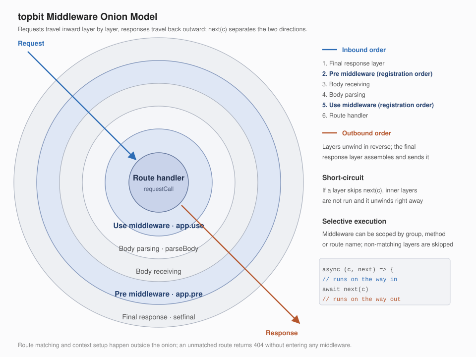

# Topbit

#### [🪭 中文文档 ☯️](README.cn.md)

Topbit is a server-side Web framework based on Node.js. It has no third-party dependencies and is optimized for extreme performance with a unique routing and middleware grouping execution mechanism.

**Core Features:**

*   **Request Context Design:** Shields interface differences.
*   **Global Middleware Pattern.**
*   **Route Grouping and Naming.**
*   **Group-Based Middleware Execution:** Middleware is matched and executed based on request methods and route groups.
*   **Daemon Mode:** Supports multi-process clustering and automated worker process load adjustment.
*   **Load Monitoring:** Displays child process load status.
*   **Body Parsing:** Parses body data by default.
*   **HTTP/1.1 & HTTP/2:** Supports enabling HTTP/1.1 or HTTP/2 via configuration. Allows simultaneous support for HTTP/2 and HTTP/1.1.
*   **HTTPS Support:** Supports enabling HTTPS via configuration. Pure HTTP/2 can run over cleartext (h2c), but browsers require HTTPS to use HTTP/2 (it depends on TLS ALPN negotiation); `allowHTTP1` compatibility mode likewise requires HTTPS.
*   **Request Limiting:** Limits the maximum number of visits per single IP within a specific time period.
*   **IP Blacklist and Whitelist.**
*   **Memory Management:** In cluster mode, monitors child processes and restarts them if they exceed the maximum memory limit.
*   **Auto-Scaling:** Optional automatic load mode: creates new child processes to handle requests based on load and restores the initial state when idle.
*   **Security:** Default settings related to network security to avoid DDoS attacks and other network security issues at the software service level.

## 📦Installation

```javascript
npm i topbit
```

You can also install via yarn:

```javascript
yarn add topbit
```

**This document corresponds to topbit v3.7.3.** The framework requires Node.js v14.18 or above (only the major version is checked at startup; below 14 it exits directly). Current LTS is recommended.

**Command line tools shipped with the package** (the `bin` field of `package.json`):

| Command | Script | Purpose |
|---|---|---|
| `tbload` | `bin/loadinfo.sh` | Clears the screen every 0.35 s and `cat`s the load file, for **viewing** the load information written to `loadInfoFile`. Usage: `tbload /tmp/topbit-loadinfo.log`. It only polls and displays — it is **not** a start/stop service manager. |
| `topbit-new-app` | `bin/newapp.js` | Copies the built-in template into a new entry file, default name `app.js`; the first argument may specify the target filename. If the target already exists it prints "file already exists" and skips — it never overwrites. |
| `new-route` | `bin/new-ctl.js` | Generates a controller template file whose header carries a JSDoc typedef for `context`, used together with the Loader directory conventions. |

## Minimal Example

```javascript
'use strict'

const Topbit = require('topbit')

const app = new Topbit({
  debug: true
})

//in debug mode, output service info and run the service
//printServInfo(timeout=0, debug=true): with timeout>0 the output is delayed, otherwise it
//is printed within a microtask; the first argument may also be a boolean (taken as debug).
//It only prints when debug is true and config.debug is true.
//Under cluster, workers hand the route table to the master via a message for unified printing.
//Returns this, so run() can be chained onto it.
app.printServInfo().run(1234)
```

When no routes are added, Topbit registers a single default route (`GET /*`, GET only):

`/*`

Visiting via a browser will show a very simple page. This is merely for initial understanding and documentation access; it will not affect actual development. Other request methods (POST, PUT, etc.) still go through the notFound handling.

## Add a Route

``` JavaScript
'use strict'

const Topbit = require('topbit')

const app = new Topbit({
  debug: true
})


app.get('/', async ctx => {
  ctx.to('success')
})

// Defaults to listening on 0.0.0.0, two parameters run(port, host), port defaults to 2368.
app.printServInfo().run(1234)

```

`ctx.data` is the response data to be returned. You can also use `ctx.to(data)`.
> Actually, `ctx.to()` internally sets the value of `ctx.data`. **Using `ctx.to()` to set return data is recommended.**

## Using Import

In `.mjs` files, you can use ES6 import:

```javascript
import Topbit from 'topbit'

const app = new Topbit({
  debug: true
})

app.get('/', async ctx => {
    ctx.to('success')
})

app.printServInfo().run(1234)

```

## Routes and Request Types

The HTTP start line defines the request type, also known as the Request Method. Current request methods:
```
GET POST PUT PATCH DELETE OPTIONS  TRACE HEAD
```

The first 6 are the most commonly used. For each request type, the router has a corresponding lowercase function for mounting routes. For convenience, after initializing the app, you can use the shortcut calls with the same names on the `app` instance. (The framework supports these types.)

Besides the same-named shortcuts, there are two multi-method mounting entry points:

- `app.any(path, callback, name)`: mounts the route to all 8 request methods at once.
- `app.map(methods, path, callback, name)`: mounts by an array of methods, e.g. `app.map(['GET','HEAD'], '/p', handler)`.

Route callbacks (and middleware callbacks) **must be `async` functions**. A synchronous function is rejected at registration time with `callback and middleware function must use async` (`src/midcore.js:96`).

**Example:**

``` JavaScript

'use strict'

const Topbit = require('topbit')

const app = new Topbit({
  debug: true
})

app.get('/', async c => {
  c.to('success')
})

app.get('/p', async c => {
  c.to(`${c.method} ${c.routepath}`)
})

app.post('/', async c => {
  // Return uploaded data
  c.to(c.body)
})

app.put('/p', async c => {
  c.to({
    method : c.method,
    body : c.body,
    query : c.query
  })
})

// Defaults to listening on 0.0.0.0, two parameters run(port, host), port defaults to 2368.
// port may also be an object, but only host is recognized from it; the port still comes from the first argument.
app.printServInfo().run(8080)

```

## Get URL Parameters

- Query strings in the URL (parameters like `?a=1&b=2`) are parsed into `c.query`. The `#` fragment and everything after it is stripped and not parsed.
- The number of parameters is capped by `maxQuery` (default **25**): beyond the cap the excess is **silently dropped**, with no error and no warning, which shows up as "the later parameters are missing". Raise this option when you send many parameters.
- By default (`fastParseQuery: false`) same-named parameters are aggregated into an array; set it to `true` to keep only the first value and never produce an array.
- `autoDecodeQuery` defaults to `true`, i.e. `decodeURIComponent` is applied to query values. If a value itself contains an unescaped `%`, decoding throws `URIError`; turn this option off and handle it yourself in that case.
- Form submitted data is parsed into `c.body`.

> The content-type for forms is `application/x-www-form-urlencoded`.

``` JavaScript
'use strict';

const Topbit = require('topbit');

let app = new Topbit({
    debug: true
})

app.get('/q', async c => {
  // Query strings after ? in URL are parsed into query.
  // Returns JSON text, the main difference is that content-type in the header is application/json;charset=utf-8
  c.to(c.query)
})

app.post('/p', async c => {
  // Data submitted via POST/PUT/PATCH/DELETE is saved into body.
  // Forms and application/json are parsed into an object, text/* into a string,
  // and for any other content-type body is the raw Buffer (i.e. rawBody).
  // Middleware can be used to handle various data types.
  c.to(c.body)
})

app.run(2019)

```

## Get POST Data

Requests that submit body data are POST, PUT, PATCH and DELETE. In front-end pages, this is usually form submission or asynchronous requests.

- Form submitted data is parsed into `c.body`.

> Form content-type is `application/x-www-form-urlencoded`.

> Asynchronous request data often has a content-type of `application/json`.

For both types above, `c.body` will be an object. When `application/json` fails to parse, the framework returns 400 directly with the body `bad json data`. The number of form key/value pairs is limited by `maxFormKey` (default 100); the excess is silently not parsed.

For any other content-type, `c.body` points to the original Buffer (i.e. `c.rawBody`); only `text/*` is converted into a utf8 string. So do not use `typeof c.body === 'string'` to cover every non-form case.

``` JavaScript
'use strict'

const Topbit = require('topbit')

let app = new Topbit({debug: true})

app.post('/p', async c => {
  // POST/PUT/PATCH/DELETE data is saved into body; forms are auto-parsed to object.
  // Middleware can be used to process various data.
  c.to(c.body)
});

app.run(2019)

```

## About content-type

**application/x-www-form-urlencoded**

Basic form types are parsed into `c.body` as a JS object.

**text/\***

If content-type is `text/*` (starts with text/), such as `text/plain` or `text/csv`, the framework does not parse it. It simply converts the uploaded data to a string in utf8 format and assigns it to `c.body`. Subsequent processing is decided by the developer.

**multipart/form-data;boundary=xxx**

If content-type is a file upload type, it is parsed by default. The parsed file objects are placed in `c.files`, accessible via `c.getFile`.

**application/json**

This type will be parsed using `JSON.parse`.

**Other types**

If content-type is any other type, `c.body` defaults to point to `c.rawBody`, which is the rawest Buffer data.

The framework provides basic core support. Other types need to be handled by the developer or via extensions.

To be easy to use while leaving enough space for developers, you can completely discard the default body parsing by setting the initialization option `parseBody` to `false`. You can also extend upon this.

The body parsing module is essentially a middleware designed to facilitate extension and replacement.

## to Function Returning Data

The `to` function is a wrapper for `c.data`; it sets the value of `c.data`. There are two aliases: `ok` and `oo`. You can choose freely based on the scenario.

``` JavaScript

app.get('/', async c => {
  c.to('success')
})

app.get('/randerr', async c => {
  let n = parseInt(Math.random() * 10)
  if (n >= 5) {
    c.ok('success')
  } else {
    // Return 404 status code
    /*
      Equivalent to:
        c.status(404).data = 'not found'
    */
    c.status(404).oo('not found')
  }
})

app.run(1234)

```

## Chain Calls

`setHeader`, `status`, `sendHeader`, `write` and `removeHeader` all return `this` and can be chained. The chaining capability is implemented by the framework itself and does not depend on the Node.js version.

`to` and its aliases `ok` and `oo` do not return `this` (they return undefined) and can only be the last link of a chain.

```javascript

app.get('/', async c => {

  c.setHeader('content-type', 'text/plain; charset=utf-8')
    .setHeader('x-server', 'nodejs server')
    .status(200)
    .to(`${Date.now()} ${Math.random()}`)

})

```

> When headers actually take effect differs between the two protocols: HTTP/1.1 `setHeader` calls `res.setHeader` directly, so the headers are already written out at that point; HTTP/2 `setHeader` only caches into `ctx.dataHeaders`, and `stream.respond` is not called until `sendHeader`/`write`/`pipe`. Also, only HTTP/2's `setHeader` accepts an object as its first argument for bulk setting.

## Route Parameters

``` JavaScript
app.get('/:name/:id', async c => {
  // Use : to indicate route parameters, request params are parsed into c.param
  let username = c.param.name;
  let uid = c.param.id;
  c.to(`${username} ${uid}`)
})

app.run(8000)
```

## Wildcard Path Parameters

`*` represents any path, but it must appear at the end of the route.

``` JavaScript

app.get('/static/*', async c => {
  // Any path represented by * is parsed into c.param.starPath
  let spath = c.param.starPath

  c.to(spath)
})

```

Two points to note:

- `starPath` **has no leading slash**. A request for `/static/images/a.jpg` matching `/static/*` gives `starPath` = `images/a.jpg`.
- `/static/*` also matches `/static` itself, in which case `starPath` is an empty string.

----

## Route Lookup Rules

----

The route lookup process strictly controls the order of parameterized routes and routes with `*`, rather than matching based on addition order. Stricter ordering reduces the likelihood of conflicts.

Route Lookup Strategy:

1.  Ordinary string paths.
2.  Parameterized routes (routes with fewer parameters match first).
3.  Routes with `*` (matched in longest-to-shortest pattern).

Three additional constraints of the current implementation:

- Extra slashes in the request path are already tolerated — `/x//y` is equivalent to `/x/y` (this is fixed framework behavior; there is no slash-matching switch).
- The path segment limit is 13 (`router.maxDepth`); requests beyond it go straight to 404.
- After normalization a given string can only be registered once; registering it again throws "conflict, added more than once". Star and parameterized routes get their prefix index and static-segment tree built at `run()` time, so **routes must all be registered before `run()`**; parameterized/star routes added afterwards never enter the index and can never be matched.

```
Example:
Existing routes: /x/y/:id  /x/y/* /x/*  /x/:key/:id

/x/y/123 matches /x/y/:id first, stops matching.

/x/y/123/345 matches /x/y/* first, stops matching.

/x/q/123 will match /x/:key/:id.

/x/a.jpg will match /x/*, other routes cannot match.

/x/static/images/a.jpg will match /x/*, other routes cannot match.
```

----

----

## Route Format Validation

`router.checkRoute(path)` checks whether a route string is well-formed **before** registering it. It does not register anything, does not throw, and has no side effects — useful when routes are generated from a configuration file, so errors surface at startup rather than as an `addPath()` throw.

``` JavaScript
const r = app.router;

r.checkRoute('/api/:id')
// { ok: true }

r.checkRoute('/api\\v2')
// { ok: false,
//   message: "路由字符串 /api\\v2 存在非法字符，路由字符串允许 '字母 数字 - _ : * / . @'，最大长度1000",
//   route: '/api\\v2' }
r.checkRoute('/x/:id/*')
// { ok: false, message: '/x/:id/* 参数 : 和 * 不能同时出现', route: '/x/:id/*' }
```

When `ok` is `false`, `message` explains the problem and `route` is the normalized route string (the form in which this route would actually be registered); when the argument is not a string, `route` is the empty string.

What it checks:

| Item | Rule |
|---|---|
| Type | Must be a string |
| Character set | Only `letters digits - _ : * / . @`, max length 1000 |
| Position of `*` | Only allowed as the last segment |
| Number of `*` | At most one |
| `:` with `*` | Cannot appear in the same route |
| Parameter name | Must not be empty, must not be `__proto__` |

It does **not** check pattern conflicts or duplicate route names. Those depend on what is already registered in the route table — runtime state rather than a property of the string itself, so the same route string yields different answers in different route tables. `addPath()` still checks them at registration time.

`addPath()` calls `checkRoute()` internally, so the two always agree.

Route strings are also normalized at registration: leading/trailing whitespace is trimmed first, then consecutive slashes are collapsed, a missing leading slash is added, and a trailing slash is stripped; the empty string normalizes to `/`. `router.normalizeRoute(path)` returns that normalized form — `//api//v2//` and `/api/v2` are the same route.

----

## Grouping Routes

You can use `app.middleware` to specify middleware and use the returned `group` method to add grouped routes, or use `app.group` directly.

**topbit.prototype.middleware(mids, options=null)**

- `mids` is an array. Each element is a middleware function or an array where the first element is the middleware and the second is the options for adding that middleware.
- `options` defaults to `null`. Pass an object for options applying to all `mids`, e.g., `{pre: true}`. If an array element carries its own options (`[mid, {method:'POST'}]`), the element-level options are merged with these common options, and **the element level wins**.
- The return value is an object containing only the single property `group` (`{ group }`); the route methods are reached through `group()`. `use()` cannot be called on the return value directly.

**topbit.prototype.group(group_name, callback, prefix=true)**

- `group_name` is a string representing the route group name. When it matches the **prefix character set** (`/`? + letters/digits/`_`/`-`/`/`, length 1~500, see `src/router.js:21`), it is also concatenated into the path as the route prefix.
- `callback` is a callback function. The parameters received by the callback can still call `middleware` and `group`, as well as `get`, `post`, etc., to add routes. If the second argument is a boolean, it is treated as `prefix`: the callback is not executed and only the mountable route object is returned.
- `prefix` is a boolean, defaults to `true`. It controls whether `group_name` is added as a route prefix. It only acts as a prefix when `group_name` matches the prefix character set above.

> **When a group name does not become a prefix, the framework neither throws nor warns** — the routes are silently registered on the path without the prefix.
> Note that the prefix character set **does not include `.` `@` `:`**, even though those characters are legal inside a full route: `app.group('v1.0', ...)` and `app.group('v1:2', ...)` register `/u`, not `/v1.0/u`. For version-style group names write `v1_0`, or put the prefix into the route string itself.
>
> `@` is the group *reference* marker, not part of a name: `app.use(mid, '@web')` strips the `@` and attaches to the group `web`, whereas `app.group('@web', ...)` names the group `@web` — the two never meet and the middleware is silently skipped. Likewise the object form `app.use(mid, {group: '@web'})` does **not** strip the `@` (the key is `@web`). **Never put `@` in a group name; add `@` only when referencing a group in string form.**

```javascript
'use strict'

const Topbit = require('topbit')

const app = new Topbit({
  debug: true
})

// Middleware function
let mid_timing = async (c, next) => {
  console.time('request')
  await next(c)
  console.timeEnd('request')
}

// The return value of group can use 'use' and 'pre' to add middleware.
// /api is also added to the route prefix.
app.group('/api', route => {
  route.get('/test', async c => {
    c.to('api test')
  })

  route.get('/:name', async c => {
    c.to(c.param)
  })
})

// Add middleware to the corresponding group
app.use(
  async (c, next) => {
    console.log(c.method, c.headers)
    await next(c)
  }, {group: '/sub'}
).group('/sub', route => {
  route.get('/:id', async c => {
    c.to(c.param.id)
  })
})

// 测试 does not conform to the prefix rules, so it is not used as a path prefix.
app.group('测试', route => {
  route.get('/test', async c => {
    console.log(c.group, c.name)
    c.to('test ok')
  }, 'test')
})

app.run(1234)

```

Specifying multiple middlewares in this way can be somewhat complex; you can use the `middleware` method. See the example below.

### Assigning Middleware to Groups and Subgroups

```javascript
'use strict'

const Topbit = require('topbit')
// Import ToFile extension
const {ToFile} = Topbit.extensions

const app = new Topbit({
  debug: true
})

// Middleware function
let mid_timing = async (c, next) => {
  console.time('request')
  await next(c)
  console.timeEnd('request')
}

let sub_mid_test = async (c, next) => {
  console.log('mid test start')
  await next(c)
  console.log('mid test end')
}

// group return value can use use, pre, middleware to add middleware.
// /api is also added to the route prefix.

app.middleware([
     // Time recording middleware, runs before receiving body data, so set pre: true
     [ mid_timing, {pre: true} ],

     // ToFile extension runs after receiving body data, only for POST and PUT requests
     [ new ToFile(), {method: ['POST', 'PUT']} ]
  ])
  .group('/api', route => {
      route.get('/test', async c => {
        c.to('api test')
      })

      route.get('/:name', async c => {
        c.to(c.param)
      })

      // Subgroup /sub enables middleware sub_mid_test. Middleware registered through
      // middleware() is inherited by subgroups, but note: middleware attached directly to
      // the parent with use/pre is NOT pushed down to subgroups (see the note below).
      route.middleware([sub_mid_test])
        .group('/sub', sub => {
            sub.get('/:key', async c => {
              c.to(c.param)
            })
        })
  })

app.run(1234)

```

Groups support nested calls, but the hierarchy cannot exceed 9 levels. Usually, nesting more than 3 levels indicates a design issue and should be reconsidered.

**This feature is not as convenient and easy to use as the automatic loading mechanism of the `TopbitLoader` extension. However, in practice, requirements vary. Sometimes you have to use a single file for the service while still taking advantage of the framework's routing and middleware grouping, and also conveniently writing logic-clear, structured code. Therefore, `middleware` and `group` interfaces are convenient for handling this. Also, if you are not used to TopbitLoader's MCM pattern (Middleware - Controller - Model, similar to MVC), this method combines well with other module code.**

The function of assigning routing groups above is non-intrusive; it will not affect existing code, nor will it conflict with TopbitLoader.

**!! Complex route handling functions should be placed in separate modules and completed using a unified automated loading function.**

It supports adding via return values, so passing a callback function is not mandatory:

```javascript
'use strict'

const Topbit = require('topbit')
// Import ToFile extension
const {ToFile} = Topbit.extensions

const app = new Topbit({
  debug: true
})

// Middleware function
let mid_timing = async (c, next) => {
  console.time('request')
  await next(c)
  console.timeEnd('request')
}

let sub_mid_test = async (c, next) => {
  console.log('mid test start')
  await next(c)
  console.log('mid test end')
}

let route = app.middleware([
                // Time recording middleware, pre set to true
                [ mid_timing, {pre: true} ],

                // ToFile extension runs after receiving body data, only for POST and PUT
                [ new ToFile(), {method: ['POST', 'PUT']} ]
              ])
              .group('/api')

route.get('/test', async c => {
  c.to('api test')
})

route.get('/:name', async c => {
  c.to(c.param)
})

// Subgroup /sub enables middleware sub_mid_test; middleware registered through
// middleware() is inherited by subgroups (use/pre attached to the parent is not).
route.middleware([sub_mid_test])
  .group('/sub', sub => {
      sub.get('/:key', async c => {
        c.to(c.param)
      })
  })

app.run(1234)

```

----

## Uploading Files

Uploaded files are parsed by default. You can turn this off by passing the `parseBody` option when initializing the service (detailed in options below).
Parsed file data is stored in `c.files`. The specific structure is shown later.

``` JavaScript
'use strict'

const Topbit = require('topbit')

const app = new Topbit()

app.post('/upload', async c => {
  
  let f = c.getFile('image')

  // Generate a unique filename based on original extension + timestamp + random number.
  let fname = c.ext.makeName(f.filename)

  try {
    c.to(await c.moveFile(f, fname))
  } catch (err) {
    c.status(500).to(err.message)
  }
  
}, 'upload-image'); // Name the route 'upload-image', accessible in c.name.

app.run(1234)

```

## c.files Data Structure

This structure is designed based on the data construction of HTTP protocol file uploads. HTTP protocol allows multiple files for the same upload name, so it parses into an array. Using `getFile` returns the first file by default, as usually, one upload name corresponds to one file.

> For the front-end, the upload name is the name attribute in the HTML form: `<input type="file" name="image">`.
> `image` is the upload name; do not confuse upload name with filename.

```javascript
{
  image : [
    {
      type: CONTENT_TYPE,
      filename: ORIGIN_FILENAME,
      start : START,
      end   : END,
      length: LENGTH,
      rawHeader: HEADER_DATA,
      headers: {...}
    },
    ...
  ],

  video : [
    {
      type: CONTENT_TYPE,
      filename: ORIGIN_FILENAME,
      start : START,
      end   : END,
      length: LENGTH,
      rawHeader: HEADER_DATA,
      headers: {...}
    },
    ...
  ]
}
```

`c.getFile` indexes by name. The default index value is 0. If a number less than 0 is passed, it gets the entire file array; returns null if not found.

> The file objects have **no `data` field**: `start`/`end`/`length` are only the byte range of that file inside `c.rawBody`, the content always stays in `rawBody`. To read the bytes use `c.rawBody.slice(f.start, f.end)`; to give the file object a `.toFile()` writing capability you must mount the `ToFile` extension (see the extensions chapter) — the base context does not provide it. Treating `f.data` as the content and testing it for emptiness will mark every upload invalid.

## Max Body Data Limit

```javascript
'use strict'

const Topbit = require('topbit')

const app = new Topbit({
  // Allows the maximum data size submitted via POST/PUT/PATCH/DELETE to be approx 20MB.
  // Unit is bytes.
  maxBody: 20000000
})

//...

app.run(1234)

```

`maxBody` is the real gate on upload size: the framework decides and rejects by `content-length` before the body has been read, so it never buffers an entire request body into memory before checking it.

A related option is `maxFiles` (default 12), which limits **the number of file parts parsed out of one request**; the excess is **silently dropped** — no error, and no indication that files went missing. So when accepting multi-file uploads, compare `Object.keys(c.files).length` yourself.

## Middleware

Middleware is a very useful pattern. Implementation varies slightly between languages, but the essence is the same. The middleware mechanism allows developers to organize code better and implement complex logic easily. In fact, the entire framework runs on a middleware pattern.

Middleware Diagram:


This framework's middleware is designed to distinguish by route groups and recognize different request types to determine whether to execute or skip to the next layer. This makes it extremely fast. Multiple routes and groups have their own middleware, do not conflict, and avoid meaningless calls. Reference format:

``` JavaScript

/*
  The second parameter is optional; omitting it enables the middleware globally.
  Here, the second parameter indicates: execute only for POST requests AND the route group must be /api.
  This design ensures execution on demand, avoiding unnecessary operations.
*/
app.add(async (c, next) => {
    console.log('before');
    await next(c);
    console.log('after');
}, {method: 'POST', group: '/api'});

```

Middleware added with `add` executes in reverse order of addition (LIFO), which is the standard onion model. To provide logic that is easier to understand, the `use` interface is provided. Middleware added with `use` executes in the order of addition (FIFO). Different frameworks have different logic for order implementation, but sequential execution suits developer habits better.

**It is recommended to use `use` to add middleware:**

``` JavaScript
// Executes first
app.use(async (c, next) => {
  let start_time = Date.now()
  await next(c)
  let end_time = Date.now()
  console.log(end_time - start_time)
})

// Executes later
app.use(async (c, next) => {
  console.log(c.method, c.path)
  await next(c)
})

// use can be cascaded: app.use(m1).use(m2)
```

## Topbit Complete Middleware Execution Model



> **It is important to know that internally, body data reception and parsing are also middleware. The order is deliberately arranged, separating `pre` and `use` interfaces.**

## Middleware Parameters

Using `use` or `pre` interfaces to add middleware supports a second parameter for precise control via option properties:

*   `group`: Route group. Indicates which group to execute for.
*   `method`: Request method. String or Array, must be uppercase.
*   `name`: Request name. Indicates execution only for this request name.

Example:

```javascript

app.get('/xyz', async c => {
  //...
  // Route group named proxy
}, {group: 'proxy'})

app.use(proxy, {
  method : ['PUT', 'POST', 'GET', 'DELETE', 'OPTIONS'],
  // Execute for requests in route group 'proxy'.
  group : 'proxy'
})
```

## pre (Before Receiving Body Data)

The main difference between middleware added via the `pre` interface and `use` is that `pre` executes before receiving body data. It can be used for permission filtering operations before receiving data. Its parameters are consistent with `use`.

For a consistent development experience, you can use the `use` interface and simply specify `pre` in the options:

```javascript
let setbodysize = async (c, next) => {
    // Set max body receive data to ~10k.
    c.maxBody = 10000;
    await next(c);
};

// Equivalent to app.pre(setbodysize);
app.use(setbodysize, {pre: true});

```

Using `pre` allows for more complex processing, including intercepting and not executing the next layer. For example, the `proxy` extension uses this feature to implement a high-performance proxy service directly as a framework middleware. Its main operation is to set the request's `data` event to receive data at this layer, handle other logic, and return directly.

**Dynamically limiting request body size based on different request types**

This requirement can be solved by adding middleware via `pre`:

```javascript

const app = new Topbit({
  // Default max body limit ~10M.
  maxBody: 10000000
})

app.pre(async (c, next) => {

  let ctype = c.headers['content-type'] || ''

  if (ctype.indexOf('text/') === 0) {
    // 50K
    c.maxBody = 50000
  } else if (ctype.indexOf('application/') === 0) {
    // 100K
    c.maxBody = 100000
  } else if (ctype.indexOf('multipart/form-data') < 0) {
    // 10K
    c.maxBody = 10000
  }

  await next(c)

}, {method: ['POST', 'PUT']})


```

If these parameters appear in the file simultaneously, it can look complex and be hard to maintain, but the functionality is powerful. Therefore, leaving it to automated program completion can greatly simplify coding.

**For complete project structure setup, please use `topbit-loader`. This extension completes automatic loading of routes/models and automatic orchestration of middleware. <a target=_blank href="https://gitee.com/daoio/topbit-loader">topbit-loader</a>**

## HTTPS

```javascript
'use strict'

const Topbit = require('topbit')

// Just pass the path to the certificate and key files
const app = new Topbit({
    // './xxx.pem' file also works
    cert: './xxx.cert',
    key: './xxx.key'
})

app.run(1234)

```

## Simultaneous Support for HTTP/2 and HTTP/1.1 (Compatibility Mode)

Compatibility mode uses ALPN to negotiate h2 and http/1.1 on the same port. **ALPN only exists in the TLS handshake, so compatibility mode requires HTTPS** (this does not contradict "pure HTTP/2 can run over h2c": h2c has no ALPN and cannot do this same-port protocol negotiation). Certificates and keys must therefore be configured.

```javascript
'use strict'

const Topbit = require('topbit')

// Just pass the path to the certificate and key files
const app = new Topbit({
    cert: './xxx.cert',
    key: './xxx.key',
    // Enable http2 and allow http1; compatibility mode is enabled automatically
    http2: true,
    allowHTTP1: true
})

app.run(1234)

```

## Configuration Options

Full configuration options for app initialization are as follows. Please read the comments carefully.

``` JavaScript
  {
    // This config represents max bytes for POST/PUT form submission and file uploads.
    maxBody   : 50000000,

    // Max number of files to parse
    maxFiles      : 12,

    /*
      After enabling daemon mode, if path is not empty string, pid is written to this file. Used for service management.
    */
    pidFile       : '',

    // Whether to enable global logging. true enables it, outputting request info or writing to file.
    globalLog: false,

    // Log output type: 'stdio' for terminal, 'file' for file output.
    logType : 'stdio',

    // File path for successful request logs
    logFile : '',

    // File path for error request logs
    errorLogFile : '',

    // Max lines per log file
    logMaxLines: 20000,

    // Max number of historical log files
    logHistory: 50,

    // Custom log handler function
    logHandle: null,

    // Enable HTTPS
    https       : false,

    http2   : false,

    allowHTTP1: false,

    // HTTPS key and cert file paths. If paths are set, https is automatically set to true.
    key   : '',
    cert  : '',

    // Server options written in 'server', passed during http service initialization. Reference http2.createSecureServer, tls.createServer
    server : {
      handshakeTimeout: 9000, // TLS handshake (HANDSHAKE) timeout
      //sessionTimeout: 350,
    },

    // Set server timeout in ms. Specific request timeouts can be set in specific requests.
    timeout   : 20000,

    debug     : false,

    // Enable request limiting
    useLimit: false,

    // Max connections, 0 means no limit
    maxConn : 2560,

    // Max connections per single IP within unit time, 0 means no limit
    maxIPRequest: 0,

    // Rate limit unit time for IP, 1 means 1 second. Default 30 seconds. Range 0.1 ~ 86400.
    unitTime : 30,
    
    // Display load info, requires enabling cluster mode via daemon interface
    loadMonitor : true,

    // Load info type: text, null, obj, orgobj
    // json type is for program communication, convenient for interface development
    loadInfoType : 'text',

    // Load info file path. If not set, outputs to terminal; otherwise saves to file.
    loadInfoFile : '',

    // Data to return for 404
    notFound: 'not found',

    // Data to return for 400
    badRequest : 'bad request',

    // Percentage parameter controlling max memory usage for child processes. Range -0.45 ~ 0.45. Base is 0.52, so default is 80%.
    memFactor: 0.28,

    // Max URL length, including path and querystring. Range 1 ~ 4096.
    maxUrlLength: 1152,

    // Timer milliseconds for child process resource reporting. Range 5 ~ 10000.
    monitorTimeSlice: 500,

    // When globalLog is true, record real IP address? Mainly used in reverse proxy mode.
    realIP: false,

    // Max allowed querystring parameters.
    maxQuery: 25,

    // Enable strong mode? If enabled, processes unhandledRejection and uncaughtException events,
    // and captures errors: TypeError,ReferenceError,RangeError,AssertionError,URIError,Error.
    // strong can be true, or an object ({ quiet, errorHandle, catchErrors }).
    // Note: errors not listed in catchErrors still trigger console.error and process.exit(1).
    strong: false,

    // Fast querystring parsing. Multiple values with same name only set the first one, not parsed as array.
    fastParseQuery: false,
    
    // Whether to auto decode Query parameters using decodeURIComponent.
    autoDecodeQuery: true,

    // In multipart format, limit max length of a single form item.
    maxFormLength: 1000000,

    /* Error handler function. Unifies collection of runtime errors:
          tlsClientError, server error, secureConnection error, clientError, thrown runtime errors.
      errname is a string marking error info and location, format --ERR-CONNECTION--, --ERR-CLIENT--, etc.

      Usually Node.js thrown errors have code and message. 
      errname is optional but passed.
      Pass custom function via config option to implement custom error collection/handling.
    */
    errorHandle: (err, errname) => {
      this.config.debug && console.error(errname, err)
    },

    // Max load rate percentage. Default 0.75 means if CPU usage > 75%, automatically create child process.
    // Must enable auto load mode via autoWorker.
    maxLoadRate: 0.75,

    // http2 protocol http2Stream timeout. If not set, -1 means consistent with timeout.
    // Note: -1 is only an input convention; it is normalized to the actual timeout value at
    //       construction, so reading app.config.streamTimeout does NOT give you -1.
    streamTimeout: -1,

    // Request timeout. This is total request time, mainly to counter malicious requests.
    // e.g. Slowloris attacks where 1 byte is sent per second.
    // Idle timeout won't work, allowing long-term resource occupation.
    // This is a DDoS attack.
    requestTimeout: 65000,

    // Whether to parse body data automatically. When false, the framework does not mount the
    // built-in bodyparser middleware and you must handle body yourself.
    parseBody: true,

    // In multipart format, max number of form key/value pairs; the excess is silently not parsed.
    maxFormKey: 100,

    // Max entries in the IP rate-limit cache; minimum 1024.
    maxIPCache: 100000,

    // Fallback CPU count, used only when os.cpus() returns 0; default 0 means no fallback.
    cpus: 0,

    // IP blacklist; either a Set or an (ip) => boolean function.
    deny: null,

    // IP whitelist; either a Set or an (ip) => boolean function.
    allow: null,

    // Whether to start in daemon (cluster) mode; can also be started via app.daemon().
    daemon: false,

  };
  // For HTTP status codes, only these two are needed here. Others don't strictly need full support, 
  // and you can handle them in your application implementation.
  // Because once execution starts, corresponding status codes can be returned via runtime state.
  // Before that, the framework prepares for the onion model execution, which is very fast.

```

**Configuration activation rules**

Not every value above is free to take. The framework validates the type and range of every option (`src/optionsCheck.js`):

- When validation fails, **only a delayed yellow warning is printed and the value is NOT written into `config`** — the actual behavior is "silently keep the default", with no throw and no aborted startup. When a config change appears to have no effect, check the console for this warning first.
- An unrecognized option name likewise only produces an "unknown option" warning and is then ignored.
- Value whitelists: `logType` accepts only `'stdio'`, `'file'` or `''`; `loadInfoType` accepts only `null`, `'null'`, `'text'`, `'obj'`, `'orgobj'`.
- Numeric ranges: `memFactor` -0.45 ~ 0.45; `maxUrlLength` 1 ~ 4096; `monitorTimeSlice` 5 ~ 10000; `maxLoadRate` 0.15 ~ 0.98; `maxIPCache` >= 1024; `logMaxLines` 1 ~ 5000000; `unitTime` 0.1 ~ 86400 (the unit is seconds).
- `key` and `cert` must be provided **together** to take effect and automatically set `https` to true; giving only one of them is ignored. A function-valued `server.SNICallback` also sets `https` to true automatically.

## Request Context

Request context is an object encapsulating various request data. This design handles differences between HTTP/1.1 and HTTP/2 protocols and incompatibilities from Node.js evolution. For design and performance reasons, the HTTP2 module encapsulates the request object as the stream, not the `http` module's `IncomingMessage` and `ServerResponse` (the encapsulated objects being request and response).

**Request Context Properties and Description**

| Property | Description |
| ---- | ---- |
| version | Protocol version, string type, '1.1' or '2'. |
| major | Major protocol version number, 1, 2, 3 (HTTP/1.1, HTTP/2, HTTP/3). |
| maxBody | Max supported request body bytes. Number. Defaults to `maxBody` init option. Can be set automatically in middleware based on request. |
| method | Request type (GET, POST, etc.). Uppercase string. |
| host | Service hostname, value of `request.headers.host`. |
| protocol | Protocol string without colon, 'https', 'http'. |
| path | Specific request path. |
| routepath | Actual executed route string. |
| query | URL passed parameters. |
| param | Route parameters. |
| files | Uploaded file information. |
| body | Body request data. The format depends on content-type: `application/x-www-form-urlencoded` and `application/json` are parsed into an object, `text/*` into a string, and for any other content-type it is the raw Buffer (i.e. rawBody). |
| port | The client's **source port**, i.e. `socket.remotePort` — not the port the service is listening on. |
| ip | Client request IP address (socket address). Check x-real-ip or x-forwarded-for if using proxy. |
| headers | Points to `request.headers`. |
| isUpload | Boolean property (**not a function**): whether this is a file upload request, i.e. whether the content-type header is in multipart/form-data format. |
| name | Route name, defaults to empty string. |
| group | Route group, defaults to empty string. |
| res | HTTP/1.1 points to response, HTTP/2 points to stream. |
| req | HTTP/1.1 is `IncomingMessage` object, HTTP/2 points to stream object. |
| box | Defaults to empty object. Can add any property value to dynamically pass info to next layer components. |
| service | Object for dependency injection, points to `app.service`. |
| data | Saves final data to return to client. Assign to data or use `ctx.to`. |
| dataEncoding | Encoding used when writing out a string `data`; defaults to `utf8`. |
| rawBody | The original Buffer of the request body; use it when body is not parsed or when working byte-wise. |
| bodyLength | Bytes of body received so far. |
| requestCall | Reference to the route handler function hit by this request. |
| ext | Helper function collection, containing: `aesDecrypt aesEncrypt bigId ctype delay extName extnameType hmacsha1 makeId makeName md5 nrand pipe randstring readFile readb serialId sha1 sha256 sha512 sm3 timestr uuid writeFile`. |
| to(data) | Function to set `ctx.data`. Returns undefined, so it cannot be a middle link of a chain; the aliases `ok` and `oo` point to the same function. |
| write(data) | Directly write data to client. Under HTTP/2, if the headers have not been sent yet this triggers respond first. |
| moveFile(file:object, target_filepath:string) | Function to write an uploaded file out to the given path. The implementation slices `ctx.rawBody` by `file.start`/`file.length` and writes a new file (`fs.open(target,'w+',0o644)`), returning the bytes written; it is not a rename, and it throws ENOENT if the target directory does not exist. |
| status() | With a number it sets the status code and returns this; **with no argument it returns the current status code** (HTTP/2 reads `:status`, defaulting to 200). |
| setHeader(k, v) | Function to set headers. HTTP/1.1 calls `res.setHeader` directly, so the headers are written out at that point; HTTP/2 only caches into `ctx.dataHeaders` and sends them on `sendHeader`/`write`/`pipe`. Only HTTP/2 accepts an object as the first argument for bulk setting. |
| removeHeader(k) | Function to remove a header waiting to be sent. On HTTP/1.1 it throws if called after the response headers have already been sent. |
| getFile(name, ind = 0) | Function to get uploaded file info; it reads the `files` property. `ind` defaults to 0 (first file); a negative value returns the whole array for that field; returns null when the field is missing or the index is out of range. |
| sendHeader() | Function to send the headers. HTTP/2 calls `stream.respond` with the cached headers; on HTTP/1.1 it is **not an empty function** — it runs `res.writeHead(res.statusCode)` while the headers are still unsent. Both return this. |
| user | Standard property for user login, defaults to null. |
| json(data) | Function, sets return data and marks type as json. |
| text(data) | Function, sets return data and marks type as text. |
| html(data) | Function, sets return data and marks type as html. |
| pipe(filepath) | Function, stream response data. Example: `await ctx.setHeader('content-type', 'text/html').pipe('./index.html')` |
| pipeJson(filepath) | Stream file data as json type. |
| pipeText(filepath) | Stream file data as text type. |
| pipeHtml(filepath) | Stream file data as html type. |
| dataHeaders | **Exists only on HTTP/2 contexts.** The object where `setHeader` caches headers; sent as a whole via respond by `sendHeader`. |
| stream | **Exists only on HTTP/2 contexts.** Points to the current http2stream. |

Note: `to` function only sets `ctx.data` value; data is returned at the end. It's same as direct assignment, but function calls reveal errors faster (wrong assignment adds a property without error but returns incorrect data).

> There are two request-context implementations, one per protocol: HTTP/1.1 uses context1, pure HTTP/2 (without `allowHTTP1`) uses context2; with `allowHTTP1` enabled the same instance uses one or the other per request. Code shared across protocols must not depend on members that exist in only one context — object-form `setHeader`, `dataHeaders`, `stream`.

## Dependency Injection

The request context has a `service` item pointing to `app.service`. After initializing the app, all data/instances needed can be mounted to `app.service`.

``` JavaScript

'use strict';

const Topbit = require('topbit');

let app = new Topbit({
  debug: true
});

// Overwrites if exists, adds if not.
app.addService('name', 'first');
app.addService('data', {
  id : 123,
  ip : '127.0.0.1'
});

/*
This might seem useless in a single file where variables are accessible.
However, it becomes very important for module separation.
*/
app.get('/info', async c => {
  c.to({
    name : c.service.name,
    data : c.service.data
  })
})

app.run(1234)

```

Alongside `addService` there are `app.getService(key)` for reading and `app.clearService()` for emptying. `c.service` points at the `app.service` object itself; replacing `app.service = {...}` wholesale only works **before `run()`** (`run()` syncs the new target into the service layer). While running, assign item by item instead — otherwise already-established references are not updated.

## Extending Request Context

To add extension support to the request context object, use `app.httpServ.Context`. This property is the request context's **constructor** (note the **capital `C`** — `http1.js:27` and `http2.js:27` both do `this.Context = Context`; with the lowercase `context` you get `undefined` and `.prototype` throws a TypeError right away).

HTTP/1.1 and HTTP/2 use two different context constructors and must be extended separately, or extended conditionally on the current protocol.

**Example:**

```javascript
'use strict'

const Topbit = require('topbit')

const app = new Topbit({
    debug: true
})

// 'this' represents the request context
app.httpServ.Context.prototype.testCtx = function () {
    console.log(this.method, this.path)
}

app.get('/test', async ctx => {
    ctx.testCtx()
})

app.run(1234)

```

## app.isMaster and app.isWorker

The Node.js cluster module recommends `isPrimary` in place of `isMaster` (`isMaster` is still available). After topbit initializes the app instance, `app` carries three getter properties: `isMaster`, `isPrimary` and `isWorker`. They act exactly like the corresponding `cluster` properties. The purpose is:

- Avoid writing `const cluster = require('cluster')` again.
- Shield future incompatible changes in `cluster`, enhancing code compatibility.

## daemon and run

`run` parameters: `port`, `host`. `host` defaults to `0.0.0.0`. Can also be `sockPath` (path to .sock file), supported by http listen interface. Using .sock ignores host.

`daemon` first two parameters match `run`. Third parameter is a number indicating how many child processes to use. Defaults to 0, which automatically creates child processes based on CPU core count. It maintains stable child process count, creating new ones if any terminate unexpectedly.

**On the child-process ceiling: if the number passed exceeds 2x the CPU core count, it is NOT clamped to 2x — it is discarded entirely and the default policy takes over** (`topbit.js:1273-1285`). The default policy is: take the CPU core count, and subtract 1 when there are more than 2 cores. Passing `0` also uses the default policy.

Example:

```javascript

// Host defaults to 0.0.0.0, port 1234
app.run(1234)

// Listen on localhost, only accessible locally
app.run(1234, 'localhost')

// Use 2 child processes, host defaults to 0.0.0.0
app.daemon(1234, 2)

// Use 3 child processes
app.daemon(1234, 'localhost', 3)

```

## Logging

The framework provides global logging. When using cluster mode (`daemon` interface), use initialization option `globalLog` to enable global logs and specify a log file. In single process mode, logs output to terminal (can use output/error redirection to save to file).

**Note: Only daemon execution (cluster mode) allows saving logs to file natively. `run` (single process) outputs to screen; use IO redirection to save.**

Besides file saving and terminal output, `logHandle` option allows custom log processing functions.

**Setting `logHandle` invalidates `logFile` and `errorLogFile`. See code for details.**

Example:

``` JavaScript

const Topbit = require('topbit')

const app = new Topbit({
  debug: true,
  // Enable global log
  globalLog: true,

  // Output to file. Default is 'stdio' (terminal). Choices: stdio | file
  logType: 'file',

  // Log file for status codes 2xx or 3xx
  logFile : '/tmp/topbit.log',

  // Log file for errors (4xx or 5xx)
  errorLogFile: '/tmp/topbit-error.log',

  // Custom handler function. logFile/errorLogFile become invalid.
  // Parameters: (worker, message)
  // worker: see cluster worker docs
  /*
    msg is log object, properties:
      {
        type : '_log',
        success : true,
        log : '@ GET | https://localhost:2021/randst | 200 | 2020-10-31 20:27:7 | 127.0.0.1 | User-Agent'
      }
  */
  logHandle : (w, msg) => {
    console.log(w.id, msg)
  }

})

app.daemon(1234, 3)

```

Using middleware for logging does not conflict with global logging. However, middleware logging cannot capture 404s returned by the framework when no route matches (as context is not created to avoid overhead).

Furthermore, this method integrates better with cluster mode as it uses master-worker communication internally.

## Message Event Handling

Based on the `message` event, in daemon mode (based on cluster module), a `setMsgEvent` function is provided to handle events sent by child processes.

This requires the message sent by worker processes to be an object, with a mandatory `type` property indicating the event name. Other fields can be custom.

`app.setMsgEvent(evt, callback, mode='always')`: the third argument may be `always` (default, fires repeatedly) or `once` (fires once then is removed). The callback receives `(worker, msg, handle)`. `app.getMsgEvent(evt)` queries a registration and `app.removeMsgEvent(evt)` removes one; both entry points return immediately inside a worker process — they only take effect in the master.

Usage:

``` JavaScript

const Topbit = require('topbit')
const cluster = require('cluster')

const app = new Topbit({
  debug: true,
  loadInfoFile: '/tmp/loadinfo.log'
})

if (cluster.isMaster) {
  app.setMsgEvent('test-msg', (worker, msg, handle) => {
    // Child process receives message via message event
    worker.send({
      id : worker.id,
      data : 'ok'
    })

    console.log(msg)
  })
} else {
  // Receive messages sent by worker.send
  process.on('message', msg => {
    console.log(msg)
  })

  setInterval(() => {
    process.send({
      type : 'test-msg',
      pid : process.pid,
      time : (new Date()).toLocaleString()
    })
  }, 1000)

}

```

The awkward part is that sending messages from a worker process is complex, so a `send` method is provided for quick message sending. It only sends to the master when running inside a worker process, so no extra worker check is needed.

`app.send(evtname, msg, handle)`: when `msg` is a string or a number it is wrapped as `{msg: value}`, then `msg.type = evtname` is written. Note that **an empty `msg` returns silently** (`''`, `0`, `false` and `undefined` are all not sent) — to send an empty message use the object form.

## app.send and app.workerMsg

Let's rewrite the worker message sending part of the code above:

```javascript

const Topbit = require('topbit')

const app = new Topbit({
  debug: true,
  loadInfoFile: '/tmp/loadinfo.log'
})

// Master process registers message event type. Worker process ignores this.
app.setMsgEvent('test-msg', (worker, msg, handle) => {
  // Child process receives message via message event
  worker.send({
    id : worker.id,
    data : 'ok'
  })

  console.log(msg)
})

// Only worker process listens.
app.workerMsg(msg => {
  console.log(msg)
})

cluster.isWorker
    &&
setInterval(() => {
  // Only worker executes.
  app.send('test-msg', {
    pid: process.pid,
    time: (new Date).toLocaleString()
  })

}, 1000)

app.daemon(1234, 2)

```

## Automatically Adjusting Child Process Quantity

The parameter passed to `daemon` sets the base number of child processes, e.g.:

``` JavaScript

// Use 2 child processes to handle requests.
app.daemon(1234, 2)

```

To automatically create child processes based on load and terminate them when idle (maintaining base quantity), use `autoWorker` to set a maximum value. This value must be larger than the base quantity to take effect.

```javascript

// Max 9 child processes.
app.autoWorker(9)

//...

app.daemon(1234, 2)

```

When load is high, child processes are created. After a period of idleness, processes with 0 connections are terminated, restoring the base number.

----

## 🛡️Strong Mode

Enable strong mode via the `strong` option. This monitors `uncaughtException` and `unhandledRejection` events to ensure stable operation. Simplest usage: set `strong` to `true`.

**All strong mode features can be implemented via the `process` module; this just simplifies it.**

```javascript
'use strict';

const Topbit = require('topbit');

setTimeout(() => {
  // Throw exception inside timer loop
  throw new Error(`test error`)
}, 2000);

const app = new Topbit({
    // Debug mode, output errors.
    debug: true,
    // Enable strong mode
    strong: true
});

app.run(1234);

```

By default, strong mode captures:

```
'TypeError', 'ReferenceError', 'RangeError', 'AssertionError', 'URIError', 'Error'
```

You can customize handling by passing an object to `strong`.

```javascript

// Core code example
const app = new Topbit({
    // Debug mode, output errors.
    debug: true,
    // Enable strong mode
    strong: {
      // Silent behavior, no error output.
      quiet: true,
      // Custom error handler
      errorHandle: (err, errname) => {
        //....
      },

      // Which errors to catch
      catchErrors: [
        'TypeError', 'URIError', 'Error', 'RangeError'
      ]

    }
})

```

## 🔔Simultaneous HTTP and HTTPS?

Note the question mark. You shouldn't do this in production. If HTTPS is enabled, HTTP isn't needed, and some frontend features won't work without HTTPS.

If needed (perhaps for testing), do this:

```javascript
'use strict'

const Topbit = require('topbit')
const http = require('node:http')
const https = require('https')

const app = new Topbit({
    // Enable debug
    debug: true,
})

// Below are http/1.1 services. For http2, enable http2 and compatibility mode.
// Or use topbit-httpc extension.

// In this case, you must set event listeners manually.

let http_server = http.createServer(app.httpServ.onRequest())

// The https server must be given a certificate itself, otherwise the TLS handshake cannot complete
const fs = require('node:fs')
let https_server = https.createServer({
    key: fs.readFileSync('./cert/localhost-privkey.pem'),
    cert: fs.readFileSync('./cert/localhost-cert.pem')
  },
  app.httpServ.onRequest()
)

http_server.listen(2025)
https_server.listen(2026)

```

**Note: You cannot support http2 in this scenario, but you can use http2 to be compatible with http1.**

## Request Limiting

The framework's rate limiting works by counting and filtering on IP addresses, to keep a single IP from sending requests densely. With HTTP/2 it must be paired with the `StreamLimit` extension — the source file is `http2limit.js`, but the key registered in `Topbit.extensions` is **`StreamLimit`** (the two names differ).

```javascript
'use strict';

const Topbit = require('topbit')

const app = new Topbit({
    debug : true,
    // Enable request limiting
    useLimit: true,

    // IPs allowed without frequency limit
    allow: new Set(['127.0.0.1']),

    // IPs to deny
    deny: (ip) => {
      // Example only, supports function and Set
      if (ip.indexOf('1.') === 0) return false
      return true
    },
    
    // Max requests per IP within unit time
    maxIPRequest: 6,
    
    // Unit time, 15 seconds
    unitTime: 15,
    
    // Max concurrent connections per worker process
    maxConn: 2000,

    loadMonitor: true,
    loadInfoType : 'text',
    globalLog : true,
    logType: 'stdio',
    // Load info in memory
    loadInfoFile : '--mem'
})


app.get('/', async ctx => {
  ctx.to('ok')
})

// Use 3 worker processes. Each allows 6 requests/unit time.
// Total approx 6 requests? Set maxIPRequest to 2.
app.daemon(1234, '0.0.0.0', 3)

```

## Other

- After running, Topbit has a final wrapper middleware doing the last processing, so setting `c.data` returns data. The content-type is inferred from the data shape: an object becomes `application/json;charset=utf-8`; for a string, one starting with `{`/`[` becomes `application/json;charset=utf-8`, one starting with `<!` becomes `text/html;charset=utf-8`, everything else `text/plain;charset=utf-8` (note it only recognizes the `<!` prefix — a lone `<` is not treated as html). Two preconditions: **you have not set content-type yourself**, and the response headers have not been sent yet; otherwise the framework never interferes.

- Defaults to limiting max URL length and sets a max memory usage rate based on hardware.

- All of this can be extended/overridden via config options or middleware.

- It is fast, and we focus on optimization. If comparing, add multiple middleware and hundreds of routes to test.

- Provides a `sched` function to quickly set the cluster scheduling policy, supporting the arguments `'rr'` or `'none'` — it just sets `cluster.schedulingPolicy`. **Passing any other value (including none) does not return `this` but the current `schedulingPolicy`**, so it cannot be chained onto unconditionally.

The framework automatically detects memory size and sets limits on initialization. You can change limits via properties in `secure` after init, but this requires using `daemon` (master managing workers).

```javascript
'use strict'

const Topbit = require('topbit');

let app = new Topbit();

/*
 Operations below can be controlled via memFactor option. See config options above.
 */

// Max memory 600M, auto restart only when connection count is 0.
app.secure.maxmem = 600_000_000;

// Mandatory restart max memory limit 900M. Total memory usage including Buffers.
// Must be larger than maxmem. If memory > maxmem AND connections != 0, 
// AND continues to exceed diemem, process restarts immediately.
app.secure.diemem = 900_000_000;

// Max RSS memory 800M. Program memory usage, excluding Buffer allocations.
app.secure.maxrss = 800_000_000;

app.get('/', async c => {
  c.to('ok');
})

app.daemon(8008, 2);

```

**Note: Requires `loadMonitor` option (enabled by default).**

---

# 🧩 Middleware Extensions and Other Extensions 📜

---

As a Web framework, providing only basic functionality is not enough. Many basic functions are used across all Web services, which inevitably leads to the creation of universal extension modules.

In Topbit's global middleware design mechanism, most web service-related extensions can be completed by developing a middleware extension. You can refer to the `Middleware` section; this plugin mechanism is extremely flexible.

**Topbit provides several universal middleware extensions that developers can use as needed.**

**It also provides other extension modules: Route Loader, Token Session Verification, Command Argument Parsing, Automatic Error Log Processing, and ZIP compression/decompression.**

## Importing Middleware Extensions

All middleware extensions are located under `Topbit.extensions`. Example:

```javascript
'use strict'

process.chdir(__dirname)

const Topbit = require('topbit')

// Import extensions via destructuring assignment
const {Cors, ToFile} = Topbit.extensions

const app = new Topbit({
  debug: true,
  // Enable logging, alias for globalLog
  log: true
})

// CORS extension runs before body parsing
// Middleware added via 'use' runs after body data parsing
app.pre(new Cors())
  .use(new ToFile, {method: ['PUT', 'POST']})

app.post('/file', async ctx => {
  let f = ctx.getFile('file')
  if (!f) return ctx.status(400).to('file not found')

  ctx.to(
    await f.toFile('./uploads')
  )
})

app.run(1235)
```

## ☲ Middleware Extensions

| Middleware | Description |
| :--- | :--- |
| **Cors** | Middleware to support Cross-Origin Resource Sharing (CORS). |
| **Resource** | Static resource processing; a powerful service for serving static files. |
| **ToFile** | Equips uploaded file objects with a `toFile` method. |
| **SSE** | SSE (Server-Sent Events) protocol middleware for HTTP-based data streaming. |
| **Proxy** | Reverse proxy for the HTTP/1.1 protocol, supporting load balancing and alive checks. |
| **Http2Proxy** | Reverse proxy for the HTTP/2 protocol, supporting load balancing and alive checks. |
| **SNI** | Support for multi-domain HTTPS (Server Name Indication). |
| **ParamCheck** | Request parameter validation, supporting checks for `param`, `query`, and `body`. |
| **JWT** | Token verification using the JWT protocol. (Note: `Topbit.Token` is recommended instead as it is much stronger than JWT). |
| **Cookie** | Parses the `cookie` request header from the frontend; the result is on `ctx.box.cookie`. |
| **Session** | Session management using a local file mechanism; depends on Cookie. For testing and teaching only. |
| **RealIP** | Recovers the real client IP from `x-real-ip` / `x-forwarded-for`; essential behind a reverse proxy. |
| **Referer** | Referer whitelist check (anti-hotlinking); failures return the configured status code. |
| **Timing** | Measures the duration of each route per request method; can be written to a file. |
| **MixLogger** | Aggregates or takes over the framework log; under cluster it collects the logs of all workers. |
| **SetFinal** | Custom final response handler, settable per protocol. |
| **StreamLimit** | Rate limiting for dense streams on a single HTTP/2 connection (the source file is `http2limit.js`). |
| **ProxyNoAgent** | HTTP/1.1 reverse proxy without an Agent; options basically match `Proxy`. |
| **Http2Pool** | HTTP/2 upstream connection pool, used internally by `Http2Proxy` — **not a middleware, do not register it directly**. |

> The keys in this table come from `Topbit.extensions` and take **the exported item's own `.name`, unrelated to the file name** — e.g. `http2limit.js` is exported as `StreamLimit`. Files starting with `_` or `!` are skipped (`src/_loadExtends.js:17-20`).

**Registration contract for class-style extensions** (required reading when writing your own): when `app.use/pre/add` receives an instance, only two shapes are accepted, otherwise it throws `callback and middleware function must use async` right away (`src/midcore.js:80-96`):

1. The instance has a `mid()` method — the framework calls it and uses its **return value** as the middleware (the returned function must be async);
2. The instance has a `middleware` method — it must be declared `async` (constructor name `AsyncFunction`), and the framework binds it to the instance automatically.

Plain objects, synchronous functions and arrow functions satisfy neither and throw at registration. Also note: only Proxy / ProxyNoAgent / Http2Proxy warn about unknown constructor options; every other extension has its own switch whitelist and silently ignores misspelled keys.

---

### 1. Cors (Cross-Origin Support)

Middleware that supports cross-origin requests. It supports cross-origin communication via the `origin` header as well as resource inclusion via `referer`, allowing for flexible selection and configuration.

**Basic Usage:**

```javascript
const Topbit = require('topbit')
const {Cors} = Topbit.extensions

let cr = new Cors({
    // Defaults to *, meaning cross-origin is enabled for all.
    // If you want to specify supported domains, pass an array.
    // Note: This specifies the domain of the application page accessing the API.
    allow : [
        'https://a.com',
        'https://www.a.com',
    ],

    // Defaults to authorization and content-type
    allowHeaders : 'authorization,content-type',

    // Caches OPTIONS requests for 60 seconds; the browser will read from cache during this period.
    optionsCache: 60,

    // Allowed request methods, defaults to '*'. To set methods use methods (maps to the access-control-allow-methods response header)
    // methods : ['GET','POST','PUT'],

    // requestHeaders maps to the access-control-request-headers response header and defaults to '*'.
    // It is NOT the option for setting allowed methods — do not confuse it with methods.
    // requestHeaders : '*'

    // Defaults to '', indicating which headers can be exposed to the requester. Multiple headers are separated by commas.
    // exposeHeaders: 'x-test-key,x-type'
})

app.pre(cr)

// Supports OPTIONS requests. Browsers send an OPTIONS preflight request before processing POST/PUT/DELETE.
// You must handle OPTIONS requests to fully support CORS.
app.options('/*', async c => {})
```

**Advanced Configuration (Referer Check & Grouping):**

```javascript
let cr = new Cors({
  // Do not allow empty referer
  allowEmptyReferer: false,

  // Route groups that allow empty referer.
  // Group names are custom; refer to the framework's route grouping feature.
  // Note: these are the group NAMES themselves, without @ — the framework stores ctx.group
  // with the reference @ already stripped, so '@webapp' would never match.
  // This is mainly used when an API service also serves pages.
  emptyRefererGroup: [
    'webapp', 'pages'
  ],

  allow: [
     // Default string format allows both origin cross-domain and referer external linking
    'https://w.a.com',
    'https://w.x.cn',

    {url: 'https://servicewechat.com/wx234hiohr23', referer: true},
    // Not applied to referer check; if a request submits referer as self-define, it will not pass
    {url: 'self-define', referer: false}
  ],
})
```

---

### 2. Resource (Static Resource Processing)

Static resource processing service, mainly used for hosting JS, CSS, images, audio, and other static files. Supports cache control, route prefix correction, and more.

**Basic Usage:**

```javascript
const Topbit = require('topbit')
const {Resource} = Topbit.extensions

let st = new Resource({
    // Set the directory where static resources are located
    staticPath: './public'
})

// Execute middleware only for the 'static' group.
app.use(st, {group: 'static'})

// Add static resource route. Assuming 'css/a.css' exists in the 'public' directory.
// Access via /static/css/a.css
app.get('/static/*', async c => {
    // Request is in group 'static'
}, '@static')
```

**Quick Example & Configuration Details:**

```javascript
let st = new Resource({
    // Set the directory where static resources are located
    staticPath: './public',

    // Route path: Frontend must start with /static/, mapping to files in ./public
    routePath : '/static/*',

    // Specify route group
    routeGroup: '_static',

    // Whether to support decoding of Chinese paths (default false)
    decodePath: true,

    // Prefix path correction. If set to xyz, it automatically corrects to /xyz.
    // prepath : '',

    // Maximum file size to cache (in bytes); files larger than this will not be cached.
    // Valid range: 10000 ~ 500000000. Values outside this range are reset to the
    // default 10000000 (reset, not clamped to the boundary).
    maxFileSize: 12_000_000,

    // Set the value of the cache-control header, defaults to null
    cacheControl: 'max-age=3600',
    
    // Maximum total cache size (default 128MB)
    maxCacheSize: 128_000_000,

    // Failure limit and cache release probability
    failedLimit: 50,
    prob: 6,

    // Interval (ms) for re-validating cached files, default 600000. On expiry the file is stat'ed again and compared by size+mtime
    // checkInterval: 600000,
})

// The second argument of init can specify the group this instance serves; when omitted it takes the routeGroup value from the example above
st.init(app)

// Automatically added to the _static group.
// Example: If favicon.ico is in the public directory, it can be accessed via this request.
app.get('/favicon.ico', async c => {}, {group: '_static'})
```

**Interface Description:**
*   `addType(obj)`: Add mapping from extension to content-type.
*   `clearCache()`: Clear the cache.
*   `removeCache(path)` / `removeNameCache(name)` / `removeGroupCache(filepre)`: Drop cache entries by path, name fragment or group prefix, adjusting the accounted size.
*   `canCache()`: Whether a new cache entry can still be admitted.
*   `init(app, group)`: The second argument can specify the group this instance serves; when omitted it takes the constructor option `routeGroup`.

> Resource's constructor options are its own switch whitelist, **with no unknown-option warning** (unlike the Proxy family) — a misspelled key is silently ignored and shows up as "the configuration had no effect".

**Content coding negotiation**

Text-ish resources (`text/*`, `.json`, `font/*`) larger than 1KB are gzipped. Whether the compressed form is actually sent depends on the request's `accept-encoding`:

| `accept-encoding` | Behaviour |
|---|---|
| Absent | Compress (RFC 9110 §12.5.3: no stated preference means any coding is acceptable) |
| Present but empty | Do not compress (the client explicitly wants no content coding) |
| Contains `gzip` | Compress |
| Anything else (`identity`, `br, deflate`) | Do not compress |

The check is simply whether `gzip` appears; **q-values are not parsed**. This is deliberate: a client that does not want compressed content should not advertise gzip in the first place, and using `gzip;q=0` to say "I know it but don't send it" is rare enough that a character-level parser is not worth its weight. So `accept-encoding: gzip;q=0` still yields a compressed response.

The cache keeps **both the raw and the gzipped bytes** and picks per request, so a client that does not accept gzip never receives compressed bytes. The two are distinct representations of the same resource: their ETags differ (the compressed one ends in `-gz`), responses carry `Vary: accept-encoding`, and conditional requests are evaluated against whichever representation would be sent. A compressed result that ends up larger than the original is discarded.

Files above `maxFileSize` are streamed without caching or compression. When the cache is full the same applies — the file is no longer accumulated in memory just to populate a cache that cannot accept it.

---

### 3. ToFile (File Upload Objectification)

Equips uploaded file objects with a `toFile` method, facilitating file saving in an object-oriented style.

```javascript
const Topbit = require('topbit')
const {ToFile} = Topbit.extensions

app.use( new ToFile() )

app.post('/upload', async c => {
    // Get the uploaded file object (the first one when several share the same upload name)
    let f = c.getFile('image')

    // All files under that upload name: pass a negative second argument
    // let all = c.getFile('image', -1)

    if (!f) {
        return c.status(400).oo('image file not found')
    }

    // Move the file to the 'images' directory (ensure the directory exists).
    // The second parameter is optional to specify a filename; defaults to a unique name based on timestamp and random number.
    let fname = await f.toFile('./images')

    // Return filename
    c.ok(fname)
})

app.run(1234)
```

> ToFile only replaces `getFile` on `multipart/form-data` requests (when `c.isUpload` is true), and only then do the file objects carry a `toFile` method; on ordinary JSON/form requests you still get the plain objects. It also has to be mounted **before the routes are registered**, otherwise the `getFile` inside a route is not the enhanced one.

---

### 4. SSE (Server-Side Messaging)

Server-Sent Events (SSE) middleware based on the HTTP protocol, used for the server to proactively push data streams to the client.

**Basic Usage:**

```javascript
const Topbit = require('topbit')
const {SSE} = Topbit.extensions

let s = new SSE({
  // Timeout 20 seconds; connection closes automatically after this time
  timeout: 20000,

  // Reconnection time; default is 0 meaning do not reconnect
  retry: 5000,

  // Timer interval; execute the handler function every 2 seconds
  timeSlice: 2000
})

// Set handler function, ctx is the request context
s.handle = (ctx) => {
    // Send a single message
    ctx.sendmsg({event: 'eat', data: 'Rice'})
    
    if (Date.now() % 5 === 0) {
        // Send multiple messages. Strings or numbers are automatically converted to message format.
        // Default event is 'message'.
        ctx.sendmsg([
            {event: 'clock', data: Date.now()},
            'May we all be blessed with longevity.',
            Math.random()
        ])
    }
}

// Enable middleware only for route group 'sse'
app.use( s, {group: 'sse'} )

app.get('/sse', async ctx => {}, {group: 'sse'})

app.run(1234)
```

**Generator Mode:**
Suitable for scenarios requiring dynamic interval adjustment or precise control.

```javascript
let s = new SSE({
  timeout: 20000,
  retry: 5000,
  timeSlice: 10,
  mode: 'yield' // Enable generator mode
})

s.handle = async (ctx) => {
    ctx.sendmsg({event: 'eat', data: 'Rice'})
    // Use await ctx.sse.moment(ms) for delay
    await ctx.sse.moment(100)
}
```

> `handle` can only be assigned with `s.handle = ...`, **it cannot be passed through the constructor** — the `case 'handle'` branch in `src/extends/sse.js:114` reads `this[k] = optionsp[k]` (`optionsp` is undefined), so passing `handle`/`handleClose`/`handleError` at construction throws a ReferenceError.
> For the same reason `handleClose` and `handleError` must also be set by assignment. SSE defaults: `timeout 15000`, `retry 0`, `timeSlice 1000`, `mode 'timer'`.

---

### 5. Proxy (HTTP/1.1 Reverse Proxy)

Reverse proxy for HTTP/1.1 protocol, supporting load balancing and Alive Check.

**port option (optional):** Tell the proxy the listening port so it auto-appends the port to hostname keys in `config`; requests are then matched directly against the Host header without port parsing.
- Default `''`; `0` and empty string mean no auto-appending (the config key must exactly match the Host header).
- Can be a number or numeric string, range 1 ~ 65535.
- Non-80/443 ports: bare hostname `'a.com'` is replaced with `'a.com:port'`; a config key already ending with `:port` is kept as-is.
- 80/443 ports: regardless of whether the config key is bare `'a.com'` or suffixed `'a.com:443'`, both keys (`'a.com'` + `'a.com:443'`) are generated and share the same backend config, so Host headers with or without the port both match.
- When port is empty but the config key ends with `:80`/`:443`, the corresponding bare key is also auto-generated and both share.
- When both a bare key and a suffixed key are configured, the first one wins; the latter's backend config is appended to the same array.

**Basic Proxy Configuration:**

```javascript
const Topbit = require('topbit')
const {Proxy} = Topbit.extensions

let hostcfg = {
    // Simple mapping: default path is /
    'a.com' : 'http://localhost:8001',

    // Specific path mapping
    'b.com' : {
        path : '/xyz',
        url : 'http://localhost:8002'
    },

    // Complex config and rewrite
    'c.com' : [
        {
            path : '/',
            url : 'http://localhost:8004',
            rewrite: (ctx, path) => {
              // Custom route rewrite rules
              if (path.indexOf('/xyz') === 0) {
                return path.replace('/xyz', '/w')
              }
            }
        }
    ]
};

const pxy = new Proxy({
    timeout: 10000,
    // Tell the listening port so hostname keys get the port appended
    port: 1234,
    config: hostcfg
})

pxy.init(app)

app.run(1234)
```

**The Host sent to the backend:**

By default this matches nginx's `proxy_set_header Host $proxy_host`: the `Host` sent to the backend (`:authority` for h2 backends) is the **backend's own address** — the host and port of the `url` in the config (default ports omitted) — not the domain the user visited. If a user visits `xyz.com` and the request is proxied to `ioo.com`, the backend receives `Host: ioo.com`. `Proxy`, `ProxyNoAgent` and `Http2Proxy` behave the same, whether the downstream is h1 or h2.

To customize it, set `host` in the backend's `headers` (`:authority` is equivalent for h2 backends); a configured value is used as-is:

```javascript
config: {
    'xyz.com': [
        {
            url : 'http://ioo.com:8080',
            // let the backend see the domain the user visited
            headers : { host : 'xyz.com' }
        }
    ]
}
```

Configuration is grouped by the host the user visited, so one static value per group is enough. Headers sent by the client are forwarded as-is, and a configured `headers` entry of the same name overrides them — a general rule that applies to every header alike.

**Automatically injected headers:**

The proxy does **not** add `x-real-host` or `x-real-proto`, and does not write `x-real-ip` by default (see `addIP`). There are just two general rules: headers sent by the client are forwarded as-is, never filtered; and a same-named entry in the backend's configured `headers` overrides them. To let the backend know the original domain or protocol, set them yourself in the config:

```javascript
config: {
    'xyz.com': [
        {
            url : 'http://ioo.com',
            headers : { 'x-real-host' : 'xyz.com', 'x-real-proto' : 'https' }
        }
    ]
}
```

> Note: `x-real-host` / `x-real-proto` / `x-real-ip` sent by the client itself are not filtered. A backend that trusts them should override them with a same-named header in the config, or have a trusted proxy in front strip them.

> Note: nginx by default also pairs this with `proxy_redirect default`, which rewrites absolute `Location` values in backend responses back to the proxy's address. There is **no** such response-header rewriting here. If a backend returns absolute URLs containing its own domain, users will be sent to the backend's domain; handle it in the backend, or adjust with `resHeaders` / `resHeadersCallback`.

**Path matching and cross-host fallback:**

The `path` in a backend entry is normalized into a prefix route: `/api` → `/api/*`, `/` → `/*` (parameter routes containing `/:` are kept as-is). Paths from all hosts are merged into a single global route table and registered with the framework; each distinct path is registered exactly once, so multiple hosts declaring the same path never conflict.

Because route matching happens **before** middleware and is not Host-aware, the `c.routepath` handed to the proxy is the **globally most specific** one, which is not necessarily a path the current host declared. The proxy automatically **falls back** to the longest prefix that host did declare:

```javascript
const pxy = new Proxy({
    port: 443,
    config: {
        'a.com': [
            { path: '/api',    url: 'http://127.0.0.1:8001' },
            { path: '/static', url: 'http://127.0.0.1:8002' }
        ],
        'b.com': [{ path: '/',       url: 'http://127.0.0.1:8003' }],
        'c.com': [{ path: '/api/v2', url: 'http://127.0.0.1:8004' }]
    }
})
```

| Request | Matched routepath | Fallback | Forwarded to |
|---|---|---|---|
| `a.com/api/x` | `/api/*` | direct hit | a's `/api` backend |
| `a.com/api/v2/x` | `/api/v2/*` | → `/api/*` | a's `/api` backend |
| `a.com/other` | `/*` | nothing to fall back to | no match |
| `b.com/api/v2/x` | `/api/v2/*` | → `/*` | b's `/` backend, full path `/api/v2/x` forwarded |
| `c.com/api/x` | `/api/*` | nothing to fall back to | no match |

Fallback rules:

- The fallback map is computed once in `init()`; at runtime it costs a single hash lookup.
- **Only paths the proxy itself registered are eligible.** Your own application routes (e.g. `app.get('/admin/:id')`) are not in the map and will never be swallowed by the proxy.
- **It only falls back to a path that host actually declared** — no backend is invented.
- If there is nothing to fall back to, the request is treated as unmatched.
- After a fallback, `c.routepath` is rewritten to the path actually used, so later middleware sees the real value.
- Parameter routes (those not ending in `/*`) do not participate.

**defaultServer (default host):**

Specifies the fallback target when the request Host matches no configured host. The typical use is routing traffic for retired domains to one canonical domain.

```javascript
const pxy = new Proxy({
    port: 443,
    defaultServer: 'main.com',       // 'https://main.com' also works; the scheme is stripped
    config: {
        'a.com'   : 'http://127.0.0.1:8001',
        'main.com': 'http://127.0.0.1:8009'
    }
})
```

- The value is a **host name**, not a URL. Forms like `'https://main.com/x'` have the scheme and path stripped, leaving `main.com`.
- Works together with `port`: you may give the bare host exactly as written in `config`, and the proxy appends the port before matching.
- If the normalized value is not present in `config`, a warning is printed and the option is ignored, leaving behavior unchanged.
- **It only applies when the Host does not match.** A matching Host with no matching path does not fall back — that means "this domain has no such path".
- The host fallback happens before the path fallback, so the fallback target host also benefits from path fallback.
- HTTP/1.0 requests with no Host header are caught by `defaultServer` as well.

**Handling unmatched requests:**

When the proxy does not match (neither Host nor path), it calls `next()` and hands the request back to the middleware chain. The routes registered by `init()` belong to the group `topbit_proxy`, so adding a middleware to that group lets you customise the unmatched response:

```javascript
// Works the same for Proxy / ProxyNoAgent / Http2Proxy
app.use(async (c, next) => {
    return c.status(404).html('<h1>404 Not Found</h1>')
}, '@topbit_proxy')
```

Three properties of this middleware:

- It sits **downstream** of the proxy middleware, so it does not run when the proxy matches.
- It only applies to routes the proxy registered and **never affects your own application routes**.
- It is orthogonal to `defaultServer`: an unmatched Host is taken over by `defaultServer` first; only a matched Host with an unmatched path reaches this middleware.

If `full` mode is on and `defaultServer` is not configured, an unmatched request returns 502 directly instead of calling `next()`.

**Load Balancing Configuration:**
Implemented via configuration arrays, supporting `weight` and alive checks.

```javascript
let load_balance_cfg = {
    'a.com' : [
        {
            path : '/',
            url : 'http://localhost:1234',
            // Check service liveness every 3 seconds
            aliveCheckInterval : 3,
            aliveCheckPath : '/alive-check',
            // Weight: larger numbers mean higher weight
            weight: 3
        },
        {
            path : '/',
            url : 'http://localhost:1235',
            aliveCheckInterval : 3,
            aliveCheckPath : '/ok',
            weight: 2
        }
    ]
}

const pxy = new Proxy({
    timeout: 10000,
    config: load_balance_cfg
})

pxy.init(app)
```

**Request body size limit:** the proxy is a `pre` middleware and streams the request body to the backend before the framework ever reads it, so the **framework's `maxBody` does not apply to proxied requests** — the proxy enforces its own limit.

Precedence (same shape as `requestTimeout`):

| Priority | Source | Description |
|---|---|---|
| 1 | `ctx.box.proxyMaxBody` | Set by a pre middleware, applies to that one request |
| 2 | backend option `maxBody` | Per-backend override |
| 3 | proxy option `maxBody` | Defaults to `50000000` (50MB) |

The comparison matches the framework's: accumulated bytes against the limit, so `0` means no request body is allowed. A request that declares a `content-length` over the limit is rejected up front (no backend connection is opened); `chunked` requests are counted while forwarding and aborted as soon as they exceed it. Both return **413**.

```javascript
// The pre middleware must be registered BEFORE pxy.init(app) to run ahead of the proxy
app.use(async (c, next) => {
    if (c.path.startsWith('/upload')) c.box.proxyMaxBody = 100 * 1024 * 1024
    return await next(c)
}, {pre: true})

const pxy = new Proxy({
    maxBody: 2 * 1024 * 1024,   // instance default
    config: {
        'a.com': [
            { url: 'http://127.0.0.1:1234', maxBody: 20 * 1024 * 1024 }  // per-backend override
        ]
    }
})

pxy.init(app)
```

**Full list of constructor options:**

| Option | Default | Description |
|---|---|---|
| `config` | `{}` | Proxy table; key is a host, value is a string, object, or array of objects |
| `port` | `''` | Listening port, used to auto-append to the keys of `config`; see above |
| `defaultServer` | `''` | Fallback host when the Host does not match; see above |
| `timeout` | `35000` | Timeout for a single backend request (ms); can be overridden per backend |
| `requestTimeout` | `600000` | Overall transfer time limit (ms), counted from when response headers arrive; `0` means unlimited |
| `maxBody` | `50000000` | Request body limit in bytes; see above |
| `methods` | `['GET','POST','PUT','DELETE','OPTIONS','HEAD','PATCH','TRACE']` | Methods used when registering routes |
| `full` | `false` | Full-proxy mode: an unmatched request returns 502 instead of calling `next()`. When `defaultServer` is configured the fallback takes precedence |
| `addIP` | `false` | Whether to send the client IP to the backend. **Off by default**: nothing is written, and a same-named header from the client is forwarded as-is. When `true` it is written, **appended** as a comma-separated chain if a value already exists. This happens before the backend's configured `headers` are applied, so a configured header of the same name overrides it |
| `realIPHeader` | `'x-real-ip'` | Name of the header carrying the client IP when `addIP` is `true` |
| `balancer` | `null` | Custom load balancer providing `select(c, prlist, pxybalance)`. `Topbit.ProxyBalancer` (identity-based consistent hashing) is built in |
| `connectOptions` | `{family: 4}` | Connection options passed to the underlying request; each key can be overridden per backend |
| `maxSockets` | `1000` | Max sockets per backend Agent |
| `maxFreeSockets` | `100` | Max free sockets per backend Agent |
| `agentKeepAlive` | `true` | Whether the backend Agent uses keepAlive |
| `autoClearListeners` | `false` | Remove listeners from the backend response object after forwarding completes |
| `debug` | `false` | Print debug output |

**Backend options (each entry in `config`):**

| Option | Default | Description |
|---|---|---|
| `url` | required | Backend address; `http://`, `https://` and `unix://` are supported |
| `path` | `'/'` | Match path, normalized into a prefix route |
| `weight` | `1` | Weight; higher values are selected more often |
| `timeout` | inherits instance | Per-request timeout |
| `requestTimeout` | inherits instance | Overall transfer time limit |
| `maxBody` | inherits instance | Request body limit |
| `headers` | `{}` | Extra request headers when forwarding; overrides the client's on conflict. Names are lower-cased at parse time; `host` and `:authority` are equivalent and map to the header matching the backend protocol (`host` for h1 backends, `:authority` for h2 backends) |
| `resHeaders` | `null` | Extra headers added to the response; names are lower-cased as well |
| `resHeadersCallback` | `null` | Function to post-process backend response headers |
| `rewrite` | `null` | Function `(ctx, path)` returning the rewritten path; a falsy return means no rewrite |
| `aliveCheckPath` | `'/'` | Path used by the alive check request |
| `aliveCheckInterval` | `5` | Alive check interval in seconds, range 0 ~ 7200; `0` disables it |
| `aliveCheckMethod` | `'GET'` | Method used by the alive check; one of `GET`, `HEAD`, `TRACE` |
| `connectOptions` | inherits instance | Connection options for this backend only |

**Methods:**

*   `init(app)`: Attach to a topbit instance — registers the proxy routes and middleware, and starts the alive check.
*   `stopAliveCheck()`: Stop every alive-check timer; returns `this`. **Required for a graceful reload** — `server.close()` only stops accepting new connections, while the alive-check timers keep running, keeping the old instance alive and still probing backends. The pending retry probe is cleared too.
*   `startAliveCheck()`: Start (or restart) the alive check; returns `this`. Calling it again stops the existing timers first, so nothing leaks.

```javascript
// Graceful reload: stop accepting, then stop the alive check as well
serv.close()
pxy.stopAliveCheck()
```

> `Http2Proxy` does not use timer-based alive checking (liveness comes from the connection pool), so it has neither method.

**About `ProxyNoAgent`:** the extensions also ship `ProxyNoAgent`, used exactly like `Proxy` except that it keeps no per-backend `http(s).Agent` and relies on the global agent instead. Therefore `maxSockets` / `maxFreeSockets` / `agentKeepAlive` from the table above do not apply to it; the instance-level `keepAlive` (default `true`) takes their place.

> Since Node.js >= 19 `http.globalAgent` defaults to `keepAlive: true`, so `ProxyNoAgent` **still reuses connections** by default. Pass `keepAlive: false` explicitly if you really want one connection per request.

```javascript
const {ProxyNoAgent} = Topbit.extensions

const pxy = new ProxyNoAgent({
    config: { 'a.com': 'http://127.0.0.1:1234' },
    keepAlive: false  // disable connection reuse
})
```

---

### 6. Http2Proxy (HTTP/2 Reverse Proxy)

Reverse proxy for HTTP/2 protocol. Parameters are basically the same as `Proxy`, using HTTP/2 connection mechanisms for keep-alive.

The following behave exactly as in `Proxy` — see the previous section for details: the `port` key-appending rules, `defaultServer`, path matching and cross-host fallback, handling of unmatched requests (also via the `@topbit_proxy` group), the backend options in `config` (`path` / `url` / `weight` / `headers` / `rewrite` and so on), and custom `balancer`.

The difference is connection management: `Http2Proxy` does not use `http.Agent` but maintains an HTTP/2 connection pool, so `maxSockets` / `maxFreeSockets` / `agentKeepAlive` do not apply — the pool options below take their place. Liveness is likewise not determined by periodic probes but by whether the pool holds a usable connection.

```javascript
const Topbit = require('topbit')
const {Http2Proxy} = Topbit.extensions

let hxy = new Http2Proxy({
  config: {
    'a.com' : [
      {
        url: 'http://localhost:3001',
        weight: 10,
        path : '/',
        reconnDelay: 200, // Reconnection delay
        maxConnect: 2,
        headers: {
          'x-test-key': `${Date.now()}`
        },
        connectTimeout: 2000
      },
      {
        url: 'http://localhost:3002',
        weight: 4,
        path : '/'
      }
    ]
  },
  debug: true
})

hxy.init(app)

app.run(1234)
```

**Connection pool behavior:**

| Option | Default | Description |
|---|---|---|
| `connectTimeout` | `15000` | Handshake wait limit for a new HTTP/2 connection (ms). This is the `Http2Proxy` default; the pool itself falls back to `5000` |
| `reconnDelay` | `500` | Base unit of the reconnect backoff ladder; actual interval is base × ladder multiplier |
| `maxConnect` | `10` | Max physical connections per backend. `Http2Proxy` builds the pool with `tmp.maxConnect \|\| 10`, so **the effective default when configured through Http2Proxy is 10**; only the connection-pool module's own internal default is 100. This option must be &gt; 1 |
| `maxAliveStreams` | `100` | Max concurrent streams per connection, converged to `min(config, peer SETTINGS)` after the peer's SETTINGS arrive |
| `minConnect` | unset (pool default `2`) | Resident connections per backend; configurable on the instance and per backend, the backend value wins. **`<= 0` means no pre-created connections and no maintained pool**: nothing connects at startup, the first request opens the connection, and idle reclaim is not followed by a refill. A non-number logs an error and falls back to the default |
| `queueTimeout` | `3000` | How long (ms) a request may wait in the pool's queue when no concurrency slot is available; on expiry it fails with 503. Configurable on the instance and per backend; a backend that does not set it inherits the instance value. Cold-start requests (e.g. after idle reclaim with `minConnect <= 0`) queue while the handshake completes, so raise it if your handshake can exceed this. Must be a number greater than 0, otherwise an error is logged and the inherited value is kept |

> `reconnLadder` (the ladder `[1,2,4,8,16,32]`) **cannot be configured through `Http2Proxy`** — it only exists in the connection-pool module `Http2Pool`'s own defaults. Writing it into the `Http2Proxy` constructor arguments triggers an "unknown option" warning and it is ignored. Use the `Http2Pool` interface to change it.
>
> `Http2Proxy` also does **not** support the Proxy options `methods` and `autoClearListeners`; its `timeout` default is `30000` (Proxy uses `35000`).

- **Graceful restart**: on GOAWAY the connection stops accepting new streams immediately but drains in-flight streams to completion (30s cap) before closing, so response bodies are never silently truncated.
- **Idle keepalive**: connections within the resident quota (`minConnect`, default 2) are **never** closed when idle — they are kept alive with periodic `ping`. Persistent connections are the whole point of an HTTP/2 proxy (no handshake, multiplexing), and holding a live connection is itself the reachability signal `ok()` reports. Only surplus connections are reclaimed, and they are not reconnected, so a zero-traffic backend stays usable without spinning on reconnects.
- **On-demand connections (`minConnect <= 0`)**: no pre-created connections, and no background keepalive or reconnect. A connection is opened only when a request arrives and is reclaimed after sitting idle for the proxy `timeout` (default 30s); the next request then pays the handshake again (more noticeable with TLS backends). Since nothing reconnects in the background, `ok()` reports a failed backend as unavailable for only 3 seconds, after which the next request is let through as a probe — otherwise a recovered backend would stay excluded by the load balancer forever. Behavior for `minConnect > 0` is unchanged.
- **Handshake timeout**: when a new connection has not finished its handshake within `connectTimeout`, only that request is abandoned; the connection stays in the pool and keeps handshaking. If it succeeds later it serves subsequent and queued requests normally without holding or leaking a concurrency slot, and with `minConnect <= 0` it is still reclaimed once idle.
- **Idle timeout adjustment**: the pool's idle timeout comes from `timeout` and also runs during the handshake. If `timeout > 0` and it is smaller than `connectTimeout`, a connection would be closed as "idle" in the middle of its handshake, so the pool raises it to `connectTimeout + 5000` (the 5s margin covers connections that finish handshaking after `connectTimeout`). A `timeout` of `0` (no timeout) is left untouched. This only affects how long the pool waits before reclaiming idle connections; per-request timeouts are unchanged.
- **Reconnect backoff**: while a backend is down the interval walks a ladder — 500ms → 1s → 2s → 4s → 8s → 16s by default — and then **wraps back to 500ms** rather than stalling at the maximum. A ladder that only grows never probes quickly again, so a backend that recovered still waits out one full long interval before anyone notices; wrapping keeps one fast probe per cycle, bounding recovery latency, while most attempts still land on the long rungs and avoid a reconnect storm.

---

### 7. SNI (HTTPS Multi-Domain Support)

**Description**: Middleware to support multiple HTTPS domain certificates on the same IP address and port. It uses the TLS protocol's Server Name Indication feature to dynamically load the corresponding SSL certificate based on the domain requested by the client.

**Note**: Certificates are read synchronously during initialization; please ensure paths are correct. If a certificate for a domain fails to read, an error will be output to the console, but it will not block the loading of other domains.

**Usage:**

```javascript
const Topbit = require('topbit')
const {SNI} = Topbit.extensions

const app = new Topbit({
    // Enable HTTPS; it's recommended to configure a default key and cert as fallback
    https: true,
    key: './ssl/default.key',
    cert: './ssl/default.cert',
    debug: true
})

// Configure multi-domain certificates
// Key is the domain, Value is an object containing paths to key and cert
let certs = {
    'a.com': {
        key: './ssl/a.com.key',
        cert: './ssl/a.com.cert'
    },
    'www.b.org': {
        key: '/etc/nginx/ssl/b.org.key',
        cert: '/etc/nginx/ssl/b.org.crt'
    }
}

// Instantiate and initialize
let sni = new SNI(certs)

// The init method injects SNICallback into app.config.server
sni.init(app)

app.run(443)
```

**Parameters**:
*   The constructor accepts an object where keys are **domains** and values are configuration objects.
*   The configuration object must contain:
    *   `key`: Path to the private key file.
    *   `cert`: Path to the certificate file.

---

### 8. ParamCheck (Request Parameter Validation)

Supports declarative checks for `param` (route parameters), `query` (query strings), and `body` (request body).

**Query and Param Check:**

```javascript
const Topbit = require('topbit')
const {ParamCheck} = Topbit.extensions

// Query parameter check
let pck = new ParamCheck({
  key: 'query',
  rule: {
    // Strictly restrict value
    say: 'hello',
    // Type conversion and range restriction
    offset: {
      default: 0,
      to: 'int',
      min: 0,
      max: 100
    }
  }
})

// Param parameter check and custom callback
let paramck = new ParamCheck({
  key: 'param',
  deny: ['x-key'], // Fields forbidden to submit
  deleteDeny: true,
  // errorMessage is a TOP-LEVEL option, defaults to "提交数据不符合要求"
  errorMessage: '参数错误',
  rule: {
    // A single field can also be given its own error message
    mobile: {
      errorMessage: '手机号格式不正确',
      callback: (obj, k, method) => {
        let preg = /^(12|13|15|16|17|18|19)[0-9]{9}$/
        return preg.test(obj[k])
      }
    }
  }
})

app.use(pck, {method: 'GET'})
   .use(paramck, {method: 'GET'})
```

**Body Check:**

```javascript
let pmbody = new ParamCheck({
  key: 'body',
  rule: {
    username: {
      must: true,
      //min length
      min: 5,
      //max length
      max: 30
    },
    passwd: {
      must: true,
      min: 7,
      max: 20
    },
    mobile: {
      regex: /^(12|13|15|16|17|18|19)[0-9]{9}$/
    }
  }
})

app.use(pmbody, {method: ['POST', 'PUT'], name: 'login'})
```

> The body check only takes effect when `c.body !== c.rawBody && typeof c.body === 'object'` (`src/extends/paramcheck.js:238`). That is, only requests successfully parsed into an object by the bodyparser are checked; a parse failure or a non-object body is skipped outright.

> ParamCheck's option switch falls through to `default: this[k] = options[k]` for unknown keys (`:52-54`) — **a misspelled option name produces no warning, it silently becomes an instance property**. The usable options are `key`, `rule`, `errorMessage` (default `"提交数据不符合要求"`), `denyMessage` (default `'存在禁止提交的数据'`), `deny`, `deleteDeny`; `key` may only be `query`, `param` or `body`.

---

### 9. JWT (Token Verification)

JWT protocol Token verification and issuance. It is recommended to use `Topbit.Token` instead.

```javascript
const Topbit = require('topbit')
const {JWT} = Topbit.extensions

let j = new JWT({
  expires: 7200000, // validity in milliseconds, default 3600000
  // key: 'your secret'  // Must be set explicitly! Without it a random 16-character key is
                         // generated on every start, so tokens issued before a restart — or by
                         // another process — never verify against each other.
})
j.alg = 'hs512' // Set algorithm (default SM3)

// Issue Token
let token = j.make({
  id: '123we',
  username: 'long'
})

// Verify Token
// Returns object: { ok: true, data: {...} } or { ok: false, errcode: '...' }
let r = j.verify(token)

// Use as middleware
// On successful verification, data is mounted to ctx.user
app.pre(j.mid())
```

> `mid()` reads the **raw value** of `c.headers.authorization` and does not strip the `Bearer ` prefix (`src/extends/jwt.js:197`; only when that header is absent does it fall back to `c.query.token`). If clients send `Authorization: Bearer xxx` as is customary, sanitize the prefix yourself before the middleware runs, or verification fails every time.

---

### 10. Cookie (Cookie Parsing)

Parses the Cookie request header from the frontend; the result is mounted on `ctx.box.cookie` — **not** a top-level `cookie` property on the context. With no cookie header `ctx.box.cookie` is `null`, so test for it before reading; when the same name appears twice the last value wins, and no automatic decoding is done.

```javascript
const Topbit = require('topbit')
const {Cookie} = Topbit.extensions

app.use( new Cookie() )

app.get('/', async ctx => {
  // Get parsed cookie object
  console.log(ctx.box.cookie)
})

app.run(1234)
```

---

### 11. Session (Session Management)

Session management based on local file mechanisms, dependent on the Cookie component.
**Note**: This extension is mainly for testing and teaching; for production environments, it is recommended to use Redis or other database storage solutions.

```javascript
const Topbit = require('topbit')
const {Cookie,Session} = Topbit.extensions

let sess = new Session()
sess.init(app) // Initialize: Adds ctx prototype methods

// Must enable Cookie first, then Session
app.use( new Cookie() ).use( sess )

app.get('/:key/:data', async ctx => {
  // Set Session
  ctx.setSession(ctx.param.key, ctx.param.data)
  
  // Get Session (key defaults to null to get all)
  let data = ctx.getSession()
  
  ctx.ok(data)
})

app.run(1234)

// Other methods:
// ctx.deleteSession(key) - Delete specific Session
// ctx.clearSession()  - Clear all Sessions
```

> Session depends on the Cookie extension: internally it reads and writes `ctx.box.cookie` (`session.js:89`), so `use(new Cookie())` must come before `use(sess)`.
> `init()` mounts `setSession/getSession/deleteSession/clearSession` onto **the current protocol's** `app.httpServ.Context.prototype`; HTTP/1.1 and HTTP/2 are two different constructors, so when you only run one protocol the actual one is enough.

---

## ⌨️ Command Argument Parsing

**Used for quickly parsing `process.argv`.**

### Usage Example

```javascript
'use strict'

const Topbit = require('topbit')
const parseArgv = Topbit.npargv

let ret = parseArgv({
  '--port=' : {
    name: 'port',
    // Alias
    alias: '-p',
    type: 'int',
    min: 2000,
    max: 2100
  },

  '--host=' : {
    name: 'host',
    match: /^[0-9]{1,3}\.[0-9]{1,3}\.[0-9]{1,3}\.[0-9]{1,3}$/i
  },

  '-w' : {
    name: 'worker',
    type: 'int',
    min: 1,
    max: 4,
    // The default applies only when the argument is absent; an invalid value follows strict mode (error by default).
    default: 2
  },

  '--https': {
    name: 'https'
  },

  '--http2': {
    name: 'http2'
  },

  '--test': {
    name: 'test'
  },

  '--id' : {
    name : 'id',
    callback: (str) => {
      return str.split(',').filter(p => p.length > 0)
    }
  },

  // Automatically converts to {type: 'bool', name: 'limit'}
  '--limit' : 'limit',

  // Automatically converts to {type: 'bool', name: '-x'}
  '-x' : false

})

console.log(ret)
```

Run with command arguments:

```shell
$ node test.js x --host=1.2.3.4 --https --http2 --test --port=2010 --id 1,2,3,4,5 --local a b c
```

Output result:

```javascript
{
  ok: true,
  message: '',
  errors: [],
  args: {
    port: 2010,
    host: '1.2.3.4',
    worker: 2,
    https: true,
    http2: true,
    test: true,
    id: [ '1', '2', '3', '4', '5' ],
    limit: false,
    '-x': false
  },
  // Ordinary arguments that are not options and do not start with '-' go into 'list'.
  list: ['x', 'a', 'b', 'c'],
  command: null
}
```

Returned structure:

- `ok`: whether all arguments are valid.
- `message`: the first error message (empty string when there are no errors).
- `errors`: array of all error messages (used together with `strict: false`).
- `args`: the parsed argument object (keys are `name` or the argument name).
- `list`: ordinary arguments that are not options and do not start with `-` (e.g. file names).
- `command`: the parsed subcommand (`null` when subcommands are not enabled).

> Note: in strict mode (the default) an error returns **early**, and the object returned then only has `{ ok, message, args }` — it does **not** include `errors`, `list` or `command`. Touching `ret.list[0]` on the error branch throws a TypeError, so check that these three fields exist before reading them.

During parsing, **options not defined in the schema (starting with `-`) are ignored** and do not appear in `args` (e.g. `--local` in the example).

If the description info for an argument is not an object, it converts to boolean type, using the argument name as `name`. See the `-x` parameter.

**If no `type` is specified to limit the scope, the `type` is automatically set based on the description. This may lead to incorrect judgments, so specify `type` whenever possible.**

**Type inference rules:**

- If the argument contains `=`, e.g., `--port=`, the type is `string`.
- Otherwise, if the description object has `match` or `callback`, it is `string` type.
- Otherwise, if the description object contains `min` or `max`, it is `int` type.
- Otherwise, if the description object has `default`, the `type` matches the `default` type (number → `number`, boolean → `boolean`, otherwise `string`).
- Otherwise, the type is `bool`.

**Supported types:**

- `int`: Integer type (parsed with `parseInt`).
- `number` or `float`: Floating-point type (parsed with `parseFloat`). Note that `number` is **not** an integer — the old wording "int or number: integer type" was inaccurate.
- `string`: String type.
- `bool` or `boolean`: Boolean type.

### Argument Description Options

| Option | Required | Description |
| :--- | :--- | :--- |
| type | No | Argument type. If not given, it is automatically set based on description info. |
| name | No | Name of the parsed argument (key in the parsed object). If not given, uses the argument name. |
| min | No | Restricts minimum value. |
| max | No | Restricts maximum value. |
| default | No | Default value. Applies only when the argument is **absent**; an invalid value follows strict mode (error by default; with `strict: false` the default is kept and the error is collected in `errors`). Also works for `bool` (e.g. `default: true`). |
| alias | No | Alias. Must be a string (e.g. `'-p'`) and is registered as the same rule. The alias must be written in the same style as the original name: if the original name carries `=`, the alias must carry it too, or it will not match. |
| match | No | Regular expression. If given, regex matching is performed. **A RegExp instance must be passed** — a string is silently ignored. |
| callback | No | Function. If given, passes the argument value to the function. If the return value is not undefined, it is used as the final parsed value. |

> **Enum / array style options are not supported.** There is no value whitelist such as `limit`; writing one has no effect (it is silently ignored). For a whitelist use a `callback` that falls back; for a list pass one comma-separated string and split it in the `callback`.
>
> Two more silent behaviors: when the same flag is passed twice, **the later value overwrites the earlier one** (there is no array accumulation); and `--flag=false` on a bool type **still parses as true** (the source explicitly says `--bool=false` is not supported yet, `src/lib/npargv.js:231`) — the only way to turn a boolean item off is not to pass it.

### autoDefault (Automatic Default Values)

Sometimes the program requires parameters to be returned, using default values if invalid. This usually requires setting the `default` property for every option, or enabling `autoDefault` to let `npargv` set defaults automatically. **`autoDefault` is an option of the second `options` parameter and defaults to `true`** (an `@autoDefault` key placed inside the schema is ignored).

```javascript
'use strict'

const Topbit = require('topbit')
const parseArgv = Topbit.npargv

let opts = {
  // No default set; automatically sets default to the value of min.
  '--port' : {
    min: 1234,
    max: 5678
  },

  // No default set, type is number, no min limit; automatically sets to 0.
  '-x' : {
    type : 'int'
  }
}

// Second parameter options: { strict, autoDefault, commands, defaultCommand, argv }
let {args} = parseArgv(opts, { autoDefault: true })
```

Rules for automatic defaults:

- If `type` is `bool`, default is `false`.
- If `type` is `string`, default is an empty string.
- If `type` is `number`, `int`, or `float`, default is the value of `min`. If no `min`, default is `0`.

> ⚠ This rule has an easy-to-hit silent trap: because `autoDefault` defaults to true, **`args` still has a value when the user never passed the option** (number/int/float get `min`, or 0 without a `min`; strings get the empty string). As a result, business code like `args.port ?? engine-default-port` — "use undefined to detect an absent option" — can never be reached. To tell "not passed" apart from "passed 0", pass `{ autoDefault: false }` explicitly; then options that were not passed do not appear in `args` at all.

> ⚠ The `argv` option must receive the **complete `process.argv`** (parsing always starts at index 2 internally). If the caller slices `process.argv.slice(2)` first, the first real argument is swallowed as the program path — the symptom is "the option was configured but has no effect", with no clue at all.

### First Argument as Subcommand

Subcommands are defined via the **second `options` parameter** (an `@command`/`@defaultCommand` key inside the schema is ignored):

```javascript
// First argument is the schema, second is options
parseArgv(schema, {
    // Define supported subcommands
    commands: [
        'create', 'show', 'update', 'delete'
    ],

    // Default command used when none is entered
    defaultCommand: 'show'
})
```

Subcommand rules:

- If no subcommand is entered, or the first argument starts with `-`, `defaultCommand` is used (when set).
- As soon as `commands` is given and `defaultCommand` is not set explicitly, the framework automatically takes `commands[0]` as the fallback default command. The "not in the list → error" branch therefore only happens in cases like **passing `defaultCommand: ''` explicitly**.
- When an unknown command falls back to the default command, that word is **not consumed** — it still ends up in `list` or is taken as an argument value.
- Error handling follows strict mode: strict (default) returns the error immediately; with `strict: false` errors are collected in `errors` and parsing continues.

### Positional Reference Arguments

Using `$` followed by a number as a key indicates a positional argument. These are parsed first.

However, the positional index differs from internal indexing:

- Index starts at 1.
- Index refers to argument values, excluding the command name.
- If subcommands are enabled (`options.commands`), position 1 automatically starts after the subcommand.
- ⚠ Positions are counted by **argv slots**, and **option names and option values occupy slots too**. The check for `$N` also happens before `--key=value` is parsed (`src/lib/npargv.js:198-209`), so with `node x.js --https abc` and a `$1` configured, `$1` receives `--https`, not `abc`. When using positional arguments, put them before the options, or collect them through `list` instead.

Note: the subcommand is the first argument parsed, used for script subcommand functionality.

```javascript
const Topbit = require('topbit')
const npargv = Topbit.npargv

let {args} = npargv({
    '$1': {
        type: 'string',
    },
    '$2': {
        type: 'string',
        callback: (v) => {
            return ['i', 'o', 'v'].indexOf(v) >= 0 ? v : 'o'
        }
    }
}, { autoDefault: true })
```

---

## 🤖 Loader (Service Loader)

TopbitLoader is the official "automatic loader" extension recommended by the Topbit framework, completely eliminating the tedious manual writing of `app.get()` and `app.use()`.

There are two export names and they are **two coexisting loader implementations** (both exported at `topbit.js:1349-1350`), not a new-vs-old version relationship: `Topbit.Loader` (alias `Topbit.TopbitLoader`, `src/loader/loadernext.js`) is the recommended implementation; `Topbit.ClassicLoader` (`src/loader/loader.js`) is a separate, independent implementation. Their configuration options are not interchangeable — `deep`/`subgroup`/`multi`/`fileAsGroup` only take effect in `ClassicLoader`; passing them to `Loader` is silently ignored.

It implements a true **MCM Pattern** (Middleware → Controller → Model), similar to MVC but lighter and more aligned with Topbit's extreme performance philosophy.

[🌐 View Detailed Documentation ☛](./docs/en/topbit-loader.md)

---

## 🔐 Token (Session Verification) 🪙

TopbitToken is a zero-dependency, minimalist, high-security encrypted user credential (Token) system built specifically for the Topbit framework.

It is implemented entirely based on Node.js native `crypto`. Supported algorithms (the `alg/algorithm` whitelist in `src/token/token.js`, case-insensitive):

- AES-256-GCM (default, recommended)
- AES-192-GCM
- AES-128-CBC / AES-192-CBC / AES-256-CBC
- SM4-CBC (national standard; `sm4` is an alias that normalizes to `sm4-cbc`)

GCM and CBC use different IV lengths: a non-GCM algorithm resets `iv` to a 16-byte random string (`ivLength=16`), so a custom `iv` only means something for the GCM family.

[🌐 View Detailed Documentation ☛](./docs/en/topbit-token.md)

---
